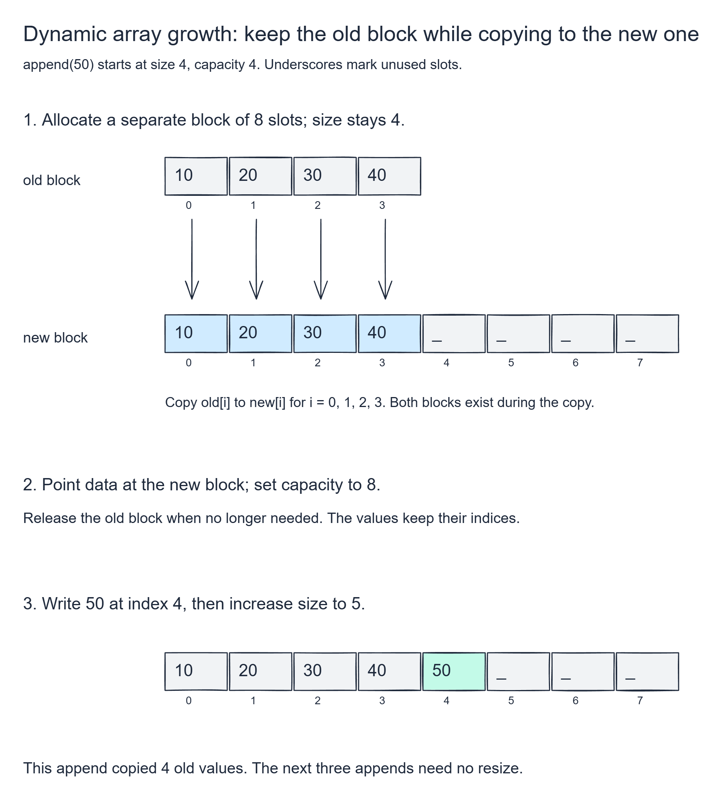

# Amortized Analysis

Amortized analysis bounds the total cost of a sequence of operations, then expresses that total as a cost per operation. Its input is a valid operation sequence and its result is a guaranteed aggregate bound under the chosen cost model. It requires no probability distribution.

## How it works

The project's dynamic array stores a logical `size`, an allocated `capacity` and a backing array. On insertion at the end, a full array doubles its capacity, copies the existing values and then writes the new value. Starting with capacity one, eight inserts have these copy counts:

| Insert number | Size afterward | Capacity afterward | Existing values copied |
| --- | --- | --- | --- |
| 1 | 1 | 1 | 0 |
| 2 | 2 | 2 | 1 |
| 3 | 3 | 4 | 2 |
| 4 | 4 | 4 | 0 |
| 5 | 5 | 8 | 4 |
| 6 | 6 | 8 | 0 |
| 7 | 7 | 8 | 0 |
| 8 | 8 | 8 | 0 |

The fifth insertion copies four values, but the next three insertions need no copy. The existing resize diagram shows that individual operation with values `10, 20, 30, 40` followed by `50`:



```c
insert(array, value) {
    if (array.size == array.capacity) {
        newCapacity = 2 * array.capacity;
        next = arrayOfSize(newCapacity);
        for (i = 0; i < array.size; i++) {
            next[i] = array.data[i];
        }
        array.data = next;
        array.capacity = newCapacity;
    }
    array.data[array.size] = value;
    array.size++;
}
```

The invariant is `0 <= size <= capacity`, with the live values in indices `[0, size)`. Copying preserves each live index. Doubling makes room for the new value, and incrementing size makes it part of the live prefix.

For `m >= 1` insertions from an empty array of capacity one, copies occur in batches `1, 2, 4, ...`. Their sum is less than `2m`. Including `m` writes gives fewer than `3m` element writes and copies. Initializing the new backing blocks also costs linear time in their capacities, but those capacities form another geometric series with total `O(m)`. Total work is therefore `Θ(m)` and amortized append cost is `Θ(1)`. A particular append that grows a full array of `n` values still takes `Θ(n)`.

The accounting method reaches the same conclusion by charging a fixed number of credits per insertion. Save credits from cheap insertions to pay for a later resize. The potential method makes the saved work explicit: for the append-only model that counts copying and the new write, choose `Φ = 2 * size - capacity + 1`. It starts at zero and remains nonnegative. An ordinary insertion has actual cost 1 and increases potential by 2, giving amortized cost 3. Growing a full capacity-`c` array has actual cost `c + 1`; its potential changes by `2 - c`, again giving 3. Allocation initialization changes the constant charge, not the asymptotic bound.

Summing `actualCost + Φ_after - Φ_before` cancels all intermediate potentials. Nonnegative final potential and zero initial potential make the sum of amortized charges an upper bound on actual work. This is the reason saved credits can pay for an expensive operation.

## Costs and project code

These implementations halve capacity only around one-quarter occupancy, leaving a gap from the full-array growth threshold. Halving immediately at half occupancy could let alternating insertions and removals trigger repeated large copies. Python uses `size < capacity // 4`; Go and TypeScript use a non-strict quarter threshold for their default power-of-two capacities. Their exact shrink moments differ.

Deletion here searches for a value and shifts the suffix before considering shrinkage. It remains `O(n)` per operation in the worst case; amortizing resize work does not remove search or shifting costs. The append proof assumes the default initial capacity one. Python and TypeScript accept an initial capacity without validating it; zero capacity does not satisfy the doubling invariant, so use a positive integer. An unusually large initial capacity must be included in construction cost.

A backing array with `n` live values and geometrically grown capacity uses `O(n)` storage after nonempty append sequences. During resizing, the old and new blocks coexist, still `O(n)` peak storage. Empty or preallocated arrays should instead be described in terms of capacity.

Expected and amortized describe different things. A native hash map may have expected constant-time lookup under its hashing assumptions; doubling gives an aggregate guarantee without averaging over inputs. Longest Consecutive Sequence also uses aggregate counting: each distinct value belongs to one run extension, but its membership checks still rely on expected hash-table costs.

Dynamic-array code: [Go](../../../data_structures/implementation/arrays/dynamic_array/golang/solution.go), [Python](../../../data_structures/implementation/arrays/dynamic_array/python/solution.py) and [TypeScript](../../../data_structures/implementation/arrays/dynamic_array/typescript/index.ts). See the [structure note](../../../data_structures/theory/arrays/dynamic_arrays/Dynamic%20Array.md) for deletion and storage diagrams.
