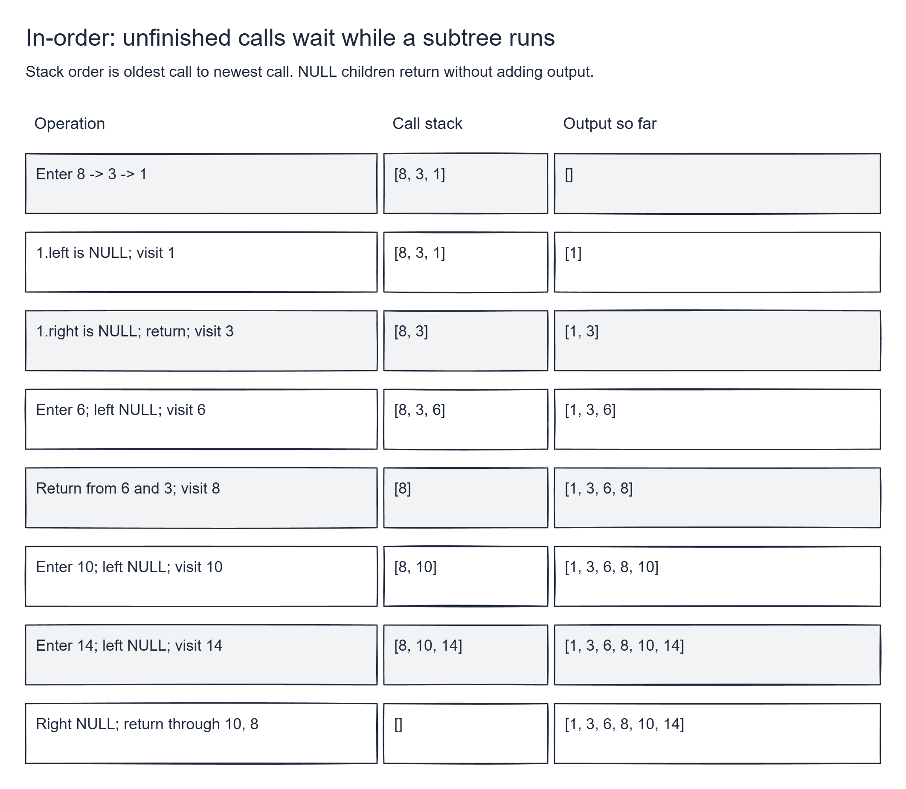

# Call Stack Space

The call stack stores unfinished function invocations, including local state and the point at which each caller resumes. Given a program and input, stack-space analysis counts the maximum simultaneously active calls and the memory retained by them. Total calls over the run measure a different quantity.

## How it works

In-order tree traversal receives a root and produces a sequence of node values. Each invocation keeps its current node and a reference to a shared output list. It visits the left subtree, emits the node's value, visits the right subtree and returns.

```c
inOrder(node, output) {
    if (node == NULL) {
        return;
    }
    inOrder(node.left, output);
    append(output, node.value);
    inOrder(node.right, output);
}
```

For root `8`, left child `3` with children `1` and `6`, and right child `10` with right child `14`, the traversal produces `[1, 3, 6, 8, 10, 14]`.



At the deepest nonempty descent the active helper calls are `[8, 3, 1]`. Calling `1.left` briefly adds a `NULL` invocation, which returns immediately. The call for `1` then appends its value. After its right child returns, the call for `1` ends; execution resumes in `3`, appends `3`, and enters `6`. Completed sibling calls do not remain on the stack. After the left subtree ends, execution resumes in `8` and then enters `10`.

Each invocation emits exactly once between its two subtree traversals. Assuming the smaller subtrees follow that rule, their output and the current value form the required in-order result. A null root returns an empty output with constant stack overhead.

Let `n` be the number of nodes and `h` the number of levels on the longest root-to-leaf path. There are `Θ(n)` helper invocations overall, including null children, but at most `h + 1` active helper frames, plus a constant number of wrappers. Each frame has constant local state, giving `Θ(h)` worst-case stack space for a nonempty full traversal. A balanced tree has `h = Θ(log(n + 1))`; a chain has `h = n`. Neither node creation nor the existing BST search balances a tree.

## Costs and project code

For sequential recursive children, stack depth follows `D(parent) = 1 + max(D(child1), D(child2))`; time usually adds both children's work. This maximum is the reason merge sort can make linearly many calls while using only logarithmic stack depth.

| Existing operation | Maximum recursive depth | Other live storage |
| --- | --- | --- |
| Tree DFS traversal | `O(h)` | `Θ(n)` returned values; one shared output, not one copy per frame |
| BST search | `O(h)` | Constant local state per frame; stops at a match or null child |
| Tree comparison | `O(h)` on compared paths | Short-circuit evaluation can stop at a mismatch |
| Merge sort | `O(log(n + 1))` | `O(n)` peak temporary arrays and results |
| Quick sort | Balanced `O(log(n + 1))`; worst `O(n)` | Constant partition state; original array mutated |
| Heap sort | `O(log(n + 1))` | Recursive heapify on the input array |
| Graph DFS | `O(V)` | `O(V)` seen marks and path; `V` counts vertices |
| Maze DFS | `O(rc)` | `O(rc)` seen grid and path for `r` rows and `c` columns |
| Subsets and permutations | `O(n)` | `O(n)` working arrays and path, plus saved results |
| Combinations | `O(k)` for `0 <= k <= n` | `O(k)` working path, plus saved results; `k > n` exits without descent |
| N queens | `O(n)` | `O(n)` column/diagonal flags and path, plus saved results |

Count referenced data only once when frames share it. Conversely, if calls retain separate slices, include those slices. Along one merge-sort descent, sizes `n, n/2, n/4, ...` sum to `O(n)` live array storage. Total allocation across all levels can be `O(n log n)` while peak live storage remains `O(n)`, excluding memory a runtime has not yet reclaimed.

Backtracking saves copies of completed paths so later pops do not alter earlier results. For distinct input values, subsets retain `Θ(n * 2^n)` element entries and permutations retain `Θ(n * n!)`. Their call-stack depth stays linear. Removing a choice from the shared path after returning restores the caller's state; it does not discard saved result copies.

The three BST searches use recursive tail calls, but portable analysis must still count the frames. Do not assume tail-call elimination in these Go, Python or Node.js implementations. A deep valid input may exhaust a language's recursion or stack limit before available heap memory is exhausted. The iterative binary searches use `Θ(1)` auxiliary space. Replacing recursion with an explicit stack would count that stack as auxiliary memory too.

In-order code: [Go](../../../data_structures/implementation/tree/bt_traversal/depth_first/golang/bt_in_order.go), [Python](../../../data_structures/implementation/tree/bt_traversal/depth_first/python/bt_in_order.py), [TypeScript](../../../data_structures/implementation/tree/bt_traversal/depth_first/typescript/bt_in_order.ts). The [tree note](../../../data_structures/theory/tree/Binary%20Tree.md) and [recurrence note](Recurrences.md) link the remaining implementations.
