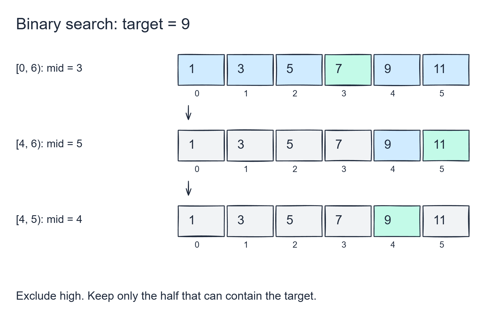

# Binary Search

Binary search is a search algorithm that halves an ordered search interval after comparing its middle element with a target. This implementation requires an array sorted in ascending order and returns a matching index or `-1` if the target is absent.

In `[1, 3, 5, 7, 9, 11]`, searching for `9` first checks index `3`, containing `7`. The target is larger, so discard indices through `3`. Check index `5`, containing `11`, then index `4`, containing `9`. The result is `4`.



## Keep a half-open interval

Use `[low, high)`: include `low` and exclude `high`. Initially, the interval covers the entire array, so `low = 0` and `high = length(values)`. Integer division computes the middle index.

```c
binarySearch(values, target) {
    low = 0;
    high = length(values);
    while (low < high) {
        mid = low + (high - low) / 2;
        if (values[mid] == target) {
            return mid;
        }
        if (values[mid] < target) {
            low = mid + 1;
        } else {
            high = mid;
        }
    }
    return -1;
}
```

Sorted order makes each discarded interval safe. If `values[mid]` is smaller than the target, earlier values cannot match it. If it is larger, later values cannot match. Each unsuccessful comparison removes `mid` from consideration, so the interval shrinks and the loop terminates.

At `low == high`, the interval is empty. This covers empty input and missing targets without accessing a position beyond the array. With repeated values, the first encountered match may be any occurrence; this routine does not search for the first or last occurrence.

## Costs and project code

The worst-case time is `O(log n)`: halving an interval of `n` elements takes a number of steps proportional to `log2(n)`. A match on the first comparison costs `O(1)`. The iterative implementation uses `O(1)` auxiliary space and preserves the input.

Binary search assumes constant-time indexed access. Applying the same midpoint idea to a linked list would require traversal to reach the midpoint. Unsorted input invalidates the discard rule, and these implementations do not check or sort the array for you.

The three language versions use an exclusive upper bound and return an index. Keep that interval convention consistent when adapting the code; an inclusive upper bound would require different updates.

Code: [Go](../../implementation/binary_search/golang/solution.go), [Python](../../implementation/binary_search/python/solution.py) and [TypeScript](../../implementation/binary_search/typescript/index.ts).
