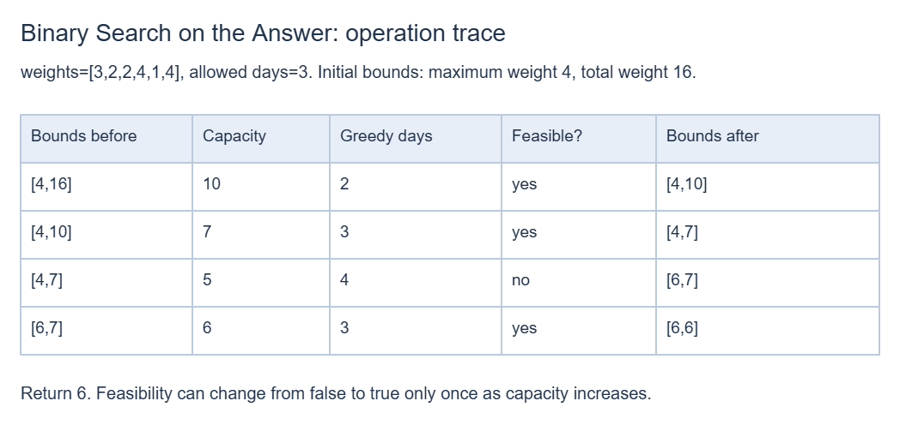

# Binary Search on the Answer

Binary search on the answer finds a smallest feasible numeric solution when feasibility is monotone. Here it returns the minimum ship capacity that sends positive integer weights, in their original order, within a positive number of days. A day's load cannot exceed capacity; packages are indivisible. Empty input returns zero.

## How it works

Search between the maximum single weight and the sum of all weights. To test a capacity, greedily fill the current day until the next item would exceed it, then start another day. If the number of used days exceeds the limit, the capacity fails. Increasing capacity cannot invalidate a feasible packing, so discard the infeasible lower half or retain the feasible midpoint as the upper bound.

```c
low = maximumWeight;
high = totalWeight;
while (low < high) {
    middle = low + floor((high - low) / 2);
    if (canShipInDays(middle)) {
        high = middle;
    } else {
        low = middle + 1;
    }
}
return low;
```

For weights `[3,2,2,4,1,4]` and three days, bounds begin at `[4,16]`. Capacity 10 needs two days, so bounds become `[4,10]`; 7 needs three, giving `[4,7]`; 5 needs four and fails, giving `[6,7]`; 6 needs three, giving `[6,6]`. Return 6. Greedy packing minimizes the number of days at a fixed capacity: its first day ends no earlier than any competing first day, and the same argument applies to each remaining suffix. This proves the predicate, while the boundary invariant retains the first feasible capacity.



## Costs and project code

Let `n` count packages and `S` be total weight. Validation and bounds cost `O(n)` time. Each predicate costs `O(n)`, with `O(1+log(S+1))` iterations as a safe bound, yielding `O((n+1)(1+log(S+1)))` time including empty input and constant auxiliary space. No weight array is copied. Nonpositive weights or days are rejected; Python/TypeScript additionally check integer inputs. Go and TypeScript require total weight to fit their exact integer representation. Capacity checks use `weight > capacity-load` to avoid adding before comparison. Tests enumerate all order-preserving partitions of small arrays and compare their best feasible maximum load.

Code: [Go](../../implementation/binary_search_answer/golang/solution.go), [Python](../../implementation/binary_search_answer/python/solution.py), [TypeScript](../../implementation/binary_search_answer/typescript/index.ts).

Tests: [Go](../../implementation/binary_search_answer/golang/solution_test.go), [Python](../../implementation/binary_search_answer/python/test_solution.py), [TypeScript](../../implementation/binary_search_answer/typescript/index.test.ts).
