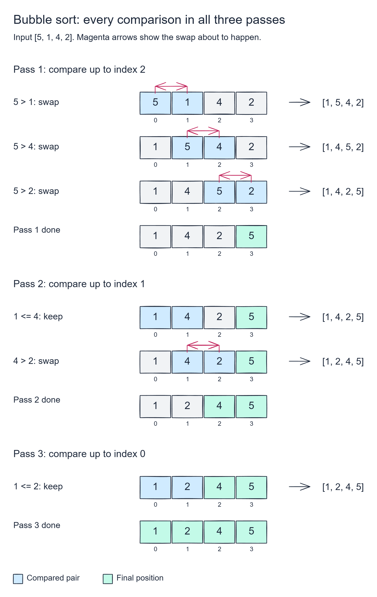

# Bubble Sort

Bubble sort is a comparison sorting algorithm that swaps adjacent out-of-order elements over repeated passes. During a left-to-right pass, a largest remaining value moves to the end of the unsorted portion. The next pass can exclude that final position.

For `[5, 1, 4, 2]`, the first pass swaps `5` with `1`, then `4`, then `2`, producing `[1, 4, 2, 5]`. The next pass moves `4` past `2`, giving `[1, 2, 4, 5]`.



Each row shows the array before a comparison and the result on its right. Blue cells mark the compared pair; magenta arrows mark a swap. Green cells have reached their final positions and stay outside later passes. Even after the second pass puts all values in order, this implementation still compares `1` with `2` in the third pass.

## Move a maximum to the boundary

```c
bubbleSort(values) {
    n = length(values);
    for (pass = 0; pass < n - 1; pass++) {
        for (i = 0; i < n - pass - 1; i++) {
            if (values[i] > values[i + 1]) {
                swap(values[i], values[i + 1]);
            }
        }
    }
}
```

After comparing a pair, the larger value occupies its right position. Repeating this through a pass places a maximum at the right boundary. After `pass` completed passes, the last `pass` elements are in their final positions. The inner loop avoids comparing them again.

Swap only for a strict `>` comparison. Equal values do not cross, so the algorithm is stable: records with equal keys retain their relative order. Empty and one-element arrays require no swaps. Sorting happens within the input array.

## Costs and project code

The loop performs `(n - 1) + (n - 2) + ... + 1` comparisons, giving `O(n^2)` time and `O(1)` auxiliary space. The repository versions have no early-exit flag, so even sorted input takes quadratic comparison work.

A variant can stop after a pass with no swaps, reducing its best-case time to `O(n)`. That optimization is not present here. The Python and TypeScript versions also perform a final empty pass; it does not affect the result or complexity.

Bubble sort provides a small example of establishing order through local comparisons. For large inputs, its repeated passes usually do more work than merge sort, heap sort or a suitable quick sort.

Code: [Go](../../implementation/bubble_sort/golang/solution.go), [Python](../../implementation/bubble_sort/python/solution.py) and [TypeScript](../../implementation/bubble_sort/typescript/index.ts).
