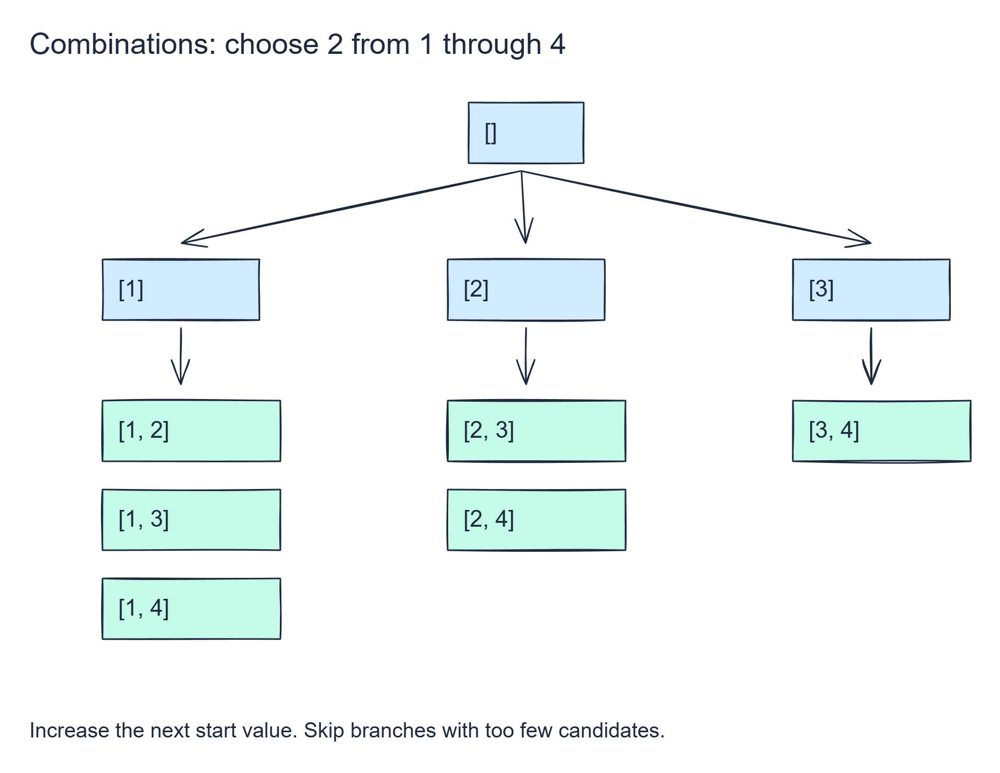

# Combinations

A combination is a selection of a fixed number of elements where order does not distinguish results. Here, `combinations(n, k)` chooses `k` distinct integers from `1` through `n`.

## How it works

Build each selection in increasing order. After choosing a value, start the next call at that value plus one. This prevents both repeated values and alternate orderings of the same selection.



At each call, compute how many values the path still needs. Stop the loop early enough to leave that many candidates. With `n = 4` and `k = 2`, a first choice of 4 cannot lead to a full selection, so the root only tries 1, 2 and 3.

```c
visit(start) {
    if (length(path) == k) {
        result.append(copy(path));
        return;
    }
    remaining = k - length(path);
    last = n - remaining + 1;
    for (value = start; value <= last; value++) {
        path.append(value);
        visit(value + 1);
        path.pop();
    }
}
```

Reject negative `n` or `k`, initialize empty `path` and `result`, then call `visit(1)`. For `(4, 2)`, return `[1, 2]`, `[1, 3]`, `[1, 4]`, `[2, 3]`, `[2, 4]` and `[3, 4]`.

## Costs and project code

For `0 < k <= n`, there are `C(n, k) = n! / (k! * (n - k)!)` results. Generating and copying them takes `O(k * C(n, k))` time and output space. The path and recursion stack use `O(k)` auxiliary space, excluding results.

Choosing zero values gives one empty selection, including `(0, 0)`. Choosing more than `n` gives no results. The implementations reject negative arguments; TypeScript also requires safe integer arguments. Unlike subsets, this function fixes the result size and constructs its candidates from an integer range.

Code: [Go](../../implementation/combinations/golang/solution.go), [Python](../../implementation/combinations/python/solution.py) and [TypeScript](../../implementation/combinations/typescript/index.ts).
