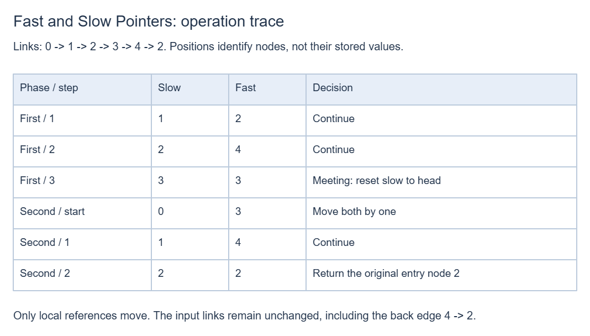

# Fast and Slow Pointers

Fast and slow pointers traverse the same linked structure at different speeds. This implementation receives a singly linked head and returns the original node at which a reachable cycle begins, or no node when the list terminates. Nodes are compared by identity, not by stored value.

## How it works

Move slow by one link and fast by two, checking that fast and its next link exist before advancing. If they meet, reset slow to the head and move both by one link until they meet again. That second meeting is the cycle entry. No next pointer is changed.

```c
slow = head;
fast = head;
while (fast != NULL && fast.next != NULL) {
    slow = slow.next;
    fast = fast.next.next;
    if (slow == fast) {
        slow = head;
        while (slow != fast) {
            slow = slow.next;
            fast = fast.next;
        }
        return slow;
    }
}
return NULL;
```

For links `0 -> 1 -> 2 -> 3 -> 4 -> 2`, the first-phase positions are `(1,2)`, `(2,4)`, `(3,3)`. Resetting slow gives `(0,3)`, then `(1,4)`, then `(2,2)`: return node 2. Let `mu` be the prefix length and `lambda` the cycle length. At a meeting after `t` slow steps, the distance difference is `t`, a multiple of `lambda`. After resetting one pointer and taking `mu` steps, both are therefore at the entry. In a cycle the speed difference closes the relative offset; without a cycle fast reaches a missing link.



## Costs and project code

Let `n` count distinct reachable nodes. The first meeting and entry search together take `O(n)` time and `O(1)` auxiliary space. Empty and acyclic lists return Python `None`, TypeScript `null` or Go `nil`; a self-loop returns its only node. Node values may repeat. The dedicated `Node` type exposes `value/next` in Python and TypeScript and `Value/Next` in Go. Tests try every tail attachment for lengths one through nineteen, use equal stored values to check identity semantics, and verify all links remain unchanged.

Code: [Go](../../implementation/fast_slow_pointers/golang/solution.go), [Python](../../implementation/fast_slow_pointers/python/solution.py), [TypeScript](../../implementation/fast_slow_pointers/typescript/index.ts).

Tests: [Go](../../implementation/fast_slow_pointers/golang/solution_test.go), [Python](../../implementation/fast_slow_pointers/python/test_solution.py), [TypeScript](../../implementation/fast_slow_pointers/typescript/index.test.ts).
