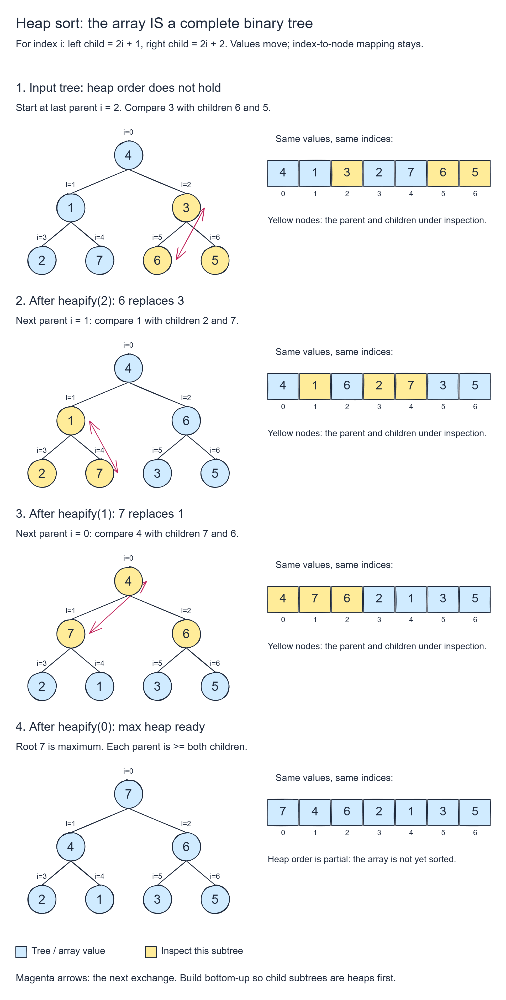
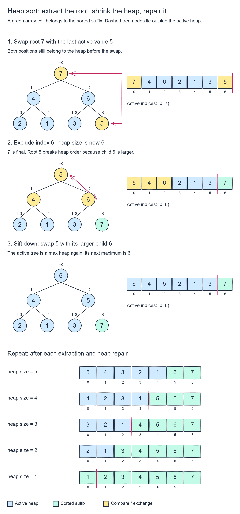

# Heap Sort

Heap sort is a comparison sorting algorithm that builds a max heap, then moves its maximum to the end of the unsorted region until the array is sorted. A max heap is a complete binary tree whose parents are no smaller than their children. Its root therefore contains a maximum.

For `[4, 1, 3, 2, 7, 6, 5]`, read the array as a complete binary tree in level order: `4` is the root, `1` and `3` are its children, and the remaining values occupy the next level. The small index beside each node matches its array cell. You do not allocate a separate tree.



Build from the last parent toward the root. Repair index `2` by exchanging `3` with `6`, then index `1` by exchanging `1` with `7`, then index `0` by exchanging `4` with `7`. The result `[7, 4, 6, 2, 1, 3, 5]` has heap order: each parent is no smaller than its children. Its array order still needs sorting.



Swap root `7` with the last active value, `5`, and reduce the heap size to six. Index `6` now belongs to the sorted suffix, so its dashed tree node has no active edge. Compare the new root with its children and exchange it with the larger child, `6`. The repaired tree supplies the next maximum. Repeat this cycle until only one active value remains.

## Repair the heap inside its boundary

In an array, index `i` has children at `2 * i + 1` and `2 * i + 2`. To repair a node whose child subtrees are heaps, swap it downward with its larger child until it is no smaller than its children.

```c
siftDown(values, size, i) {
    while (2 * i + 1 < size) {
        child = 2 * i + 1;
        if (child + 1 < size && values[child + 1] > values[child]) {
            child++;
        }
        if (values[i] >= values[child]) {
            break;
        }
        swap(values[i], values[child]);
        i = child;
    }
}

heapSort(values) {
    n = length(values);
    for (i = n / 2 - 1; i >= 0; i--) {
        siftDown(values, n, i);
    }
    for (end = n - 1; end > 0; end--) {
        swap(values[0], values[end]);
        siftDown(values, end, 0);
    }
}
```

Use integer division and a signed loop index for the bottom-up loop. Leaves already satisfy heap order. Starting from the last parent and moving toward the root repairs children before their parents. This construction costs `O(n)`, since most nodes sit near the leaves and need few downward steps.

During extraction, `end` is the exclusive heap boundary after placing a maximum at that position. Values from `end` onward remain sorted and no smaller than values still in the heap. Repairing only indices below `end` preserves that suffix.

## Costs and project code

Heap construction costs `O(n)`, followed by up to `n - 1` repairs costing `O(log n)` each. The worst-case total is `O(n log n)`. The iterative pseudocode uses `O(1)` auxiliary space. The repository uses recursive `heapify`, which adds `O(log n)` call-stack space.

All three versions sort within the input array. Heap sort is not stable because root-to-end swaps can reverse equal-key records. It suits array sorting when a worst-case `O(n log n)` bound matters. The max heap used for ascending sorting differs from the [min heap](../../../data_structures/theory/heap/Heap.md) implemented as a separate data structure.

Code: [Go](../../implementation/heap_sort/golang/solution.go), [Python](../../implementation/heap_sort/python/solution.py) and [TypeScript](../../implementation/heap_sort/typescript/index.ts).
