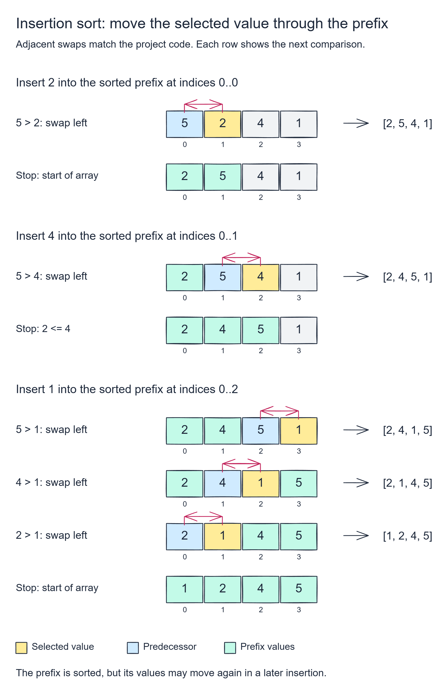

# Insertion Sort

Insertion sort is a comparison sorting algorithm that grows a sorted prefix by inserting the next element into its correct position. The repository versions do this through adjacent swaps inside the input array.

For `[5, 2, 4, 1]`, begin with the one-element prefix `[5]`. Insert `2` to obtain `[2, 5]`, then insert `4` to obtain `[2, 4, 5]`. Finally move `1` past those three values, producing `[1, 2, 4, 5]`.



Yellow follows the value being inserted. Blue marks its predecessor, and the arrows show each adjacent exchange. The diagram includes the stopping condition for each insertion: reach index zero or find a predecessor no larger than the selected value. Each stopping row shows the enlarged sorted prefix in green. During swaps, green marks the other prefix values; they keep their relative order as the selected value moves past them.

## Insert into the sorted prefix

```c
insertionSort(values) {
    for (i = 1; i < length(values); i++) {
        j = i;
        while (j > 0 && values[j - 1] > values[j]) {
            swap(values[j - 1], values[j]);
            j--;
        }
    }
}
```

Before iteration `i`, indices below `i` are sorted. The value at `i` moves left while its predecessor is larger. Stop at the beginning or a predecessor no larger than the value. The prefix through `i` is then sorted, which preserves the condition for the next iteration.

The strict comparison leaves equal values in their original relative order, making this version stable. A shift-based version can save the value, move larger predecessors right, and write the value once into its final position. The project uses swaps instead.

## Costs and project code

Sorted input needs one comparison per new element and costs `O(n)`. Reverse-sorted input can move each element across the entire prefix, requiring `1 + 2 + ... + (n - 1)` swaps and `O(n^2)` time. Average time for random order is also `O(n^2)`. Auxiliary space is `O(1)`.

Insertion sort suits small arrays and inputs with little disorder because it only moves values past larger predecessors. Empty and one-element input need no work. All three implementations mutate the input and return the resulting sequence.

Code: [Go](../../implementation/insertion_sort/golang/solution.go), [Python](../../implementation/insertion_sort/python/solution.py) and [TypeScript](../../implementation/insertion_sort/typescript/index.ts).
