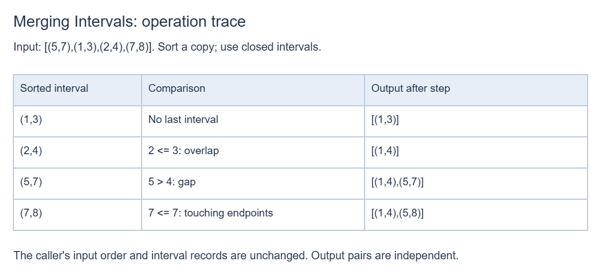

# Merging Intervals

Interval merging returns the union of closed intervals as a sorted list of disjoint closed intervals. Each input pair is `(start,end)` with `start <= end`; touching endpoints belong to the same merged interval. The implementation preserves the input and creates independent output pairs.

## How it works

Sort a copy by start, then end. Compare each interval with the final output interval. If its start is at most the current output end, extend that end to their maximum. Otherwise append a new interval. Sorting ensures no later interval can bridge a gap before the current start.

```c
result = [];
for (start, end in sortedCopy(intervals)) {
    if (!empty(result) && start <= last(result).end) {
        last(result).end = max(last(result).end, end);
    } else {
        append(result, (start, end));
    }
}
return result;
```

Input `[(5,7),(1,3),(2,4),(7,8)]` sorts to `(1,3),(2,4),(5,7),(7,8)`. The first overlap extends `(1,3)` to `(1,4)`. The gap before 5 starts another output interval, and the shared endpoint 7 extends it to `(5,8)`. Return `[(1,4),(5,8)]`. The invariant is that output represents exactly the processed union and has increasing, nonoverlapping intervals. Each overlap extension or new interval preserves it. Point intervals `(1,1)` and `(2,2)` stay separate.



## Costs and project code

Let `n` count intervals. Copying and merging take `O(n)` work; sorting gives `O(n log(n+1))` time and `O(n)` auxiliary storage, with `O(n)` output in the worst case. The TypeScript bound uses the usual comparison-sort model for its runtime. Go compares endpoints directly rather than subtracting them, avoiding comparator overflow. Empty input returns an empty collection. Reversed endpoints are rejected; pair shape and finite integer endpoint domains are caller preconditions. Python returns tuples, TypeScript new mutable pairs and Go fixed-size array values. Tests check union coverage on a half-integer grid, touching endpoints, gaps, containment, duplicates, validation and independent output.

Code: [Go](../../implementation/intervals/golang/solution.go), [Python](../../implementation/intervals/python/solution.py), [TypeScript](../../implementation/intervals/typescript/index.ts).

Tests: [Go](../../implementation/intervals/golang/solution_test.go), [Python](../../implementation/intervals/python/test_solution.py), [TypeScript](../../implementation/intervals/typescript/index.test.ts).
