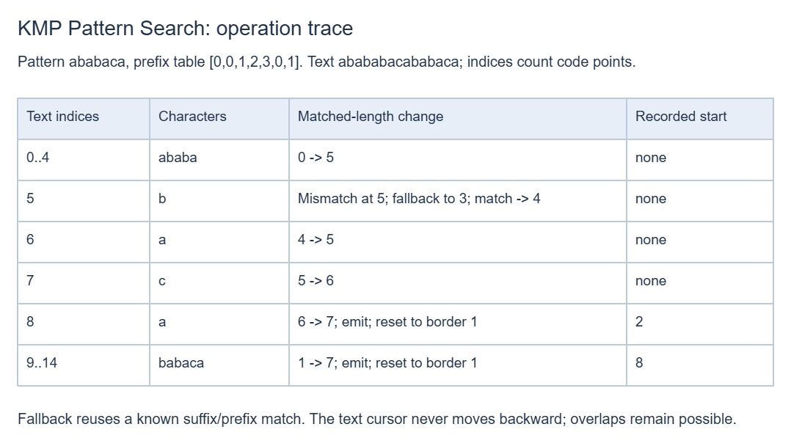

# KMP Pattern Search

Knuth-Morris-Pratt pattern search returns all starting indices where a pattern occurs in text, including overlapping matches. Positions count Unicode code points, not UTF-8 bytes or UTF-16 code units. The empty pattern matches all boundaries from zero through text length.

## How it works

Build a prefix table: entry `i` is the length of the longest proper prefix of the pattern that is also a suffix ending at `i`. Maintain a matched-prefix length. On mismatch, replace it with the preceding border length and compare again without moving the current text position backward. On a complete match, record its start and fall back to the full pattern's proper border, allowing overlap.

To build the table itself, start with length zero and scan pattern indices from one onward. On a mismatch, follow previously computed borders with `matched = table[matched - 1]`; on equality, increment the length, then save it for that index. The current index never participates in a full-length self-match because this scan starts at one. At index 5 of `ababaca`, the character `c` fails against border lengths 3 and 1, falls to zero and saves zero. This preprocessing uses the same border invariant as the text scan.

```c
matched = 0;
for (i = 0; i < length(text); i++) {
    while (matched > 0 && text[i] != pattern[matched]) {
        matched = prefix[matched - 1];
    }
    if (text[i] == pattern[matched]) {
        matched++;
    }
    if (matched == length(pattern)) {
        append(result, i - length(pattern) + 1);
        matched = prefix[matched - 1];
    }
}
```

Pattern `ababaca` has table `[0,0,1,2,3,0,1]`. Searching `abababacababaca`, text index 5 mismatches pattern index 5: fall from matched length 5 to 3, then match the current `b` to reach 4. Indices 6,7,8 reach a complete match starting at 2. Fall back to border length 1 and continue, eventually recording start 8 as well. Every fallback keeps a suffix already known to match the new prefix; longer rejected border candidates cannot match, so no valid occurrence is skipped.



## Costs and project code

Let `n` and `m` count text and pattern code points, and `r` count returned matches. Prefix construction and scanning take `O(n+m+r)` time: each forward position increases matched length by at most one, and fallback decreases it, bounding total comparisons. The prefix table costs `O(m)` space and output `O(r)`. Go converts both inputs to rune slices and TypeScript uses `Array.from`, adding `O(n+m)` storage; Python indexes strings directly. Inputs must be valid Unicode strings; no normalization or grapheme segmentation occurs. The exposed prefix-table routine returns an empty list for an empty pattern. Tests check borders against naive prefix/suffix comparisons, exhaustive binary strings, overlapping matches, absent/long patterns and supplementary Unicode characters.

Code: [Go](../../implementation/kmp/golang/solution.go), [Python](../../implementation/kmp/python/solution.py), [TypeScript](../../implementation/kmp/typescript/index.ts).

Tests: [Go](../../implementation/kmp/golang/solution_test.go), [Python](../../implementation/kmp/python/test_solution.py), [TypeScript](../../implementation/kmp/typescript/index.test.ts).
