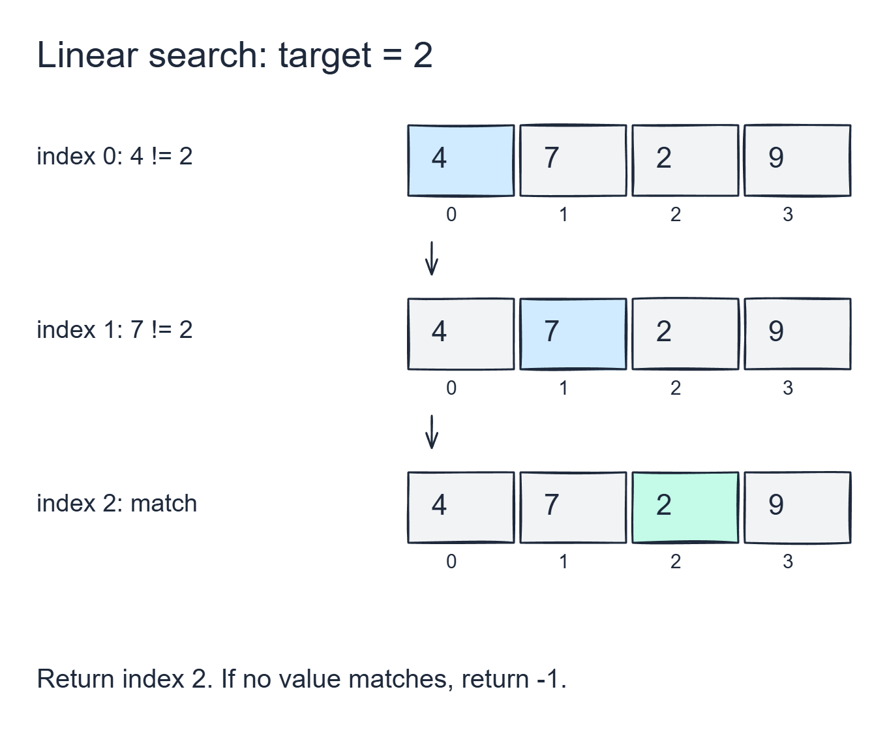

# Linear Search

Linear search is a search algorithm that checks elements in sequence until it finds a target or reaches the end. It works on unsorted input and returns the first matching index in this project. An absent value produces `-1`.

In `[4, 7, 2, 9]`, searching for `2` compares against `4`, then `7`, then `2`. The result is index `2`, counting from zero. Searching for `8` examines all four values and returns `-1`.



## Check one element at a time

```c
linearSearch(values, target) {
    for (i = 0; i < length(values); i++) {
        if (values[i] == target) {
            return i;
        }
    }
    return -1;
}
```

Before checking index `i`, the target has not appeared in indices `0` through `i - 1`. A match at `i` is therefore the first occurrence. If the loop finishes, none of the elements matches. An empty array skips the loop and returns `-1`.

The algorithm reads the input without changing it. It requires a way to compare an element with the target, but it requires no ordering or preprocessing.

## Costs and project code

For `n` elements, a match at the beginning costs `O(1)` time. A missing value or a match at the end costs `O(n)`. Under a uniform choice of matching position, the average comparison count also grows in proportion to `n`. The loop uses `O(1)` auxiliary space.

Linear search suits short sequences, unsorted input or a one-off lookup. Sorting the input for a single search can cost more than examining it once. A sorted array allows binary search when repeated lookups justify keeping that order.

The Go, Python and TypeScript versions return an index rather than a boolean. Repeated values do not change the rule: return the first matching index.

Code: [Go](../../implementation/linear_search/golang/solution.go), [Python](../../implementation/linear_search/python/solution.py) and [TypeScript](../../implementation/linear_search/typescript/index.ts).
