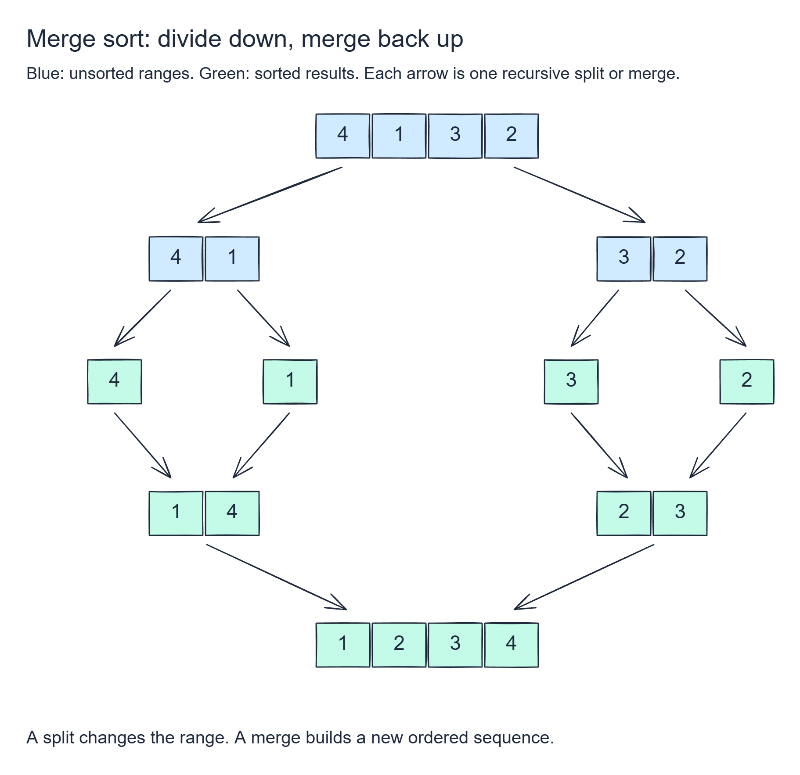
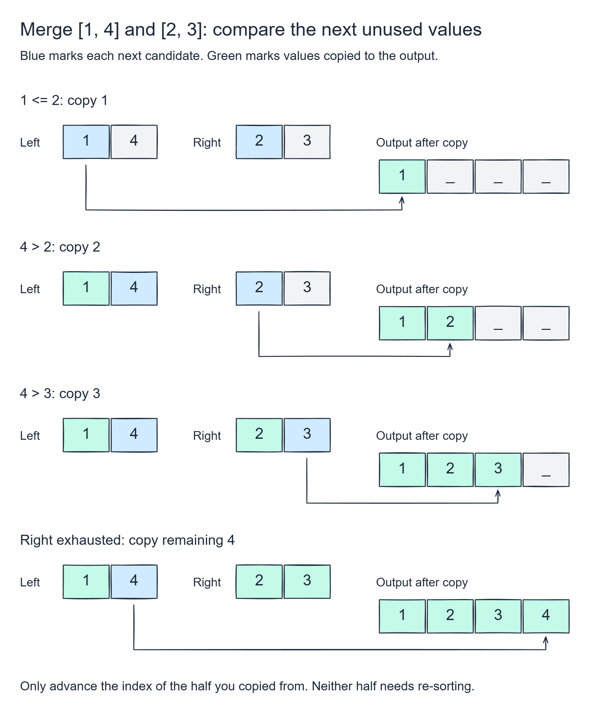

# Merge Sort

Merge sort is a divide-and-conquer sorting algorithm that splits a sequence into smaller sequences, sorts them and merges their results. A sequence of zero or one element is already sorted, so it supplies the recursion's base case.

For `[4, 1, 3, 2]`, split into `[4, 1]` and `[3, 2]`, then into individual elements. Merge the singletons to obtain `[1, 4]` and `[2, 3]`. Merging those two sorted halves produces `[1, 2, 3, 4]`.



The downward branches split ranges until each contains one value. The upward work combines sorted results. To see how the last merge produces its output, follow the next unused value in each half:



Copy `1` from the left, then `2` and `3` from the right. The right half is now empty, so copy the remaining `4`. Advance only the index of the half you copied from; neither half changes its internal order.

## Merge two sorted sequences

Keep an index into each half. Compare the two next values, append the smaller one, and advance its index. After one half ends, append the remaining values of the other half. Its remaining sequence is already sorted.

```c
merge(left, right) {
    output = createList();
    i = 0;
    j = 0;
    while (i < length(left) && j < length(right)) {
        if (left[i] <= right[j]) {
            append(output, left[i]);
            i++;
        } else {
            append(output, right[j]);
            j++;
        }
    }
    while (i < length(left)) {
        append(output, left[i]);
        i++;
    }
    while (j < length(right)) {
        append(output, right[j]);
        j++;
    }
    return output;
}

mergeSort(values) {
    if (length(values) <= 1) {
        return values;
    }
    mid = length(values) / 2;
    left = mergeSort(slice(values, 0, mid));
    right = mergeSort(slice(values, mid, length(values)));
    return merge(left, right);
}
```

Division is integer division, and `slice(start, end)` excludes `end`. Each merge appends a smallest remaining value, so it preserves order in the result. Recursive merges apply this rule until the whole sequence is sorted.

Choosing the left value on a tie preserves equal-key order across halves and makes merge sort stable. Go and TypeScript use that tie rule. Python chooses the right value on equality, so its current version does not preserve stability for tagged equal keys.

## Costs and project code

With linear-time merging, each level processes `n` elements and there are `O(log n)` levels, giving `O(n log n)` time. Array merging needs `O(n)` auxiliary storage; recursive calls add `O(log n)` depth. The project versions return a sorted result without sorting the caller's array in place. For inputs of length at most one, they may return the original sequence.

Python merges with indices. Go advances slices without shifting their underlying elements. TypeScript uses `shift()` to remove the first element of temporary arrays; those removals can move remaining elements and raise its worst-case running time to `O(n^2)`. The pseudocode uses indices to show a linear merge.

Merge sort suits inputs that need predictable comparison work. Extra merge storage is its main array-based tradeoff compared with an in-place partition or heap approach.

Code: [Go](../../implementation/merge_sort/golang/solution.go), [Python](../../implementation/merge_sort/python/solution.py) and [TypeScript](../../implementation/merge_sort/typescript/index.ts).
