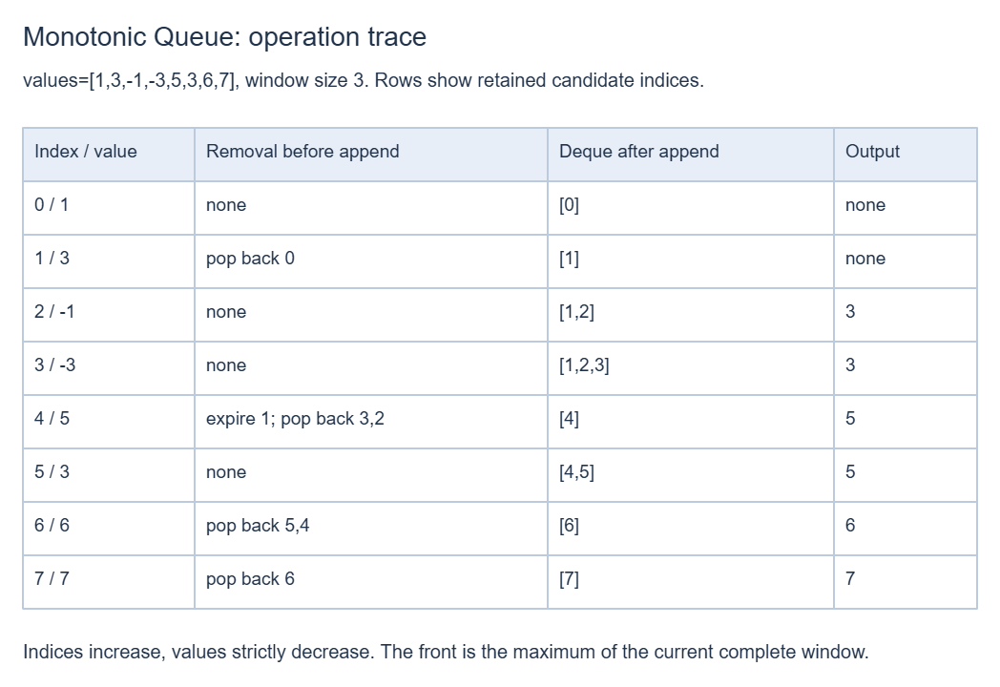

# Monotonic Queue

A monotonic queue keeps only candidates that may become the maximum of a moving window. Given an integer array and window size `k` with `1 <= k <= n`, return the maximum value of every complete consecutive window.

## How it works

Store indices in a deque. Before inserting index `i`, remove front indices at or before `i-k`, then remove back indices whose values are no larger than the entering value. Append `i`. Once a complete window exists, its maximum is the value at the deque's front. The [circular deque](../../../data_structures/theory/deque/Deque.md) supports removal from both ends without shifting array suffixes.

```c
for (i = 0; i < n; i++) {
    while (!empty(q) && front(q) <= i - k) {
        popFront(q);
    }
    while (!empty(q) && values[back(q)] <= values[i]) {
        popBack(q);
    }
    pushBack(q, i);
    if (i >= k - 1) {
        append(result, values[front(q)]);
    }
}
```

For `[1,3,-1,-3,5,3,6,7]` with `k=3`, the retained indices after each insertion are `[0]`, `[1]`, `[1,2]`, `[1,2,3]`, `[4]`, `[4,5]`, `[6]`, `[7]`. Return `[3,3,5,5,6,7]`. Indices increase and their values strictly decrease. A removed back candidate is dominated by a later value at least as large, which also expires later; it cannot be needed in any future window. Removing expired fronts preserves the window bounds, so the remaining front is the maximum.



## Costs and project code

Let `n` count values and `k` be the window size. Each index enters and leaves at most once, giving `O(n)` amortized total time and `O(k)` auxiliary storage, plus `O(n-k+1)` output. All languages use the project's growing circular deque, whose retained capacity stays bounded by this call's largest candidate count and its constant initial capacity. Empty input has no valid window and is rejected, as are zero and oversized windows. Values follow the bounded-integer precondition of the monotonic-stack example. The input is unchanged. Tests compare every window against direct maximum scans, including equal and negative values.

Code: [Go](../../implementation/monotonic_queue/golang/solution.go), [Python](../../implementation/monotonic_queue/python/solution.py), [TypeScript](../../implementation/monotonic_queue/typescript/index.ts).

Tests: [Go](../../implementation/monotonic_queue/golang/solution_test.go), [Python](../../implementation/monotonic_queue/python/test_solution.py), [TypeScript](../../implementation/monotonic_queue/typescript/index.test.ts).
