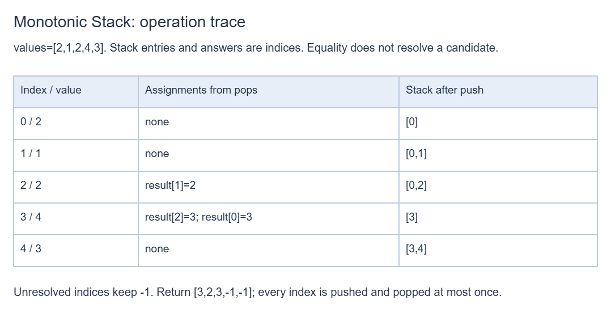

# Monotonic Stack

A monotonic stack retains unresolved candidates in ordered value order. Given an integer array, this implementation returns for each index the index of its first strictly greater value to the right, or -1 if none exists. It returns indices, not the greater values.

## How it works

Scan left to right and keep indices whose greater successor is unresolved. While the current value is larger than the value at the top, pop that index and assign the current index as its answer. Then push the current index. Equal values stay unresolved, so stack values are nonincreasing rather than strictly decreasing.

```c
result = array(n, -1);
stack = [];
for (i = 0; i < n; i++) {
    while (!empty(stack) && values[top(stack)] < values[i]) {
        result[pop(stack)] = i;
    }
    push(stack, i);
}
return result;
```

For `[2,1,2,4,3]`, the stacks after each index are `[0]`, `[0,1]`, `[0,2]`, `[3]`, `[3,4]`. Index 2 resolves index 1, but cannot resolve equal-valued index 0. Index 3 resolves indices 2 and 0. Return `[3,2,3,-1,-1]`. A popped candidate had no greater value at any earlier processed position, or it would already have been removed; the current position is therefore its first valid successor.



## Costs and project code

Let `n` count values. Every index is pushed once and popped at most once, giving `O(n)` time, `O(n)` working stack space and `O(n)` output space. Empty input returns an empty result; negative values, descending arrays and duplicates are supported. Inputs must contain comparable bounded integers, using safe integers in TypeScript; these routines do not separately validate every value. They preserve the input and use no recursion. Python tests enumerate ternary arrays through length six and compare with direct rightward scans; all variants also cover strict equality and missing-successor boundaries.

Code: [Go](../../implementation/monotonic_stack/golang/solution.go), [Python](../../implementation/monotonic_stack/python/solution.py), [TypeScript](../../implementation/monotonic_stack/typescript/index.ts).

Tests: [Go](../../implementation/monotonic_stack/golang/solution_test.go), [Python](../../implementation/monotonic_stack/python/test_solution.py), [TypeScript](../../implementation/monotonic_stack/typescript/index.test.ts).
