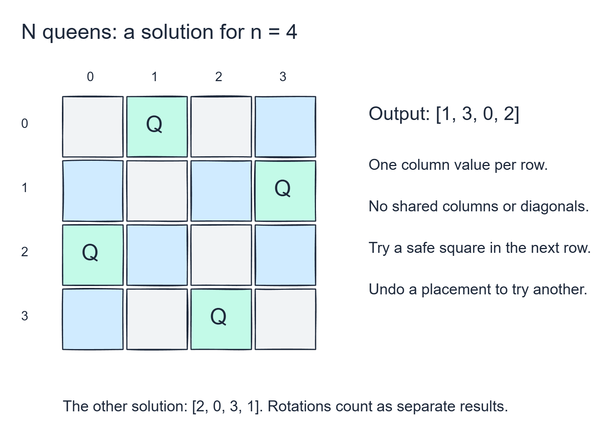
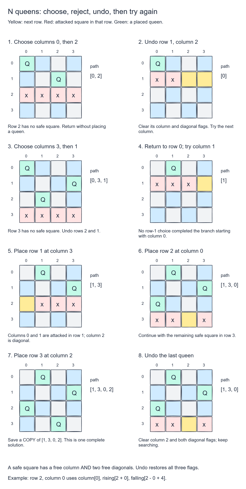

# N Queens

N queens is a constraint problem: place `n` queens on an `n` by `n` chessboard so no two share a row, column or diagonal. This algorithm enumerates the valid placements with backtracking.

## How it works

Place one queen per row, starting at row zero. For each column, check whether an earlier queen already occupies that column or either diagonal. If the square is safe, mark those three constraints, record the column and continue to the next row. Undo the placement when the recursive call returns.



That board shows the goal. The search has to reach it by testing partial placements. Starting with a queen at `(0, 0)` leads to failed branches; starting at `(0, 1)` reaches the first solution. Read each pair as `(row, column)` here.



With `path = [0, 2]`, row 2 has no safe column. Remove the row-1 queen and clear the flags it set before trying column 3. That branch reaches `[0, 3, 1]`, but row 3 has no safe square either. Return through those calls until row 0 can try column 1. The red squares show why the next row cannot continue, rather than just labeling the branch a failure.

After saving a solution, undo its last placement too. The algorithm must restore the caller's state to find the other solutions. A stored copy of `path` keeps the completed result intact.

The row order prevents row conflicts. Squares on one diagonal share `row + column`; squares on the other share `row - column`. Add `n` to the latter so you can use a nonnegative array index. These flags avoid comparing a candidate with each earlier queen.

```c
visit(row) {
    if (row == n) {
        result.append(copy(path));
        return;
    }
    for (column = 0; column < n; column++) {
        up = row + column;
        down = row - column + n;
        if (columns[column] || rising[up] || falling[down]) {
            continue;
        }
        columns[column] = rising[up] = falling[down] = true;
        path.append(column);
        visit(row + 1);
        path.pop();
        columns[column] = rising[up] = falling[down] = false;
    }
}
```

Initialize `columns` with `n` false entries, each diagonal array with `2 * n` false entries, and empty `path` and `result`. Call `visit(0)`. Each output lists the queen's column for rows `0` through `n - 1`. For `n = 4`, the outputs are `[1, 3, 0, 2]` and `[2, 0, 3, 1]`.

## Costs and project code

Column and diagonal checks take `O(1)` per candidate. A loose time upper bound is `O(n * n! + S * n)`, where `S` is the number of solutions: the search scans columns at each valid prefix and copies each complete placement. Diagonal conflicts prune branches before they reach full length.

The flags, path and recursion stack use `O(n)` auxiliary space. Results use `O(S * n)` space. The implementations keep rotations and reflections as separate solutions. Zero gives one empty placement, one gives `[[0]]`, and two or three give no solutions. Negative sizes raise an error; TypeScript also rejects noninteger or unsafe sizes.

Code: [Go](../../implementation/n_queens/golang/solution.go), [Python](../../implementation/n_queens/python/solution.py) and [TypeScript](../../implementation/n_queens/typescript/index.ts).
