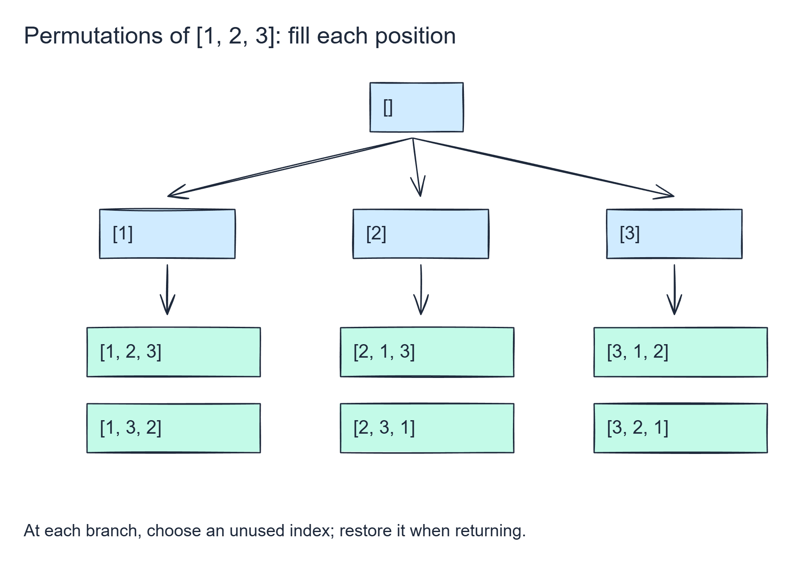

# Permutations

A permutation is an ordering of all elements in a collection. This algorithm generates distinct orderings of an array, including arrays with repeated values. Each result uses each input occurrence once.

## How it works

Sort a copy of the input, track which indices you have used, and build a path one position at a time. At each depth, try each unused index. Mark it, append its value, recurse, then undo both changes. Save a copy when the path reaches the input length.



For equal adjacent values, skip the later one when the earlier one is unused. Otherwise, two sibling branches would produce the same orderings. If the earlier occurrence is already in the path, the later occurrence remains available for another position.

```c
visit() {
    if (length(path) == length(values)) {
        result.append(copy(path));
        return;
    }
    for (i = 0; i < length(values); i++) {
        if (used[i]) {
            continue;
        }
        if (i > 0 && values[i] == values[i - 1] && !used[i - 1]) {
            continue;
        }
        used[i] = true;
        path.append(values[i]);
        visit();
        path.pop();
        used[i] = false;
    }
}
```

Initialize `values` with a sorted copy, `used` with false entries, and empty `path` and `result`. Call `visit()` once. For `[2, 1, 1]`, the results are `[1, 1, 2]`, `[1, 2, 1]` and `[2, 1, 1]`. Empty input produces one empty ordering.

## Costs and project code

For `n` distinct values, there are `n!` results. This traversal takes `O(n * n!)` time including result copies. If repeated values occur `c1, c2, ...` times, the number of distinct outputs is `P = n! / (c1! * c2! * ...)`.

The output stores `O(n * P)` values. The sorted copy, used flags, path and recursion stack require `O(n)` auxiliary space, excluding results. The implementations preserve the input. Even small increases in `n` can make storing all orderings impractical.

Code: [Go](../../implementation/permutations/golang/solution.go), [Python](../../implementation/permutations/python/solution.py) and [TypeScript](../../implementation/permutations/typescript/index.ts).
