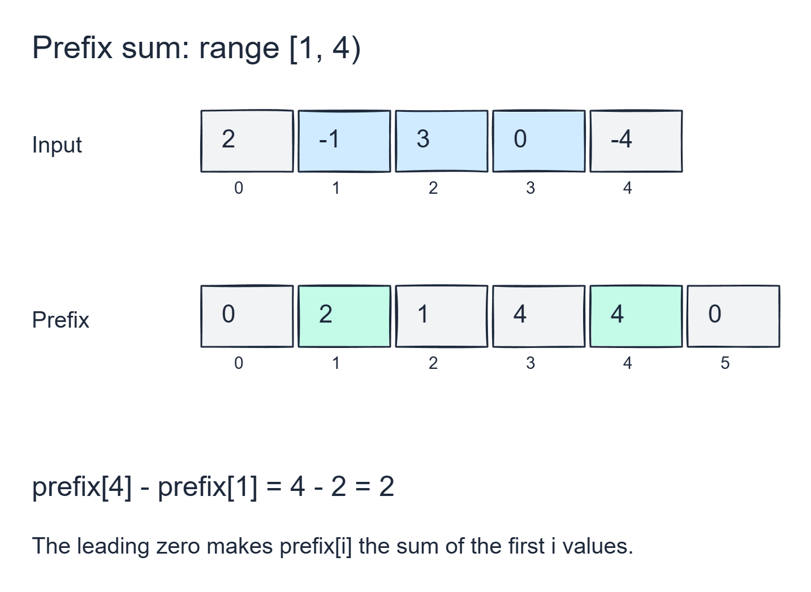

# Prefix Sum

A prefix sum array stores the sum of the values before each position in an input array. With an initial zero, `prefix[i]` equals the sum of the first `i` values.

## How it works

Build `prefix` with `n + 1` entries. Set `prefix[0]` to zero and compute each next entry by adding one input value. To sum the half-open range `[start, end)`, subtract `prefix[start]` from `prefix[end]`: the shared beginning cancels out.



For `[2, -1, 3, 0, -4]`, build `[0, 2, 1, 4, 4, 0]`. The range `[1, 4)` contains `[-1, 3, 0]`, so its sum is `prefix[4] - prefix[1] = 4 - 2 = 2`.

```c
prefixSums(values) {
    prefix = array(length(values) + 1, 0);
    for (i = 0; i < length(values); i++) {
        prefix[i + 1] = prefix[i] + values[i];
    }
    return prefix;
}

rangeSum(prefix, start, end) {
    if (start < 0 || end < start || end >= length(prefix)) {
        error("invalid range");
    }
    return prefix[end] - prefix[start];
}
```

## Costs and project code

Construction takes `O(n)` time and `O(n)` additional space. Each range query takes `O(1)` time and auxiliary space. This tradeoff suits repeated sum queries over unchanged data. Changing an input value after construction does not update the prefix array.

An empty input produces `[0]`. An empty range, where `start == end`, sums to zero. The implementations validate range bounds; TypeScript also checks integer indices. Go and TypeScript can lose exact arithmetic outside their integer representation limits, and the code does not check sum overflow.

Code: [Go](../../implementation/prefix_sum/golang/solution.go), [Python](../../implementation/prefix_sum/python/solution.py) and [TypeScript](../../implementation/prefix_sum/typescript/index.ts).
