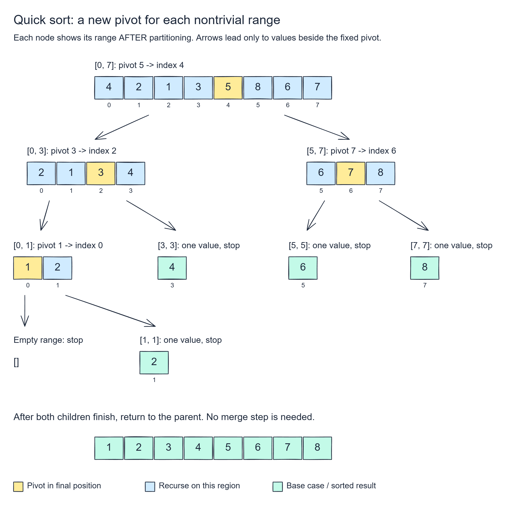
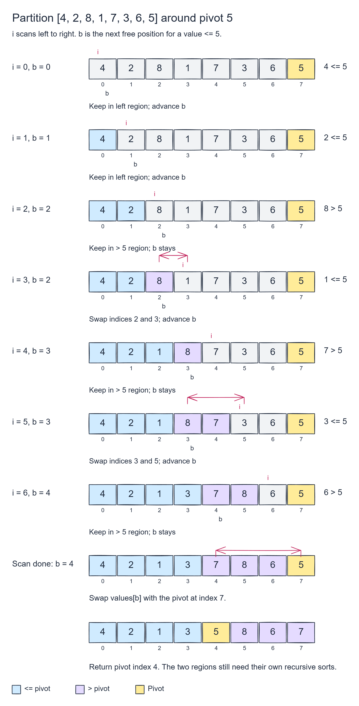

# Quick Sort

Quick sort is a divide-and-conquer sorting algorithm that partitions values around a pivot, then sorts the portions on either side. In this repository, the last value is the pivot, and the partition rearranges the input array in place.

For `[4, 2, 8, 1, 7, 3, 6, 5]`, choose pivot `5`. Partitioning gives `[4, 2, 1, 3, 5, 8, 6, 7]`, fixing `5` at index `4`. The values on either side still need sorting. Their recursive calls choose pivots `3` and `7`; the left branch needs another partition around `1`.



Each node shows a range after its own partition. Yellow marks that call's pivot in its final position. Arrows lead to the two ranges beside it, excluding the pivot. Empty and one-value ranges stop without choosing a pivot. Finish the left branch before the right branch, then return through the waiting calls.

## Partition, then exclude the pivot

The partition below shows the root call before any recursive sorting. Blue marks the scanned values no larger than `5`, purple marks scanned values larger than `5`, and gray values still await comparison. `b` marks the next place for a value no larger than the pivot; `i` marks the current comparison.



After scanning the seven non-pivot values, swap `values[b]` with `5`. That final exchange fixes the pivot. It does not finish either neighboring range; the recursion tree shows their remaining work.

```c
partition(values, low, high) {
    pivot = values[high];
    boundary = low;
    for (i = low; i < high; i++) {
        if (values[i] <= pivot) {
            swap(values[boundary], values[i]);
            boundary++;
        }
    }
    swap(values[boundary], values[high]);
    return boundary;
}

quickSort(values, low, high) {
    if (low >= high) {
        return;
    }
    pivotIndex = partition(values, low, high);
    quickSort(values, low, pivotIndex - 1);
    quickSort(values, pivotIndex + 1, high);
}
```

Here, `high` is inclusive. Start with `low = 0` and `high = length(values) - 1`. Before scanning index `i`, values before `boundary` are no larger than the pivot; values from `boundary` through `i - 1` are larger. The final swap fixes the pivot between those groups. Excluding it from the recursive ranges ensures progress.

Partitioning does not sort either group. The recursive calls supply that work. A zero- or one-element range stops at the base case. Long-distance swaps can reverse equal-key records, so this version is not stable.

## Costs and project code

Balanced partitions give `O(n log n)` time: each level performs linear partition work and there are logarithmically many levels. Random input typically gives that average behavior. Repeatedly placing the pivot at an extreme instead gives `O(n^2)` time and `O(n)` recursive depth. Balanced recursion uses `O(log n)` stack space; the partition itself uses `O(1)` auxiliary space.

Choosing the final element as pivot can produce extreme partitions for sorted, reverse-sorted or all-equal input. These versions do not randomize pivots or use three-way partitioning. A randomized variant changes the expected behavior, but it is not the implementation shown here.

All three implementations mutate the input. Their public wrappers supply the initial bounds; Python names its wrapper `quick_sort`.

Code: [Go](../../implementation/quick_sort/golang/solution.go), [Python](../../implementation/quick_sort/python/solution.py) and [TypeScript](../../implementation/quick_sort/typescript/index.ts).
