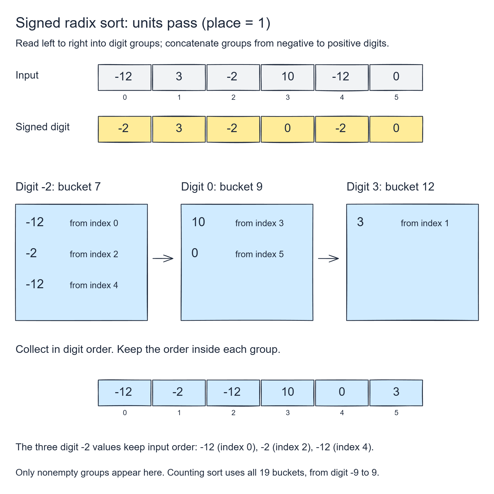
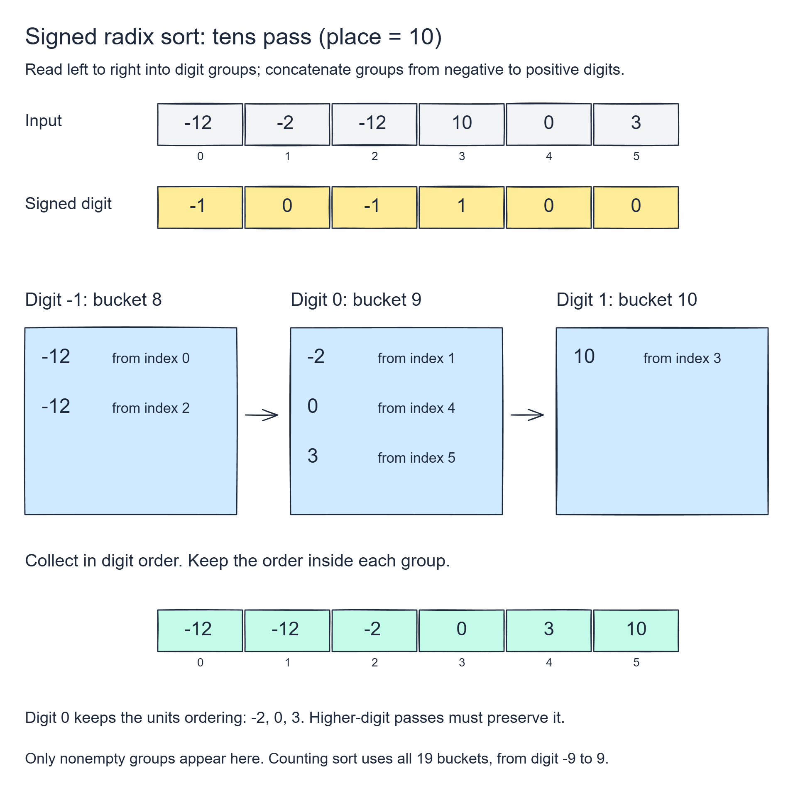

# Signed Radix Sort

Radix sort is a sorting algorithm that orders values by individual digits rather than by comparing whole values. This project uses a least-significant-digit approach: stably sort by units, then tens, then higher decimal places. It supports negative integers by using signed digits from `-9` through `9`.

For `[-12, 3, -2, 10, -12, 0]`, the units pass gives `[-12, -2, -12, 10, 0, 3]`. The tens pass gives `[-12, -12, -2, 0, 3, 10]`. Values with equal digits keep their order from the preceding pass.



The units digits are `-2, 3, -2, 0, -2, 0`. Group them in digit order: the `-2` group contains `-12, -2, -12`, the zero group contains `10, 0`, and the `3` group contains `3`. The index labels show why equal digits retain their input order. Concatenating these groups gives the input for the tens pass.



The tens digits now form groups `-1`, `0` and `1`. Inside the zero group, keep `-2, 0, 3` in their units-pass order. Concatenating the groups produces the final sorted sequence. The diagrams omit empty groups for space; the counting pass still uses all 19 buckets.

## Count digits without losing their earlier order

For place `1`, inspect units; for place `10`, inspect tens. Divide with truncation toward zero, then take the signed remainder modulo ten. Adding `9` maps digits `-9..9` to array indices `0..18`. For example, the units digit of `-12` is `-2`, which maps to bucket `7`.

```c
digitIndex(value, place) {
    return (value / place) % 10 + 9;
}

countingPass(values, place) {
    count = createArray(19, 0);
    output = createArray(length(values));
    for (i = 0; i < length(values); i++) {
        count[digitIndex(values[i], place)]++;
    }
    for (i = 1; i < 19; i++) {
        count[i] += count[i - 1];
    }
    for (i = length(values) - 1; i >= 0; i--) {
        digit = digitIndex(values[i], place);
        count[digit]--;
        output[count[digit]] = values[i];
    }
    return output;
}
```

The cumulative counts give the end position of each bucket. Reading the input backward and filling each bucket backward preserves equal-digit order. This stability is necessary: a higher-place pass must retain the lower-place ordering for values with the same higher digit.

Call `countingPass` for increasing powers of ten until no value has higher digits. Negative signed digits precede zero and positive digits at each place; missing higher digits count as zero. Go checks the lowest and highest values by division before advancing the place, avoiding an absolute-value overflow for the smallest `int` and a multiplication overflow after the final pass.

## Costs and project code

For `n` values, `d` digit positions and `b = 19` buckets, the time is `O(d * (n + b))` and the counting pass uses `O(n + b)` auxiliary space. This bound treats digit arithmetic as constant-time; Python's arbitrary-precision division has additional costs as integer sizes grow. The algorithm preserves the input's value sequence and returns a sorted result; a no-pass case may return the input itself.

Python computes an absolute digit and restores its sign to avoid floor-division behavior on negative values. TypeScript uses `Math.trunc` and accepts safe integers from `Number.MIN_SAFE_INTEGER` through `Number.MAX_SAFE_INTEGER`; it rejects fractions, infinities, `NaN` and unsafe integers. Go supports its full `int` range, and Python supports arbitrary-precision integers.

This method suits integer keys with a bounded digit count. It does not apply to arbitrary comparison-based records without defining a digit representation.

Code: [Go](../../implementation/radix_sort/golang/solution.go), [Python](../../implementation/radix_sort/python/solution.py) and [TypeScript](../../implementation/radix_sort/typescript/index.ts).
