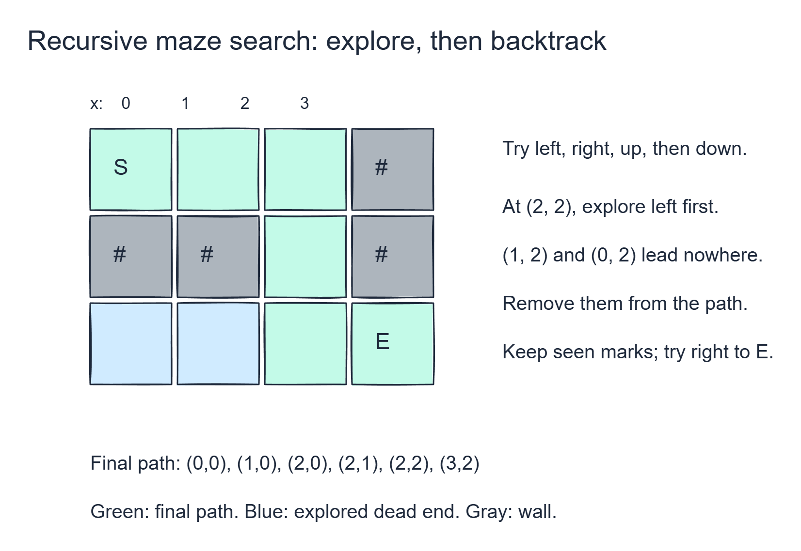

# Recursion and Maze Search

Recursion is a way to solve a problem by calling the same function on smaller or advancing states until a stopping condition applies. This maze solver uses recursive depth-first search: explore one route, return from a dead end and try the next neighbor.

## How it works

Represent a position as `(x, y)` and read its cell with `maze[y][x]`. Reject out-of-bounds positions and walls before reading further. Reaching the goal completes the path. For other unvisited cells, mark the cell as seen, append it to the path and explore left, right, up, then down.



If a recursive call succeeds, keep its path and return success through the waiting calls. If all neighbors fail, remove the current position from the path. Keep its seen mark: another route does not need to explore that same cell again to establish reachability.

```c
walk(position) {
    if (outside(position) || isWall(position)) {
        return false;
    }
    if (position == goal) {
        path.append(position);
        return true;
    }
    if (seen[position]) {
        return false;
    }
    seen[position] = true;
    path.append(position);
    neighbors = neighborsLeftRightUpDown(position);
    for (i = 0; i < length(neighbors); i++) {
        next = neighbors[i];
        if (walk(next)) {
            return true;
        }
    }
    path.pop();
    return false;
}
```

Initialize an empty path and a false `seen` grid before calling `walk(start)`. Each call keeps its own current position and neighbor progress on the call stack. Removing a failed choice before trying another is backtracking.

## Costs and project code

For a rectangular maze with `r` rows and `c` columns, search takes `O(r * c)` time and auxiliary space. Each visited cell has four neighbors; the seen grid, path and recursion stack can each grow with the number of cells. Long corridors can exceed the language's recursion limit.

Pass a nonempty rectangular maze and the wall marker. The solver returns the first path in its traversal order, which need not be the shortest. An unreachable goal gives an empty path; a traversable start equal to the goal gives a one-position path. The maze stays unchanged. To find a shortest unweighted route, use breadth-first search.

Code: [Go](../../implementation/recursion/golang/solution.go), [Python](../../implementation/recursion/python/solution.py) and [TypeScript](../../implementation/recursion/typescript/index.ts).
