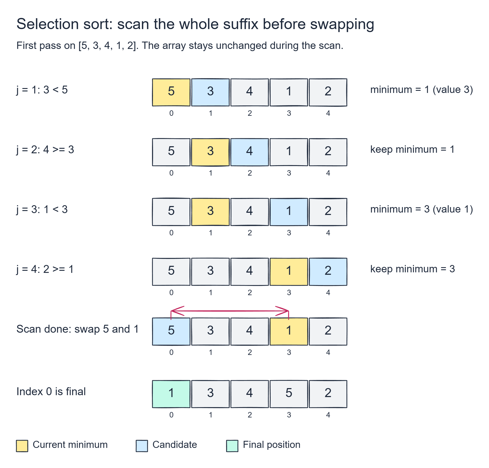
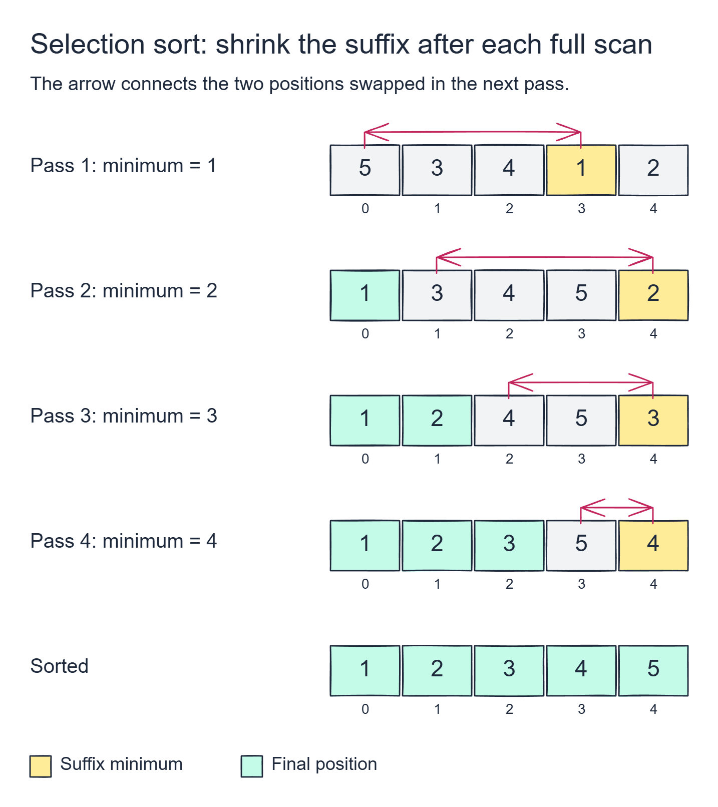

# Selection Sort

Selection sort is a comparison sorting algorithm that repeatedly selects a minimum from the unsorted suffix and swaps it into the suffix's first position. Each iteration fixes one more position at the beginning of the input array.

For `[5, 3, 4, 1, 2]`, find `1` and swap it with `5`, giving `[1, 3, 4, 5, 2]`. The next minimum is `2`, producing `[1, 2, 4, 5, 3]`. Repeat for the remaining positions to obtain `[1, 2, 3, 4, 5]`.



The first pass keeps `5`, then `3`, then `1` as its current minimum. Comparing `4` with `3` and `2` with `1` leaves that minimum unchanged. None of these comparisons moves an array value; the single swap happens after the full scan.



Each new pass starts one position farther right. Green cells have their final values. The magenta arrow joins the suffix's first position to the minimum found by that pass.

## Select before swapping

```c
selectionSort(values) {
    n = length(values);
    for (i = 0; i < n - 1; i++) {
        minimum = i;
        for (j = i + 1; j < n; j++) {
            if (values[j] < values[minimum]) {
                minimum = j;
            }
        }
        if (minimum != i) {
            swap(values[i], values[minimum]);
        }
    }
}
```

During the inner loop, `minimum` identifies a smallest value examined so far. After the scan, no value in the suffix belongs before it. The swap fixes position `i`; earlier positions remain sorted and no larger than the remaining values.

The swap can move an equal-key record past another one. For example, sorting tagged values `[2a, 2b, 1]` by numeric key first produces `[1, 2b, 2a]`. The tags have reversed order, so this version is not stable.

## Costs and project code

The suffix scans perform about `n * (n - 1) / 2` comparisons regardless of the initial order. Best, average and worst-case comparison work is `O(n^2)`. The algorithm makes at most `n - 1` swaps and uses `O(1)` auxiliary space.

Compared with insertion sort, selection sort can use fewer swaps but does not benefit from an already sorted prefix in the input. It provides a simple example of selecting an extreme value before changing the sequence. The project versions mutate the input; an empty or one-element array needs no changes.

Code: [Go](../../implementation/selection_sort/golang/solution.go), [Python](../../implementation/selection_sort/python/solution.py) and [TypeScript](../../implementation/selection_sort/typescript/index.ts).
