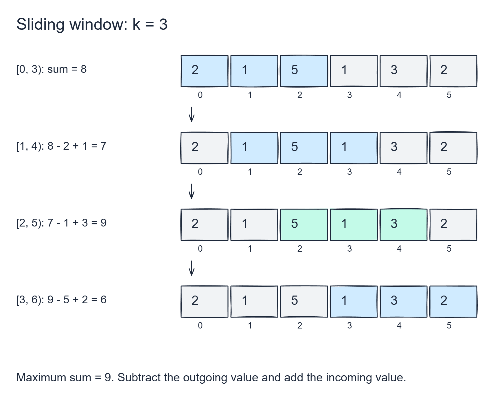

# Sliding Window

A sliding window is a contiguous range that you move through a sequence while maintaining information about its contents. This implementation finds the largest sum among windows of exactly `k` values.

## How it works

Sum the first `k` values and use that sum as the initial best result. Move one position right by subtracting the value leaving the window and adding the value entering it. Compare each new sum with the best so far.



For `[2, 1, 5, 1, 3, 2]` and `k = 3`, the sums are 8, 7, 9 and 6. The answer is 9, from `[5, 1, 3]`. Starting the best sum at zero would give a wrong answer when all window sums are negative.

```c
maxWindowSum(values, k) {
    n = length(values);
    if (k <= 0 || k > n) {
        error("invalid window size");
    }
    sum = 0;
    for (i = 0; i < k; i++) {
        sum += values[i];
    }
    best = sum;
    for (i = k; i < n; i++) {
        sum += values[i] - values[i - k];
        best = max(best, sum);
    }
    return best;
}
```

## Costs and project code

The first window costs `O(k)` and each move costs `O(1)`, for `O(n)` total time and `O(1)` auxiliary space. The input stays unchanged. A size of one chooses the largest value; a size of `n` sums the whole array.

The implementations reject nonpositive sizes and sizes larger than the array. TypeScript also rejects noninteger sizes. Go's `int` and TypeScript's `number` impose limits on exact sums; the code does not check sum overflow. Python integers have arbitrary precision.

Code: [Go](../../implementation/sliding_window/golang/solution.go), [Python](../../implementation/sliding_window/python/solution.py) and [TypeScript](../../implementation/sliding_window/typescript/index.ts).
