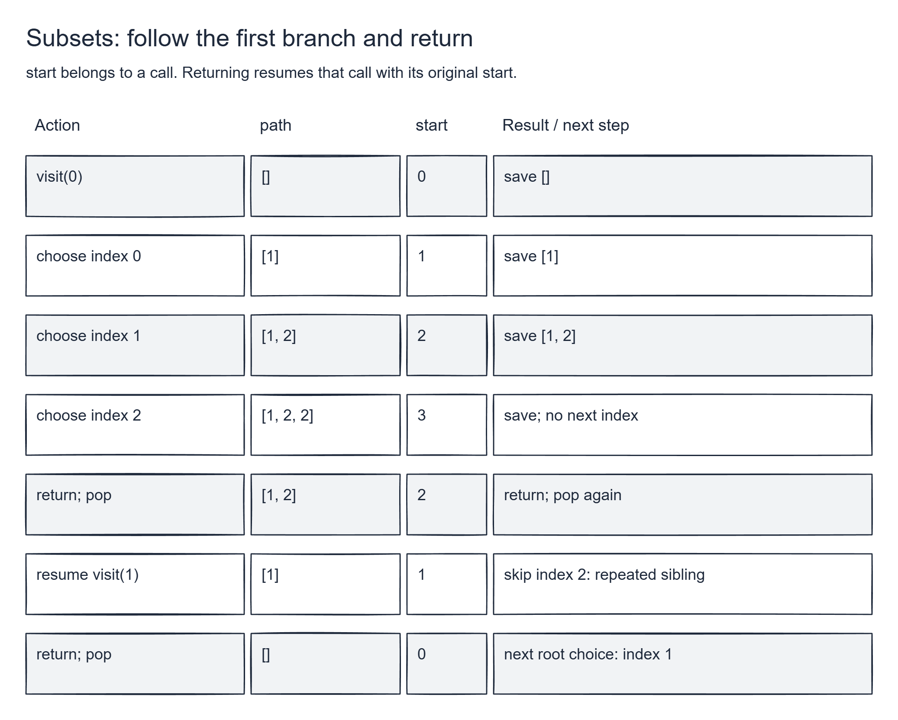

# Subsets

A subset is a selection of elements from a collection, including the empty selection. This algorithm enumerates distinct subsets of an array that may contain repeated values. It can select each occurrence at most once, and order within a subset does not distinguish results.

## How it works

Sort a copy of the input so equal values sit together. Maintain a current selection, `path`, and a start index. Save a copy of `path` at each call, then try each eligible next value. Recurse from the following index and remove the chosen value after returning.


The diagram uses sorted input `[1, 2, 2]`. Save a result at every node, including the root, because a subset can have any size. A call's `start` limits later choices to unused occurrences after the chosen index.



After saving `[1, 2, 2]`, pop the last `2`, return from that call, then pop the earlier `2`. Resume the call with path `[1]` and `start = 1`. Index 2 would repeat the sibling branch begun at index 1, so skip it. At the deeper call with `start = 2`, that same occurrence was legal: it was the first candidate at that depth. This distinction allows `[2, 2]` while preventing duplicate subsets.

Skip repeated values at the same recursion depth. That prevents two branches from starting with the same value. A deeper call can still choose another occurrence: `[1, 2, 2]` must include `[2, 2]`.

```c
visit(start) {
    result.append(copy(path));
    for (i = start; i < length(values); i++) {
        if (i > start && values[i] == values[i - 1]) {
            continue;
        }
        path.append(values[i]);
        visit(i + 1);
        path.pop();
    }
}
```

Set `values = sortedCopy(input)`, initialize empty `path` and `result`, and call `visit(0)`. Copying the path matters because later calls reuse and change it.

For `[2, 1, 2]`, the results are `[]`, `[1]`, `[1, 2]`, `[1, 2, 2]`, `[2]` and `[2, 2]`. An empty input has one subset: the empty selection.

## Costs and project code

With `n` distinct values, there are `2^n` subsets. Constructing and storing their contents costs `O(n * 2^n)` time and output space. Sorting costs `O(n log n)`; the sorted copy, current path and recursion stack use `O(n)` auxiliary space, excluding results. Repeated values reduce the number of outputs.

All three implementations preserve the input and return subsets in the traversal order of the sorted values. Use this enumeration when you need the selections themselves; counting subsets does not require constructing them.

Code: [Go](../../implementation/subsets/golang/solution.go), [Python](../../implementation/subsets/python/solution.py) and [TypeScript](../../implementation/subsets/typescript/index.ts).
