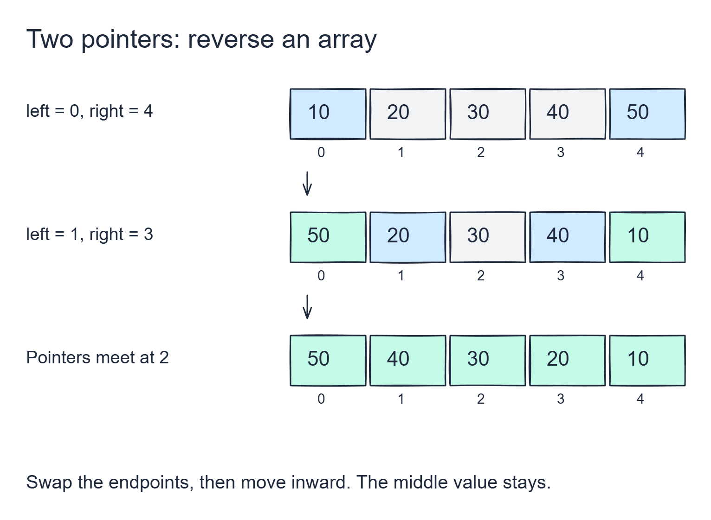

# Two Pointers

Two pointers is an array traversal technique that tracks two positions and moves them according to a shared condition. Here, you reverse an array by swapping its ends and moving both positions toward the center.

## How it works

Start `left` at zero and `right` at the last index. Swap those values, increment `left` and decrement `right`. After each swap, the positions outside the two pointers already contain their final values. Stop when the pointers meet or cross; an odd-length array keeps its middle value.



```c
reverse(values) {
    left = 0;
    right = length(values) - 1;
    while (left < right) {
        swap(values[left], values[right]);
        left++;
        right--;
    }
}
```

For `[10, 20, 30, 40, 50]`, swap 10 with 50, then 20 with 40. The result is `[50, 40, 30, 20, 10]`. Empty arrays and single values require no swaps.

## Costs and project code

Reversal takes `O(n)` time and `O(1)` auxiliary space. The implementations change the input array and return no result.

Other two-pointer algorithms move their positions differently. For example, finding a pair with a target sum in a sorted array moves the left pointer when the sum is too small and the right pointer when it is too large. You need a reason that each move can discard candidates; the reversal implementation needs no sorted input.

Code: [Go](../../implementation/two_pointers/golang/solution.go), [Python](../../implementation/two_pointers/python/solution.py) and [TypeScript](../../implementation/two_pointers/typescript/index.ts).
