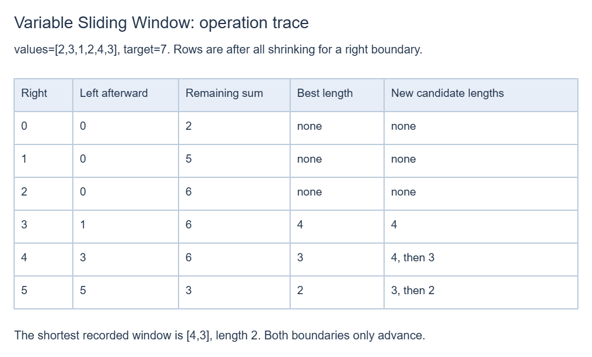

# Variable Sliding Window

A variable sliding window changes both ends of a contiguous range. Here the input is an array of positive integers and a positive target; return the length of the shortest nonempty subarray whose sum reaches the target, or zero if none exists. The input is preserved.

## How it works

Maintain the left boundary and the sum of the current window. Extend the right boundary by one value. While the sum reaches the target, record the current length, subtract the leftmost value and advance left. Only positive values are supported: removing them strictly decreases the sum, while extending a window cannot decrease it.

```c
left = 0;
sum = 0;
best = n + 1;
for (right = 0; right < n; right++) {
    sum += values[right];
    while (sum >= target) {
        best = min(best, right - left + 1);
        sum -= values[left];
        left++;
    }
}
return best == n + 1 ? 0 : best;
```

For `[2,3,1,2,4,3]` and target 7, reaching index 3 first records length 4. After processing index 4, shrinking records length 3. At index 5, shrinking records length 2 for `[4,3]`. The remaining window is `[3]` with sum 3, so shrinking stops. For each right boundary the loop examines all qualifying left boundaries before the first failure; earlier discarded boundaries cannot improve a later answer because extending them only makes their length larger. This proves the minimum is not missed.



## Costs and project code

Let `n` count values. Both pointers advance at most `n` times, so the nested loops take `O(n)` total time and `O(1)` auxiliary space. Validation also scans the array. Empty input returns zero. Nonpositive inputs are rejected; Python and TypeScript additionally validate integer domains. Go and TypeScript reject a running sum that exceeds their exact integer representation. Python's arbitrary-precision sums have additional bit costs for very large integers. Tests enumerate all positive arrays of length up to five against all subarray sums, with regression cases in each language.

Code: [Go](../../implementation/variable_window/golang/solution.go), [Python](../../implementation/variable_window/python/solution.py), [TypeScript](../../implementation/variable_window/typescript/index.ts).

Tests: [Go](../../implementation/variable_window/golang/solution_test.go), [Python](../../implementation/variable_window/python/test_solution.py), [TypeScript](../../implementation/variable_window/typescript/index.test.ts).
