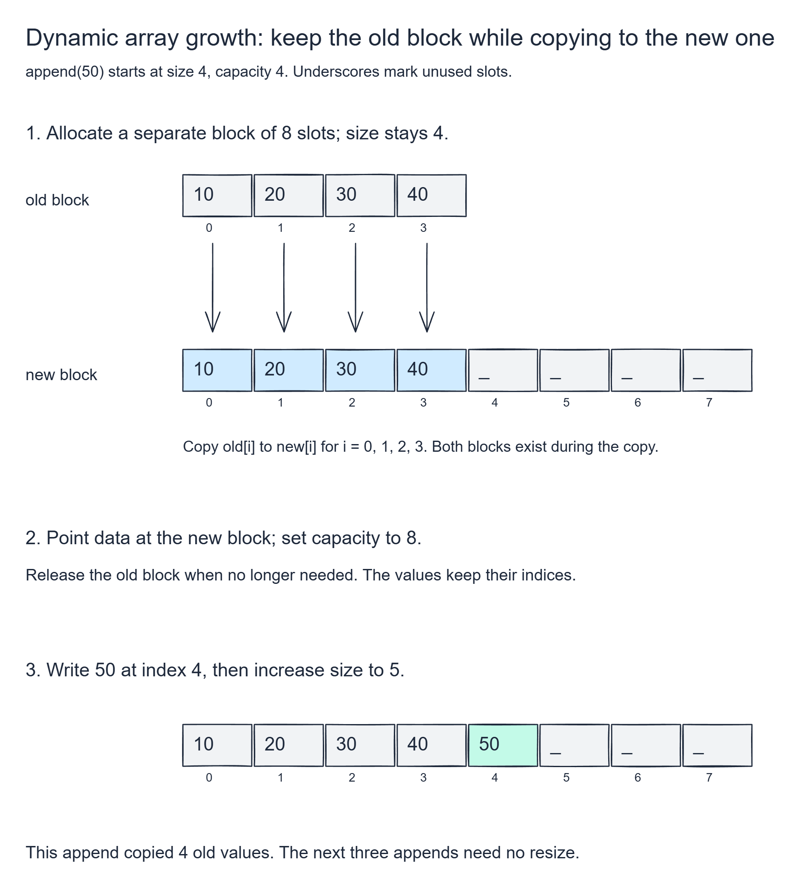
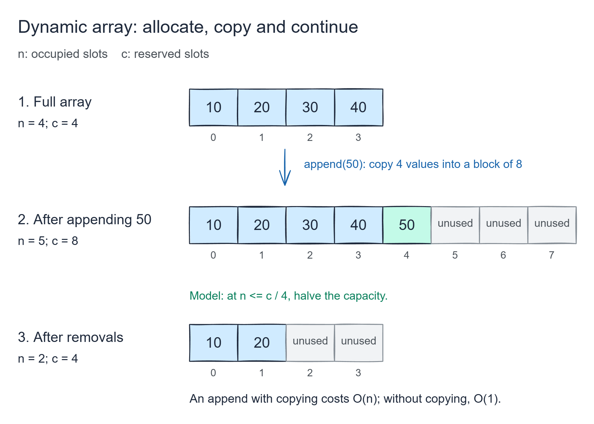
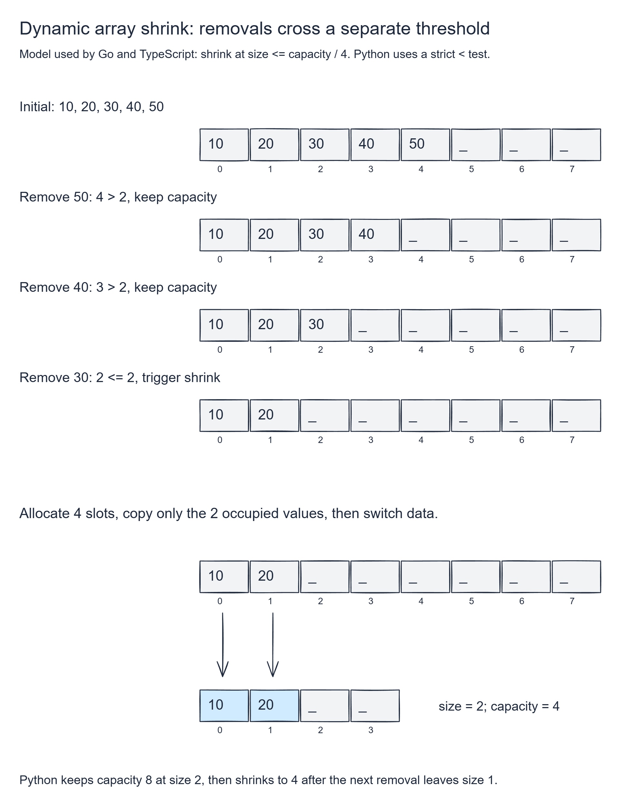

# Dynamic Array

A dynamic array is an indexed sequence backed by a contiguous block of slots whose capacity can change. It tracks a **size**, the number of stored elements, and a **capacity**, the number of reserved slots. Growing the array can require allocating a larger block and copying the occupied slots.

In `[10, 20, 30, unused]`, the size is `3` and the capacity is `4`. The next append uses index `3`. Once all four slots hold elements, appending `50` can allocate eight slots, copy the four existing values and write `50` at index `4`. The size becomes `5` and the capacity becomes `8`.



The allocation supplies a new block; it does not stretch the original block in place. Keep the old values reachable while copying them into matching indices. After the copy, update the backing reference and capacity, then append into the first unused slot. The size stays four until that final write.



Indexed access costs `O(1)` because you calculate a slot within the current block. Require `0 <= index < size` to access an element, even if the block has spare capacity. A slot can contain a value or a reference to an object elsewhere. Copying references during growth does not require copying the referenced objects.

## Growth and removal

To append, check the available space. The pseudocode starts with `size = 0` and `capacity = 1`. `createArray(c)` reserves `c` slots, and `error(...)` stops the operation with a failure.

```c
append(array, value) {
    if (array.size == array.capacity) {
        resize(array, array.capacity * 2);
    }

    array.data[array.size] = value;
    array.size++;
}

resize(array, newCapacity) {
    newData = createArray(newCapacity);
    for (i = 0; i < array.size; i++) {
        newData[i] = array.data[i];
    }

    array.data = newData;
    array.capacity = newCapacity;
}
```

Without resizing, an append needs one write. Resizing copies `n` elements. Doubling the capacity leaves room for later appends. For the first eight appends from capacity `1`, you copy `1 + 2 + 4 = 7` elements in addition to writing the eight new values. The total work grows in proportion to the number of appends. This gives **O(1) amortized** cost per append, although an append that copies elements costs `O(n)`. Amortized cost accounts for a sequence of operations; an individual operation can still take longer.

To remove index `1` from `[10, 20, 30, 40]`, save `20`, shift `30` and `40` one slot to the left, and decrease the size. Removing the last element needs no shifts. Clear the old reference if the slots store references. You can keep the capacity or shrink it after a sequence of removals.

```c
remove(array, index) {
    if (index < 0 || index >= array.size) {
        error("Invalid index");
    }

    value = array.data[index];
    for (i = index; i < array.size - 1; i++) {
        array.data[i] = array.data[i + 1];
    }
    array.size--;
    array.data[array.size] = NULL;

    if (array.capacity > 1 && array.size <= array.capacity / 4) {
        resize(array, max(1, array.capacity / 2));
    }

    return value;
}
```

The example uses integer division for capacity calculations and `NULL` to clear a slot outside the logical size. The size determines which slots contain elements.

In the shrinking example, two elements remain in a block of eight slots. Copy them into a block of four slots; the size stays `2`. Waiting until one-quarter occupancy before halving the capacity separates the growth and shrink thresholds. Shrinking at half occupancy could cause alternating appends and removals near the threshold to trigger a copy on each operation.



Starting at size 5 and capacity 8, removing `50` and `40` leaves capacity unchanged. Removing `30` leaves two elements and reaches the model's quarter-full threshold. Copy those two live elements into four slots; do not copy stale slots beyond the logical size. Python's strict comparison waits for one more removal, as noted below.

## Costs and project implementation

For `n` elements and capacity `c`, with doubling and the shrinking policy above:

| Operation | Cost |
| --- | --- |
| Read or update a valid index | `O(1)` |
| Append | `O(1)` amortized; `O(n)` when resizing |
| Remove the last element by index | `O(1)` amortized; `O(n)` when shrinking |
| Insert or remove at the beginning or middle | `O(n)` worst case, due to shifts |
| Search an unsorted array by value | `O(n)` worst case, due to comparisons |

The reserved storage takes `O(c)` space. During a resize, you keep both the old and new blocks until the copy finishes. A dynamic array suits sequences that change in size and need indexed access or appends. Frequent insertions at the beginning require shifts even with spare capacity.

In this repository, `insert`/`Insert` appends. `delete`/`Delete` takes a **value**, searches for its first occurrence and then removes that position. The search costs `O(n)` in the worst case, including when the requested value is at the end. The pseudocode takes an index to show removal without that search.

Go and TypeScript shrink at one-quarter occupancy. Python uses `size < capacity // 4`, so its shrink happens below that threshold.

Code: [Go](../../../implementation/arrays/dynamic_array/golang/solution.go), [Python](../../../implementation/arrays/dynamic_array/python/solution.py) and [TypeScript](../../../implementation/arrays/dynamic_array/typescript/index.ts).
