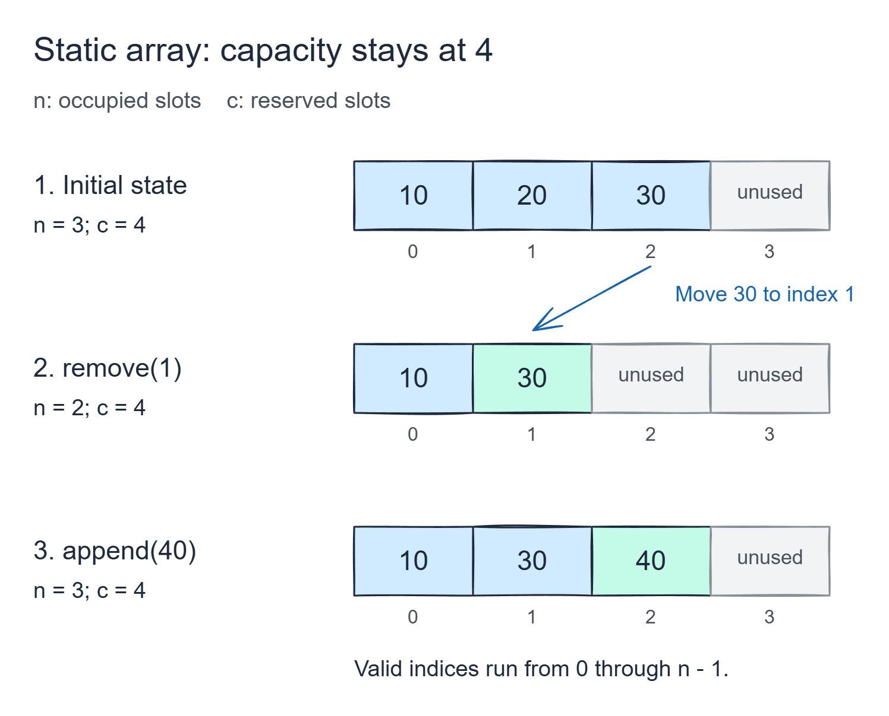

# Static Array

A static array is an indexed sequence of elements stored in a fixed-capacity block of contiguous slots. Its capacity stays the same for the lifetime of that block. Removing an element from a four-slot array leaves four slots; increasing the capacity requires another array.

The **size** counts stored elements, while the **capacity** counts reserved slots. In `[10, 20, 30, unused]`, `size = 3` and `capacity = 4`. Indices start at zero: `data[0]` contains `10`, and `data[2]` contains `30`. Slot `3` belongs to the allocated storage but lies outside the occupied portion. Require `0 <= index < size` to read or remove an element, and `size < capacity` to append one.



Each slot has a fixed width. To locate index `i`, calculate `baseAddress + i * slotSize`. This calculation takes the same number of steps regardless of the index, so indexed access costs `O(1)`. A slot can hold a value or a reference; referenced objects may occupy other memory locations.

## Insertion, removal and search

In the first state of the diagram, you can append a value at index `3`. Write it into that slot and increase the size. The capacity stays `4`. In the pseudocode, `error(...)` stops the operation with a failure.

```c
append(array, value) {
    if (array.size == array.capacity) {
        error("Array is full");
    }

    array.data[array.size] = value;
    array.size++;
}
```

Removing index `1` takes out `20`. Move `30` from index `2` to index `1`, then decrease the size to `2`. The occupied portion remains a sequence from `0` through `size - 1`. Appending `40` then uses index `2`.

```c
remove(array, index) {
    if (index < 0 || index >= array.size) {
        error("Invalid index");
    }

    value = array.data[index];
    for (i = index; i < array.size - 1; i++) {
        array.data[i] = array.data[i + 1];
    }

    array.size--;
    return value;
}
```

After removal, ignore slots at or beyond `size`. If you store references, clear the old last slot to avoid retaining a reference outside the occupied portion. The label `unused` in the diagram marks a slot outside the logical size. Use the size to identify that state.

To insert in the middle while preserving order, shift the following elements one slot to the right. To find `30` without knowing its index, compare values from the beginning until you find it. If the value is absent, you examine all `n` elements. Knowing the index avoids this search.

## Costs and project implementation

Here, `n` is the occupied size and `c` is the capacity. These costs assume operations within the existing array that preserve element order.

| Operation | Cost | Required work |
| --- | --- | --- |
| Read or update a valid index | `O(1)` | Calculate the slot and access the element |
| Append with spare capacity | `O(1)` | Write one value and increase the size |
| Remove the last element | `O(1)` | Decrease the size without shifting elements |
| Insert or remove at the beginning or middle | `O(n)` worst case | Shift following elements |
| Search an unsorted array by value | `O(n)` worst case | Compare up to `n` elements |

Reserving `c` slots takes `O(c)` space, even when fewer slots hold elements. A static array suits a known maximum size, such as the seven days of a week or a fixed-size buffer.

The repository implementations make a different storage choice from the pseudocode: `insert`/`Insert` and `delete`/`Delete` allocate an array of the same capacity and copy elements. Including allocation and initialization, these operations take `O(c)` time and auxiliary space. The capacity stays fixed; the extra copy belongs to the implementation.

Code: [Go](../../../implementation/arrays/static_array/golang/solution.go), [Python](../../../implementation/arrays/static_array/python/solution.py) and [TypeScript](../../../implementation/arrays/static_array/typescript/index.ts).
