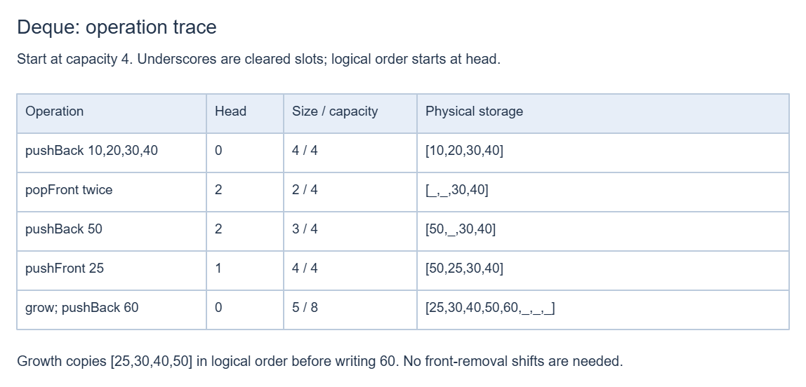

# Deque

A deque is a double-ended queue supporting insertion, removal and inspection at both ends. This implementation stores integer values in a growing circular array. Construct it with a positive initial capacity; the default capacity in Python and TypeScript is four, while Go receives it in `New(capacity)`.

## How it works

Maintain a physical head index and logical size. Logical index `i` lives at `(head+i) % capacity`. Push at the back writes at logical index size; push at the front first moves head one slot backward with wraparound. Pop clears the removed slot and updates head or size. When full, allocate twice the capacity, copy the logical sequence starting at index zero, and reset head to zero before the new insertion.

```c
pushBack(value) {
    if (size == capacity) {
        growAndCopyInLogicalOrder();
    }
    data[(head + size) % capacity] = value;
    size++;
}
popFront() {
    require(size > 0);
    value = data[head];
    clear(data[head]);
    head = (head + 1) % capacity;
    size--;
    return value;
}
```

With capacity four, push back `10,20,30,40`, then pop front twice. Head is 2 and the live sequence is `[30,40]`. Push back 50 and push front 25: physical storage becomes `[50,25,30,40]`, head 1, logical sequence `[25,30,40,50]`. Pushing back 60 grows to eight slots and produces `[25,30,40,50,60,_,_,_]` at head zero. Copying by logical rather than physical order preserves the deque sequence. The invariant `0 <= size <= capacity` and the index mapping justify each endpoint operation.



## Costs and project code

An insertion that grows `s` stored values takes `Theta(s)` time; geometric doubling makes insertion amortized `O(1)` over a sequence. Pops and peeks are worst-case `O(1)`. No shrinking occurs, so retained storage is `O(Cmax)`, where `Cmax` is the largest capacity allocated, not necessarily current size. Old and new arrays coexist during growth. Python/TypeScript clear removed slots, and Go clears them to zero. Empty operations raise `IndexError` in Python and `RangeError` in TypeScript; Go returns `(0,false)`, allowing zero as a real value with `(0,true)`. Construct Go values with `New`; the zero struct is not initialized. Tests compare mixed endpoint operations against standard deque/array models, covering growth, wraparound, empty access and reuse.

Code: [Go](../../implementation/deque/golang/solution.go), [Python](../../implementation/deque/python/solution.py), [TypeScript](../../implementation/deque/typescript/index.ts).

Tests: [Go](../../implementation/deque/golang/solution_test.go), [Python](../../implementation/deque/python/test_solution.py), [TypeScript](../../implementation/deque/typescript/index.test.ts).
