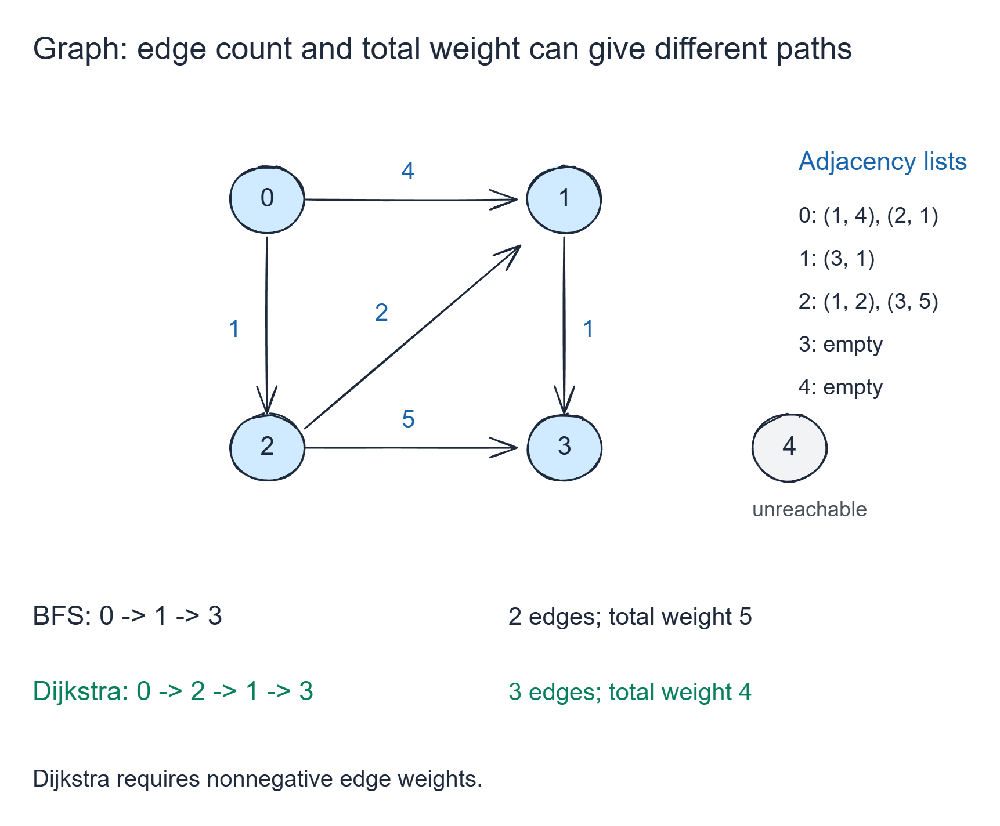
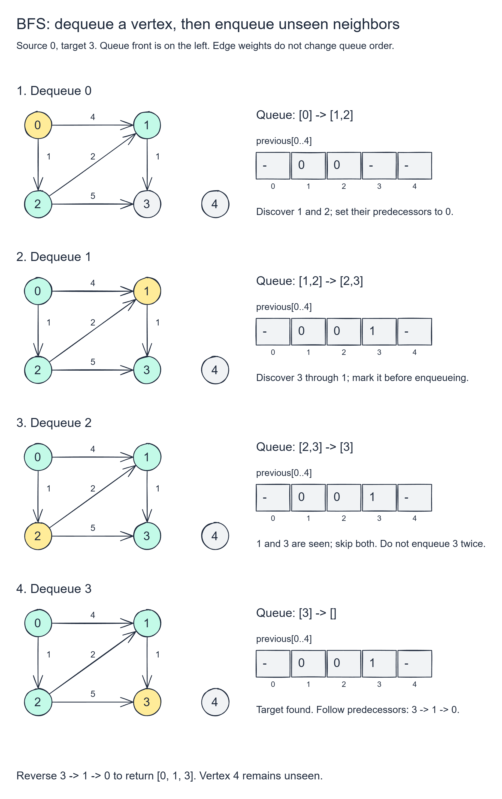
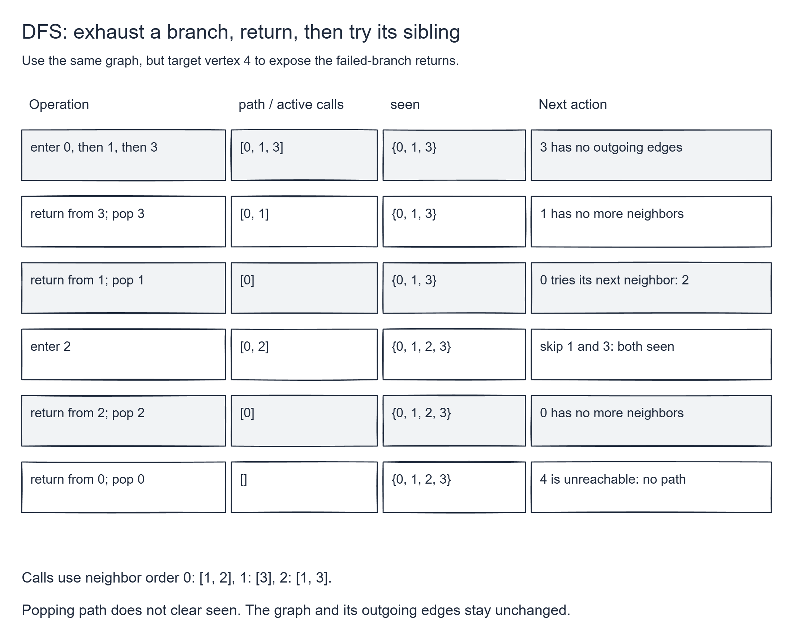
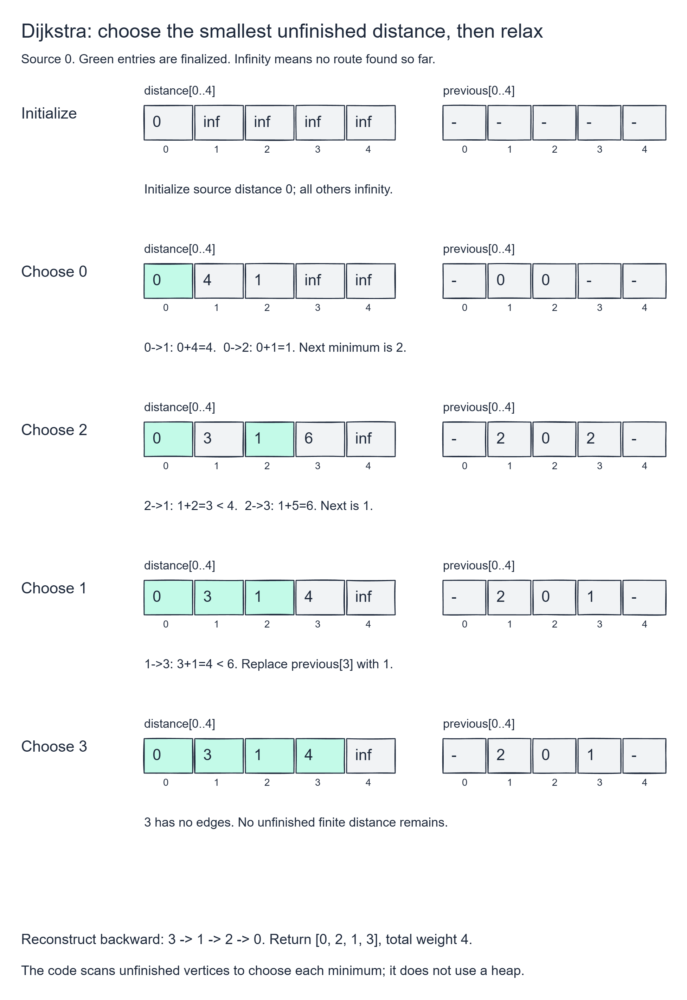

# Graph

A graph is a set of **vertices** connected by **edges**. Vertices represent entities, and edges represent relationships. Directed edges have a source and destination; an undirected edge connects vertices in both directions. A weighted edge also stores a cost, such as travel time. Graphs can contain cycles and disconnected vertices.

The project identifies vertices by indices from `0` through `V - 1`. An **adjacency matrix** stores an entry for each vertex pair, using `O(V^2)` space. An **adjacency list** stores outgoing edges for each vertex, using `O(V + E)` space for `E` edges. To represent an undirected graph with these implementations, include both directions.



## Representation and traversal

In the diagram, vertex `0` has edges to `1` with weight `4` and to `2` with weight `1`. Its adjacency list is `[[1, 4], [2, 1]]`, where each pair contains a destination and weight. Vertex `4` has no edges and is unreachable from `0`. The equivalent matrix row for vertex `0` is `[0, 4, 1, 0, 0]`.

The matrix implementation uses `0` to mean no edge, so it cannot represent a zero-weight edge. The list representation can store one. A list traversal examines outgoing edges; a matrix traversal scans a full row to discover them. The routines assume valid vertex indices.

**Breadth-first search**, or BFS, uses a FIFO queue to visit vertices by distance in number of edges. Mark a vertex when enqueuing it to avoid repeated work in cycles. Store its predecessor when first discovering it so you can reconstruct a path.

```c
bfs(graph, source, target) {
    seen = createArray(graph.vertexCount, false);
    previous = createArray(graph.vertexCount, NONE);
    queue = createQueue();
    queue.enqueue(source);
    seen[source] = true;

    while (!queue.isEmpty()) {
        current = queue.dequeue();
        if (current == target) {
            return pathFrom(previous, source, target);
        }
        for (i = 0; i < graph[current].length; i++) {
            edge = graph[current][i];
            next = edge.to;
            if (!seen[next]) {
                seen[next] = true;
                previous[next] = current;
                queue.enqueue(next);
            }
        }
    }
    return NOT_FOUND;
}
```

The pseudocode uses adjacency lists and a queue with constant-time removal. The [unweighted adjacency-list BFS](bfs_adj_list/Breadth%20First%20Search.md) implements this traversal with integer neighbor entries rather than weighted pairs. Each `graph[current]` entry lists that vertex's outgoing edges. `pathFrom` follows predecessors from the target back to the source and reverses that sequence. A source equal to the target gives a one-vertex path.

**Depth-first search**, or DFS, follows one branch before trying another. The project uses recursive calls and a path list. Mark a vertex before exploring its neighbors, append it to the current path and remove it from that path if the branch fails. Keep it marked: reaching the same vertex from another branch does not reveal new outgoing edges in this reachability search. DFS returns a path if one exists, with no shortest-path guarantee.

BFS can return `0, 1, 3` in the diagram: two edges with total weight `5`. It minimizes edge count, not the sum of weights.



When processing `2`, vertex `3` is already waiting in the queue after discovery through `1`. Its seen mark prevents another enqueue and preserves its first predecessor. Reconstruct the path by following `3 -> 1 -> 0`, then reverse it. The matrix implementation scans destinations by increasing index, giving the neighbor order shown here.



To expose DFS backtracking on the same graph, search for disconnected vertex `4`. Follow `0 -> 1 -> 3`, remove `3` and `1` as their calls fail, then try `2`. Its neighbors are already seen. Removing a vertex from the current path does not erase its seen mark. After the root returns, the path is empty and no route exists.

## Shortest paths and costs

**Dijkstra's algorithm** finds minimum total-weight paths from a source when edge weights are nonnegative. Maintain a tentative distance for each vertex, initially infinity except for distance zero at the source. Repeatedly choose the unfinished reachable vertex with the smallest distance and try to improve its neighbors. This improvement step is **relaxation**.

```c
distance[source] = 0;
while (true) {
    current = smallestUnvisitedFiniteDistance(distance, visited);
    if (current == NONE) {
        break;
    }
    visited[current] = true;

    for (i = 0; i < graph[current].length; i++) {
        edge = graph[current][i];
        if (!visited[edge.to]) {
            candidate = distance[current] + edge.weight;
            if (candidate < distance[edge.to]) {
                distance[edge.to] = candidate;
                previous[edge.to] = current;
            }
        }
    }
}
```

Initialize `visited` to false, distances to infinity and predecessors to `NONE` before this loop. In the diagram, processing `0` gives distances `4` to `1` and `1` to `2`. Processing `2` improves the distance to `1` to `3`. Processing `1` then improves the distance to `3` to `4`. The minimum-weight path is `0, 2, 1, 3`, with three edges and total weight `4`.



Processing `2` improves the tentative distance to `1` from 4 to 3 and first reaches `3` at cost 6. Processing `1` then reduces `3` to cost 4 and replaces its predecessor. A predecessor can change until its vertex is finalized. Vertex `4` keeps an infinite distance, so the algorithm never selects it.

Nonnegative weights ensure that a later route cannot improve a vertex after finalizing its smallest tentative distance. Negative weights invalidate that argument. The implementation assumes this precondition; it does not validate the edge weights. An infinite target distance means no path exists.

| Implementation | Worst-case time | Auxiliary space, excluding the graph |
| --- | --- | --- |
| Matrix BFS in this repository | `O(V^2)` | `O(V)` |
| Adjacency-list DFS | `O(V + E)` | `O(V)` for marks, path and recursion |
| Adjacency-list BFS | `O(V + E)` | `O(V)` |
| Current Dijkstra with linear minimum selection | `O(V^2 + E)` | `O(V)` |

The current Dijkstra scans the vertices to choose the next minimum. An implementation with a suitable min-priority queue can reduce selection costs, but the repository does not use one here. Its routines return a path rather than a distance table. A single traversal visits vertices reachable from the source; reaching the remaining vertices requires additional starting points.

Code: matrix BFS in [Go](../../implementation/graphs/bfs_adj_matrix/golang/solution.go), [Python](../../implementation/graphs/bfs_adj_matrix/python/solution.py) and [TypeScript](../../implementation/graphs/bfs_adj_matrix/typescript/index.ts); adjacency-list DFS in [Go](../../implementation/graphs/dfs_adj_list/golang/solution.go), [Python](../../implementation/graphs/dfs_adj_list/python/solution.py) and [TypeScript](../../implementation/graphs/dfs_adj_list/typescript/index.ts); Dijkstra in [Go](../../implementation/graphs/dijkstra_path/golang/solution.go), [Python](../../implementation/graphs/dijkstra_path/python/solution.py) and [TypeScript](../../implementation/graphs/dijkstra_path/typescript/index.ts).
