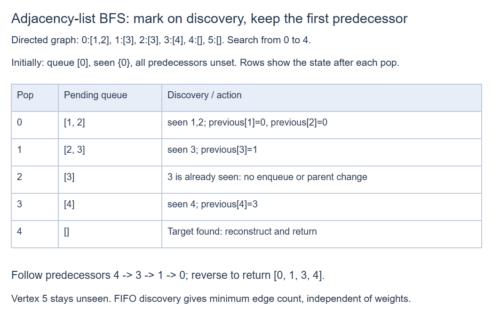

# Breadth-First Search with Adjacency Lists

Breadth-first search (BFS) finds a path with the fewest edges from a source to a target in an unweighted graph. Given an adjacency list and two valid vertex indices, these implementations return the path as a vertex sequence, or no result when the target is unreachable. A source equal to its target returns a one-vertex path.

## How it works

Vertices are indices from zero through `V - 1`, where `V` is the number of adjacency lists. Each `graph[u]` contains integer destinations, in exploration order. For example, `[[1, 2], [3], [3], [4], [], []]` represents edges `0 -> 1`, `0 -> 2`, `1 -> 3`, `2 -> 3` and `3 -> 4`, plus isolated vertex 5. This unweighted representation differs from the existing weighted-list routines, whose entries are `[destination, weight]` pairs. To use an undirected graph, store both directions of each edge.

Maintain a FIFO queue, a `seen` mark for each vertex and a `previous` predecessor initialized to -1. Mark the source and enqueue it. Remove the oldest vertex, stop if it is the target, and otherwise scan only that vertex's adjacency list. On first encountering an unseen neighbor, mark it immediately, save its predecessor and enqueue it. Marking at enqueue time prevents two pending vertices from discovering and enqueuing the same neighbor.

```c
seen[source] = true;
enqueue(queue, source);
while (!empty(queue)) {
    current = dequeue(queue);
    if (current == target) {
        path = [];
        while (current != -1) {
            append(path, current);
            current = previous[current];
        }
        reverse(path);
        return path;
    }
    for (neighbor in graph[current]) {
        if (!seen[neighbor]) {
            seen[neighbor] = true;
            previous[neighbor] = current;
            enqueue(queue, neighbor);
        }
    }
}
return NOT_FOUND;
```

Searching the example from 0 to 4 first turns queue `[0]` into `[1, 2]`. Processing 1 discovers 3, leaving `[2, 3]`. Processing 2 encounters the already-seen 3, so it leaves `[3]` and does not replace `previous[3] = 1`. Processing 3 discovers 4. When 4 is removed, follow predecessors `4 -> 3 -> 1 -> 0` and reverse to return `[0, 1, 3, 4]`. Vertex 5 remains unseen and would yield no path from 0.



The queue processes distance layers in order: all vertices discovered at distance `d` are removed before vertices at distance `d + 1`. A newly discovered neighbor therefore receives a predecessor on a shortest path. A later discovery cannot provide fewer edges, and keeping the first predecessor preserves that shortest path. The predecessor chain cannot cycle because each predecessor was discovered earlier. Neighbor order selects among equal-length paths; it does not change the minimum edge count. This routine does not minimize weighted costs.

## Costs and project code

Let `E` count stored adjacency entries, including duplicate entries. In an undirected graph, each ordinary edge contributes two entries. Every vertex is enqueued at most once and every scanned entry costs constant work, giving `O(V + E)` traversal time and `O(V)` auxiliary storage. Reconstructing a path of `P` vertices costs `O(P)` time and output storage, with `P <= V`; reversal occurs once, not through repeated front insertion.

All inputs are validated before traversal. Checking every row and destination takes `Θ(V + E)` time, including unreachable rows, so even an immediate source-target match does not bypass the full graph scan. The complete valid-input operation therefore has `Θ(V + E)` time, including initialization and validation. The graph itself uses `Θ(V + E)` input storage and is unchanged by the search.

Python uses `deque.popleft()`. Go and TypeScript use an append-only array with an advancing head index, so removal does not shift the pending suffix. Their queues retain previously processed entries until returning, still within `O(V)` memory. No implementation uses recursion. Cycles, duplicate edges and self-loops are safe because `seen` is checked before enqueuing.

Invalid destinations or source/target indices panic in Go, raise `ValueError` in Python and throw `RangeError` in TypeScript. Python rejects booleans as indices, and Python/TypeScript reject noninteger indices. An empty graph has no valid source and is rejected. Missing paths return Go `nil`, Python `None` or TypeScript `null`. Shared validation checks index bounds; callers supply the list-of-lists shape specified by the API.

Code: [Go](../../../implementation/graphs/bfs_adj_list/golang/solution.go), [Python](../../../implementation/graphs/bfs_adj_list/python/solution.py), [TypeScript](../../../implementation/graphs/bfs_adj_list/typescript/index.ts). Shared index validation: [Go](../../../implementation/graphs/adjacency_list/golang/solution.go), [Python](../../../implementation/graphs/adjacency_list/python/solution.py), [TypeScript](../../../implementation/graphs/adjacency_list/typescript/index.ts). Tests compare path lengths against all-pairs distances for all 512 directed graphs on three vertices, and check actual path edges, tie order, duplicate edges, preservation and invalid inputs: [Go tests](../../../implementation/graphs/bfs_adj_list/golang/solution_test.go), [Python tests](../../../implementation/graphs/bfs_adj_list/python/test_solution.py), [TypeScript tests](../../../implementation/graphs/bfs_adj_list/typescript/index.test.ts).
