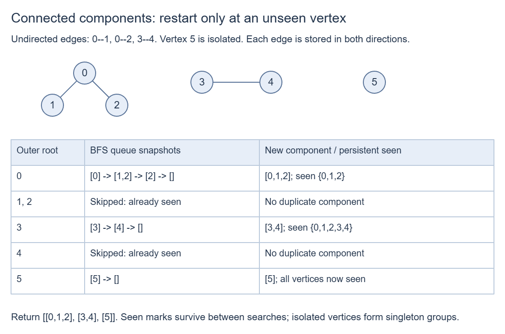

# Connected Components

A connected component of an undirected graph is a maximal group of vertices that can reach each other by following edges. Given an unweighted adjacency list, return a list of components containing every vertex exactly once. An isolated vertex forms its own component; an empty graph returns an empty list.

## How it works

The input contains one neighbor list per vertex, using integer indices. Each non-self undirected edge must appear in both directions, with matching multiplicity if parallel edges are present. The routines validate index bounds but do not enforce this reciprocal-edge precondition. Applying them to arbitrary directed input does not compute strongly connected components or a defined weak-component conversion.

Keep a `seen` array that survives between searches. Scan candidate roots in increasing index order. If a root is already seen, its component has been explored, so skip it. Otherwise mark it, start a BFS there, and collect all newly reached vertices into one component. Append that completed component and resume the outer scan at the next vertex.

```c
components = [];
seen = array(V, false);
for (root = 0; root < V; root++) {
    if (seen[root]) {
        continue;
    }
    seen[root] = true;
    queue = [root];
    component = [];
    while (!empty(queue)) {
        current = dequeue(queue);
        append(component, current);
        for (neighbor in graph[current]) {
            if (!seen[neighbor]) {
                seen[neighbor] = true;
                enqueue(queue, neighbor);
            }
        }
    }
    append(components, component);
}
return components;
```

For `[[1, 2], [0], [0], [4], [3], []]`, root 0 starts with queue `[0]`, discovers 1 and 2, and finishes component `[0, 1, 2]`. The outer scan skips roots 1 and 2 without resetting their marks. Root 3 discovers 4 and produces `[3, 4]`. Root 4 is skipped, and root 5 produces singleton `[5]`. Return `[[0, 1, 2], [3, 4], [5]]`.



Every vertex added to a component is reachable from its root, since it was discovered along an edge from another vertex in that search. If any reachable vertex were omitted, the first edge entering that omitted portion would have discovered it when its predecessor was processed. Thus one search finds the entire component. Undirected reachability is symmetric, so a completed component cannot overlap a later one or leave an edge into an unvisited component. Persistent marks make the groups disjoint, and scanning all roots makes them cover the graph.

## Costs and project code

Let `V` count vertices and `E` count adjacency entries, with both directions of each undirected edge included in `E`. Validation scans the whole input. Across all BFS runs, each vertex is enqueued once and each adjacency entry is examined once. Total time is `Θ(V + E)` for nonempty valid graphs, with constant overhead for an empty graph. The outer loop does not multiply this work by the number of components because it never restarts a search from a seen vertex.

The marks and work queue need `O(V)` auxiliary memory. The returned groups retain `Θ(V + C)` entries and list headers for `C` components, with `C <= V`. Python keeps a separate deque and appends vertices when removed. Go and TypeScript use the component array itself as the FIFO queue, advancing a head index; that same array becomes the group's output without another copy. These versions therefore also retain processed entries, already part of the result. None uses recursive calls or front-removing array shifts.

Roots are chosen by increasing index. Within a component, output follows BFS discovery order according to the given neighbor lists. The algorithm does not sort each component or promise increasing vertex order. Self-loops and parallel edges do not duplicate vertices because marking occurs when enqueuing. All versions preserve the input, allocate fresh marks and groups per call, and return an empty collection rather than a failure value for empty input.

Out-of-bounds destinations panic in Go, raise `ValueError` in Python and throw `RangeError` in TypeScript through shared validation. The undirected representation remains a caller precondition. See [adjacency-list BFS](../bfs_adj_list/Breadth%20First%20Search.md) for index validation and the queue's distance-layer invariant.

Code: [Go](../../../implementation/graphs/connected_components/golang/solution.go), [Python](../../../implementation/graphs/connected_components/python/solution.py), [TypeScript](../../../implementation/graphs/connected_components/typescript/index.ts). Tests enumerate every simple undirected graph on four vertices, compare component equivalence against transitive reachability, verify no missing or repeated vertex, and cover isolated vertices, duplicate edges, self-loops, empty inputs and preservation: [Go tests](../../../implementation/graphs/connected_components/golang/solution_test.go), [Python tests](../../../implementation/graphs/connected_components/python/test_solution.py), [TypeScript tests](../../../implementation/graphs/connected_components/typescript/index.test.ts).
