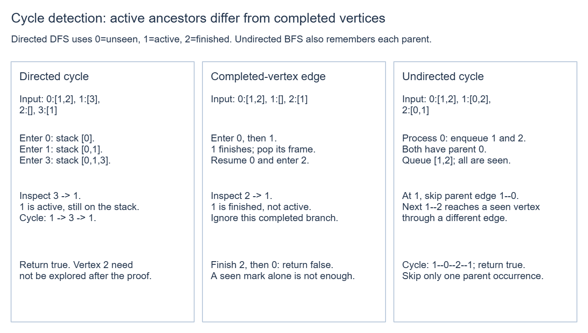

# Cycle Detection

Cycle detection decides whether a graph contains a closed path using at least one edge. The project provides separate boolean routines for directed and undirected adjacency lists. Directed edges must be followed in their given direction. Undirected input stores each ordinary edge in both directions, and the reverse entry of the same edge does not by itself form a cycle. Self-loops count as cycles; two parallel undirected edges count as a length-two cycle.

## How it works

For directed graphs, use depth-first search with three states: zero for unseen, one for active and two for finished. An explicit stack stores frames `(vertex, nextNeighborIndex)`. The index records where the caller resumes after a child finishes. Mark a newly entered vertex active. When its neighbor list ends, mark it finished and pop the frame. A finished vertex's outgoing edges have already been explored, so another edge into it need not expand them again.

```c
for (root = 0; root < V; root++) {
    if (color[root] != 0) {
        continue;
    }
    color[root] = 1;
    stack = [(root, 0)];
    while (!empty(stack)) {
        current = top(stack).vertex;
        index = top(stack).next;
        if (index == length(graph[current])) {
            color[current] = 2;
            pop(stack);
            continue;
        }
        neighbor = graph[current][index];
        top(stack).next++;
        if (color[neighbor] == 1) {
            return true;
        }
        if (color[neighbor] == 0) {
            color[neighbor] = 1;
            push(stack, (neighbor, 0));
        }
    }
}
return false;
```

In directed input `[[1, 2], [3], [], [1]]`, enter 0, then 1, then 3. The active vertices are `[0, 1, 3]`. Encountering `3 -> 1` reaches an active ancestor, proving cycle `1 -> 3 -> 1`. At that comparison the stored resume indices are `(0, 1)`, `(1, 1)` and `(3, 1)`. Returning true does not require exploring vertex 2.

In a separate acyclic input `[[1, 2], [], [1]]`, vertex 1 finishes before the root resumes and enters 2. Edge `2 -> 1` reaches a finished vertex, so it does not imply a cycle. A single permanent `seen` bit would conflate these two situations. For directed graphs, parallel edges in the same direction do not create a cycle without a return path.



For undirected graphs, BFS can use one permanent `seen` bit together with each queued vertex's parent. On first discovering a neighbor, mark it and enqueue `(neighbor, current)`. When examining a vertex's neighbors, skip exactly one occurrence of its parent, representing the same tree edge used to arrive. A different edge to an already-seen vertex proves a cycle. A second occurrence of the parent must not be skipped, since it represents a parallel edge.

```c
seen[root] = true;
queue = [(root, NONE)];
while (!empty(queue)) {
    current, parent = dequeue(queue);
    skippedParent = false;
    for (neighbor in graph[current]) {
        if (neighbor == parent && !skippedParent) {
            skippedParent = true;
            continue;
        }
        if (seen[neighbor]) {
            return true;
        }
        seen[neighbor] = true;
        enqueue(queue, (neighbor, current));
    }
}
```

This undirected loop also runs from every unseen root; the pseudocode shows one component's search. In triangle input `[[1, 2], [0, 2], [0, 1]]`, processing 0 discovers 1 and 2 with parent 0. Processing 1 skips edge `1--0`, then finds already-seen 2. The existing tree path `1--0--2` plus edge `2--1` closes the cycle. In a simple chain, each reverse parent entry is skipped and the routine returns false.

The directed stack always represents one active ancestor path. An edge back to that path closes a directed cycle. Conversely, a directed cycle cannot be fully marked finished without eventually examining an edge to an active vertex. For undirected search, discovery edges form a forest. Any seen-neighbor edge other than the arrival edge closes a path in that forest; without such an edge the explored component is a tree. Starting searches from all unseen vertices also checks cycles outside the first component.

## Costs and project code

Let `V` count vertices and `E` count adjacency entries, including duplicates and both directions in undirected input. Each vertex is entered once and each entry is considered at most once after validation, giving `O(V + E)` search time. Full graph validation itself takes `Θ(V + E)` on valid input, so the complete operation has that bound even when a cycle is found early. Empty graphs return false in constant time.

Both versions use `O(V)` auxiliary space and return one boolean. Directed DFS's explicit stack has at most one frame per active vertex, rather than one frame per edge. Its storage is counted even though the language's recursive call stack stays constant. Undirected BFS uses a deque in Python and append-only arrays with head indices in Go and TypeScript. All variants avoid recursion and front-removing array shifts, preserve the input and allocate fresh state on each call.

Index validation panics in Go and raises `ValueError`/`RangeError` in Python/TypeScript. For the undirected routine, matching reciprocal entries are a precondition, including parallel-edge multiplicity; validation does not check symmetry. Results for asymmetric input are not an undirected-cycle contract. Directed and undirected functions are deliberately separate because they interpret the same adjacency entries differently.

Code: both versions in [Go](../../../implementation/graphs/cycle_detection/golang/solution.go), [Python](../../../implementation/graphs/cycle_detection/python/solution.py), [TypeScript](../../../implementation/graphs/cycle_detection/typescript/index.ts). Tests compare all three-vertex directed graphs against positive-length transitive closure and all four-vertex simple undirected graphs against the forest edge-count criterion. Additional cases cover completed-vertex cross edges, loops, parallel edges, disconnected cycles, invalid indices and a 3,000-vertex chain that is then closed into a cycle: [Go tests](../../../implementation/graphs/cycle_detection/golang/solution_test.go), [Python tests](../../../implementation/graphs/cycle_detection/python/test_solution.py), [TypeScript tests](../../../implementation/graphs/cycle_detection/typescript/index.test.ts).
