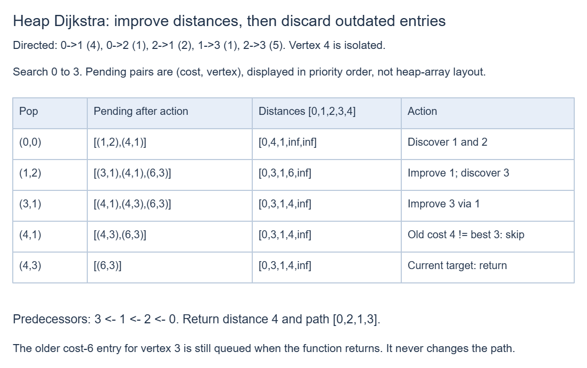

# Dijkstra with a Min Heap

Dijkstra's algorithm finds a minimum-total-weight path in a graph whose edge weights are nonnegative. Given a weighted adjacency list and source and target indices, this implementation returns the distance and one shortest path, or no result if the target is unreachable. The heap version keeps pending distance candidates in priority order rather than scanning every vertex for the next minimum.

## How it works

Each `graph[u]` contains pairs `[destination, weight]`. Vertices are indices from zero through `V - 1`, and weights are nonnegative integers. Zero-weight edges, parallel edges and self-loops are allowed. An undirected edge can be represented by storing both directions. Validation checks every pair and destination before starting, including edges unreachable from the source.

Maintain the best known distance and predecessor of each vertex. Only the source starts reached, at distance zero. Push `(0, source)` into the heap. Remove a minimum-cost entry. If its stored cost differs from the current best distance, discard it: a later relaxation already provided a better candidate. Otherwise, return if it is the target, or examine its outgoing edges and push each strict improvement.

```c
distance[source] = 0;
push(heap, (0, source));
while (!empty(heap)) {
    cost, current = popMinimum(heap);
    if (cost != distance[current]) {
        continue;
    }
    if (current == target) {
        return (cost, reconstruct(previous, target));
    }
    for (neighbor, weight in graph[current]) {
        candidate = cost + weight;
        if (distance[neighbor] == UNREACHED || candidate < distance[neighbor]) {
            distance[neighbor] = candidate;
            previous[neighbor] = current;
            push(heap, (candidate, neighbor));
        }
    }
}
return NOT_FOUND;
```

This is **lazy deletion**: improving a vertex pushes another entry and leaves the older one in the heap. It does not update an existing entry in place. Checking for staleness before checking the target prevents an obsolete entry from supplying a result. Relaxation uses strict improvement, so a zero-weight cycle does not generate endless equal-cost entries.

Use directed edges `0 -> 1` of weight 4, `0 -> 2` of weight 1, `2 -> 1` of weight 2, `1 -> 3` of weight 1 and `2 -> 3` of weight 5, plus isolated vertex 4. Search from 0 to 3. Processing 0 creates candidates `(1, 2)` and `(4, 1)`. Processing 2 improves vertex 1 to cost 3 and first reaches vertex 3 at cost 6. Processing `(3, 1)` improves 3 to cost 4. The older `(4, 1)` is then discarded because vertex 1's best cost is 3. Popping `(4, 3)` returns distance 4 and path `[0, 2, 1, 3]`.



Reconstruction follows predecessors from the target back to -1 and reverses once. The example follows `3 -> 1 -> 2 -> 0`. The old `(6, 3)` remains queued when the function returns. Searching for isolated vertex 4 instead drains all candidates and returns no result.

For correctness, a nonstale minimum entry has the smallest tentative distance among pending reachable vertices. If a shorter path to that vertex existed, consider the first unprocessed vertex along that path: its processed predecessor would already have supplied a candidate no larger than that path's total. Nonnegative remaining weights contradict selecting the current larger distance first. Thus the selected distance is final. Relaxation preserves the best discovered candidates, and a target may be returned only after its nonstale minimum entry is removed.

## Costs and project code

Let `V` count vertices and `E` count stored adjacency entries, including parallel entries. Validation and initialization cost `Θ(V + E)`. Each selected vertex scans its outgoing entries once, and each strict improvement adds one heap entry. There are at most `E + 1` pushes and pops, giving `O(V + E log(E + 1))` overall time, with constant overhead for tiny graphs. For simple graphs this is commonly written `O((V + E) log(V + 1))`. The explicit `E` logarithm also covers unrestricted parallel edges.

Distance and predecessor arrays need `O(V)` storage. Lazy entries can occupy `O(E + 1)` heap space, so total auxiliary storage is `O(V + E)`, rather than a guaranteed one-entry-per-vertex heap. A returned path has at most `V` vertices and requires linear reconstruction time and output space. All versions are iterative and preserve the graph. Full validation still occurs if source equals target; that valid case returns distance zero and path `[source]`.

Python uses `heapq` and returns `(distance, path)` or `None`. TypeScript returns `{ distance, path }` or `null`; its shared `MinQueue` is an array-backed binary heap. Go uses `container/heap` with a shared queue type and returns `*Result{Distance, Path}` or `nil`. Equal candidate costs are ordered by vertex index in all three versions. The Go/TypeScript queue also stores a third, parent field; Dijkstra always sets it to -1.

Malformed pairs, invalid indices and negative weights panic in Go or raise `ValueError`/`RangeError` in Python/TypeScript. Python rejects noninteger and boolean weights; TypeScript requires safe integers. Each candidate sum actually evaluated must also fit Go `int` or be a TypeScript safe integer, otherwise the run raises an error even if that candidate would not improve an existing distance. Python permits larger integers, whose bit-operation costs are outside the constant-time scalar model used above. Go tracks reachability separately from numeric distances, so even its largest `int` can be a valid reached distance.

Code: [Go](../../../implementation/graphs/dijkstra_heap/golang/solution.go), [Python](../../../implementation/graphs/dijkstra_heap/python/solution.py), [TypeScript](../../../implementation/graphs/dijkstra_heap/typescript/index.ts). Shared validation and queue code: [Go](../../../implementation/graphs/weighted_graph/golang/solution.go), [Python](../../../implementation/graphs/weighted_graph/python/solution.py), [TypeScript](../../../implementation/graphs/weighted_graph/typescript/index.ts). The [graph overview](../Graph.md) retains the earlier linear-selection Dijkstra for comparison. Tests compare all three-vertex directed graph shapes with Floyd–Warshall under nonnegative weights, verify returned path costs, and cover stale entries, zero cycles, parallel edges, integer limits, preservation and invalid inputs: [Go tests](../../../implementation/graphs/dijkstra_heap/golang/solution_test.go), [Python tests](../../../implementation/graphs/dijkstra_heap/python/test_solution.py), [TypeScript tests](../../../implementation/graphs/dijkstra_heap/typescript/index.test.ts).
