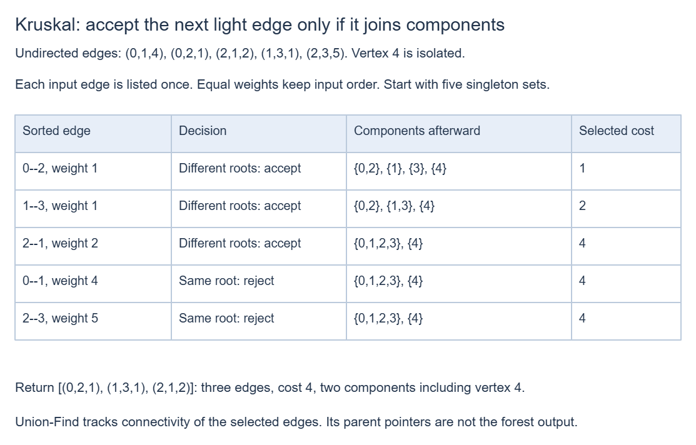

# Kruskal's Algorithm

Kruskal's algorithm finds a minimum spanning tree of a connected weighted undirected graph: an acyclic edge set connecting all vertices with minimum total weight. These implementations return a **minimum spanning forest**, so disconnected input receives one minimum tree per connected component. The input gives a vertex count and edges `(u, v, weight)`, each undirected edge listed once. The result is a list of selected edges, without a separately computed total cost.

## How it works

Validate the vertex count and endpoint indices, then sort a copy of the edge list by increasing weight. Use [Union-Find](../../union_find/Union%20Find.md) to track connectivity of the selected edges, initially with one component per vertex. For each sorted edge, union its endpoints. Accept and append the edge only if the union actually joins two previously separate components. Rejecting an edge whose endpoints already share a component prevents a cycle.

```c
sets = unionFind(vertexCount);
forest = [];
ordered = sortCopyByWeight(edges);
for (source, target, weight in ordered) {
    if (sets.union(source, target)) {
        append(forest, (source, target, weight));
        if (sets.componentCount == 1) {
            break;
        }
    }
}
return forest;
```

Consider vertices 0 through 4 and edges `(0,1,4)`, `(0,2,1)`, `(2,1,2)`, `(1,3,1)` and `(2,3,5)`, with vertex 4 isolated. Stable weight ordering gives `(0,2,1)`, `(1,3,1)`, `(2,1,2)`, `(0,1,4)`, `(2,3,5)`. Accepting the first two edges leaves components `{0,2}`, `{1,3}` and `{4}`. The weight-two edge joins the first two components. The final two edges connect vertices already in that combined component and are rejected. Return `[(0,2,1), (1,3,1), (2,1,2)]`, whose weights sum to four.



Union-Find's parent links are not the selected graph edges; record accepted edges separately. If all vertices become connected, the code can stop immediately after `V - 1` accepted edges. On disconnected input, it scans the remaining candidates and returns a forest. Isolated vertices are part of the original vertex universe but contribute no output edges.

The **cut property** justifies each accepted edge. Separate one current selected component from the others. Any edge crossing that cut with smaller weight would have been considered earlier and could not have been rejected as internal to a selected component that is still separate now. Thus the current edge is a lightest crossing choice. In any optimum extending the previously selected edges, adding this edge either leaves it unchanged or creates a cycle containing another crossing edge of no smaller weight. Exchanging that edge preserves connectivity and cannot increase cost. Repeating this argument proves the final forest is minimum, while successful unions guarantee it remains acyclic.

## Costs and project code

Let `V` count vertices, `E` count input edge records and `C` count input connected components, including isolates. Validation costs `O(E)` plus constant count checks; Union-Find initialization costs `Θ(V)`. Sorting costs `O(E log(E + 1))` under the comparison-sort model, followed by at most `E` amortized `O(α(V + 1))` union operations. Total time is `O(V + E log(E + 1) + E α(V + 1))`, usually dominated by sorting on ordinary nontrivial graph inputs. The empty graph has constant overhead.

The copied edge ordering and Union-Find arrays use `O(V + E)` auxiliary space. Output has exactly `V - C` edges. Negative and zero weights are valid, parallel edges remain separate candidates, and self-loops are rejected because their endpoints already share a representative. Distinct minimum forests can have the same total cost; these versions choose deterministically by preserving input order among equal weights.

Python uses stable `sorted` and TypeScript sorts a copied outer array. Go stores each copied edge with its original index and uses weight, then index, as the comparison for `sort.Slice`; this preserves equal-weight input order without relying on Go's stable-sort swap bound. TypeScript's time statement assumes the runtime's usual comparison-sort implementation. Every returned record is independent of mutable input edge records: Python creates tuples, TypeScript creates new triples and Go copies fixed-size arrays. Sorting and selection preserve the caller's input.

Go accepts `[][3]int`; Python accepts three-item integer records; TypeScript accepts readonly triples of safe integers. Invalid counts, endpoints, record lengths where applicable or noninteger weights panic in Go or raise `ValueError`/`RangeError` in Python/TypeScript. Signed integer weights are compared directly; the implementation never sums them, so callers computing a total must choose an appropriate numeric representation. Empty or edgeless inputs return an empty collection, not a failure result.

Code: [Go](../../../implementation/graphs/kruskal/golang/solution.go), [Python](../../../implementation/graphs/kruskal/python/solution.py), [TypeScript](../../../implementation/graphs/kruskal/typescript/index.ts). Tests enumerate candidate spanning forests for every simple graph on four vertices under a signed weight assignment, compare minimum total cost and reachability, and verify output edge multiplicity. They also cover ties, disconnected input, negative weights, loops, parallel edges, preservation, independent output records and validation: [Go tests](../../../implementation/graphs/kruskal/golang/solution_test.go), [Python tests](../../../implementation/graphs/kruskal/python/test_solution.py), [TypeScript tests](../../../implementation/graphs/kruskal/typescript/index.test.ts).
