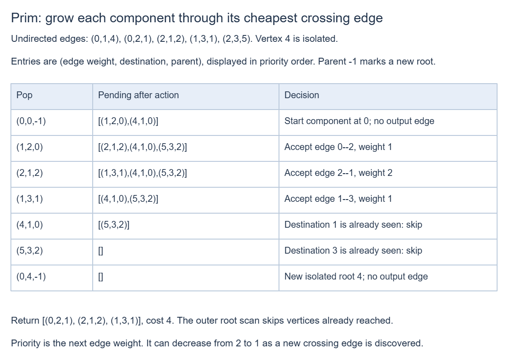

# Prim's Algorithm

Prim's algorithm grows a minimum spanning tree by repeatedly choosing the lightest edge connecting the current tree to an unseen vertex. These implementations accept an undirected edge list and return a minimum spanning forest, restarting at unseen roots when the graph is disconnected. The result contains selected `(source, target, weight)` edges; it does not return a path from a source or a summed cost.

## How it works

The input is a nonnegative vertex count and one record `(u, v, weight)` per undirected edge. Unlike adjacency-list input, the caller lists each edge once. Build two adjacency entries from every record, one in each direction. Weights may be negative, zero or positive. Validate all endpoints and weights before allocating traversal state.

Scan roots by increasing vertex index. For an unseen root, create a heap containing `(0, root, -1)`. This special parent value identifies a new component seed, not an input edge. Pop a minimum entry `(weight, current, parent)`. If the destination is already seen, discard the entry. Otherwise mark it, append its parent edge when it has a parent, and push outgoing edges to still-unseen neighbors.

```c
seen = array(vertexCount, false);
forest = [];
for (root = 0; root < vertexCount; root++) {
    if (seen[root]) {
        continue;
    }
    heap = [(0, root, NONE)];
    while (!empty(heap)) {
        weight, current, parent = popMinimum(heap);
        if (seen[current]) {
            continue;
        }
        seen[current] = true;
        if (parent != NONE) {
            append(forest, (parent, current, weight));
        }
        for (edgeWeight, neighbor in graph[current]) {
            if (!seen[neighbor]) {
                push(heap, (edgeWeight, neighbor, current));
            }
        }
    }
}
return forest;
```

Use vertices 0 through 4 and edges `(0,1,4)`, `(0,2,1)`, `(2,1,2)`, `(1,3,1)`, `(2,3,5)`, with isolated vertex 4. Starting at 0 queues edges to 2 at weight one and 1 at weight four. Select `0--2`, then `2--1` at weight two. Entering 1 reveals `1--3` at weight one, which is selected next. The remaining entries to vertices 1 and 3 are discarded because both destinations are already seen. The outer scan later seeds isolated root 4 without adding an edge.



The result is `[(0,2,1), (2,1,2), (1,3,1)]`, with total weight four. The next selected priority decreases from two to one because it represents an individual crossing edge, not an accumulated distance from the root. This distinction is why Prim can use negative weights while Dijkstra requires nonnegative weights.

For correctness, the visited set in a component forms a connected tree. Heap entries come from its outgoing edges, so a nonstale minimum entry selects a lightest edge crossing from that tree to an unseen vertex. Adding it cannot create a cycle. By the cut property, it can replace an edge crossing the same cut in some minimum spanning tree without increasing cost. Thus each growth step extends an optimum. Stale entries connect two already-seen vertices and can be discarded. When the queue empties, the component is fully spanned; restarting handles the remaining components.

## Costs and project code

Let `V` count vertices and `E` count undirected input records, including parallel edges and self-loops. Validation and adjacency construction take `Θ(V + E)` time. Every vertex is visited once. Each non-self edge can enter the heap when its first endpoint is processed and the other is still unseen; it is not pushed again from the second endpoint. There are `O(E)` real edge entries plus one seed per component, giving `O(V + E log(E + 1))` total time. For simple graphs this is commonly bounded by `O((V + E) log(V + 1))`; the edge-based logarithm also covers multigraphs.

The constructed adjacency lists use `O(V + E)` auxiliary storage, in addition to `O(V)` marks and up to `O(E + 1)` queued entries. Lazy entries can include multiple edges toward the same vertex, so the heap is not bounded by one entry per vertex. The returned forest has `V - C` edges for `C` connected components, including isolated vertices. All versions are iterative. Python uses `heapq`; Go and TypeScript share the weighted priority-queue support used by [heap Dijkstra](../dijkstra_heap/Heap%20Dijkstra.md).

Equal heap priorities compare destination, then parent index. A fixed vertex universe and edge list therefore produce deterministic tie choices, although another minimum spanning forest may use different equal-weight edges. A selected edge's orientation follows tree growth and may reverse its input endpoints. Returned records are new tuples or arrays, so mutating a result in TypeScript or Go does not change the input. The caller's edge list is preserved.

Self-loops never reach an unseen destination and are ignored. Parallel edges compete normally. Empty and edgeless graphs return empty collections, retaining isolated vertices only through the original vertex universe. Go accepts `[][3]int`, Python three-item integer records and TypeScript readonly safe-integer triples. Invalid counts, endpoints, weights or record lengths where applicable panic in Go or raise `ValueError`/`RangeError` in Python/TypeScript. The routine never sums weights; a caller calculating total cost must account for its numeric range.

Code: [Go](../../../implementation/graphs/prim/golang/solution.go), [Python](../../../implementation/graphs/prim/python/solution.py), [TypeScript](../../../implementation/graphs/prim/typescript/index.ts). Tests compare the result against exhaustive spanning-forest enumeration, checking cost, component reachability, edge count and membership. They also cover disconnected input, negative weights, ties, parallel edges, self-loops, invalid inputs, preservation and output independence: [Go tests](../../../implementation/graphs/prim/golang/solution_test.go), [Python tests](../../../implementation/graphs/prim/python/test_solution.py), [TypeScript tests](../../../implementation/graphs/prim/typescript/index.test.ts).
