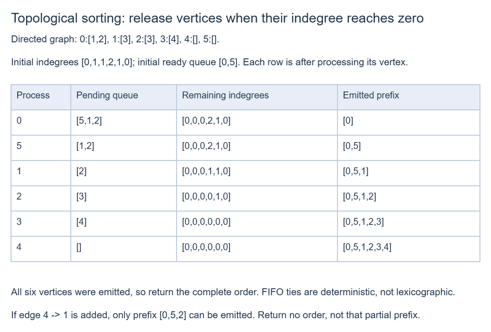

# Topological Sort

A topological ordering lists every vertex of a directed graph so that each edge `u -> v` places `u` before `v`. Such an ordering exists exactly when the graph is acyclic. Given an unweighted adjacency list, these implementations return a complete ordering or no result if a directed cycle prevents one. The empty graph has the valid empty ordering.

## How it works

Kahn's algorithm maintains each vertex's **indegree**, the number of incoming adjacency entries from vertices not yet processed. Initialize counts by scanning all outgoing entries. Enqueue every zero-indegree vertex in increasing index order. Repeatedly remove the oldest ready vertex, append it to the emitted order, and decrement its outgoing neighbors' indegrees. A neighbor joins the queue exactly when its count reaches zero.

```c
indegree = array(V, 0);
for (current = 0; current < V; current++) {
    for (neighbor in graph[current]) {
        indegree[neighbor]++;
    }
}
for (vertex = 0; vertex < V; vertex++) {
    if (indegree[vertex] == 0) {
        enqueue(queue, vertex);
    }
}
order = [];
while (!empty(queue)) {
    current = dequeue(queue);
    append(order, current);
    for (neighbor in graph[current]) {
        indegree[neighbor]--;
        if (indegree[neighbor] == 0) {
            enqueue(queue, neighbor);
        }
    }
}
if (length(order) != V) {
    return NOT_FOUND;
}
return order;
```

For input `[[1, 2], [3], [3], [4], [], []]`, the initial indegrees are `[0, 1, 1, 2, 1, 0]` and the ready queue is `[0, 5]`. Processing 0 releases 1 and 2, giving `[5, 1, 2]`. Processing isolated 5 removes no edges. Processing 1 reduces vertex 3's count from two to one, so 3 must wait. Processing 2 reduces it to zero and enqueues 3. Vertex 3 then releases 4. Return `[0, 5, 1, 2, 3, 4]` after all six vertices have been emitted.



The invariant is that `indegree[v]` counts the remaining incoming entries from unprocessed vertices. Removing one processed vertex's outgoing entries preserves that count. A zero-indegree vertex has no unprocessed prerequisite, so appending it cannot violate an edge constraint. A nonempty acyclic remaining graph always has such a vertex: otherwise following incoming edges indefinitely in a finite graph would revisit a vertex and expose a cycle. Thus all vertices are emitted on a DAG.

If the queue empties early, every remaining vertex still has an incoming entry from the remaining graph, which must contain a cycle. For example, adding `4 -> 1` to the example leaves only prefix `[0, 5, 2]` processable. Vertices 1, 3 and 4 block each other, so the routine rejects the prefix and returns no ordering. The number of unprocessed vertices may also include vertices downstream from a cycle; it is not necessarily the cycle's size.

## Costs and project code

Let `V` count vertices and `E` count directed adjacency entries. Validation, indegree construction and processing together take `Θ(V + E)` time for nonempty valid graphs. Each entry is counted and later decremented once. Every vertex is enqueued at most once because a count reaches zero only once. The empty graph takes constant overhead and returns an empty collection.

Indegrees and queue storage use `O(V)` auxiliary space, and the returned order contains `Θ(V)` entries when successful. Python uses a separate deque and emitted list. Go and TypeScript append ready vertices directly to the order array and process it with an advancing head index, so that array acts as both queue and eventual output. Pending entries are not yet processed, but on success the whole array is a valid ordering. On failure it is discarded rather than returned. No implementation shifts the front of an array or uses recursion.

The initial queue uses increasing indices, and later queue additions follow the supplied adjacency order. This makes the result deterministic for a fixed representation, but does not guarantee the lexicographically smallest valid ordering. Disconnected DAG components and isolated vertices are included. Parallel directed entries increment the count separately and are decremented separately, so they do not falsely block a DAG. A self-loop prevents its vertex from becoming ready and correctly causes failure.

Malformed indices panic in Go, raise `ValueError` in Python and throw `RangeError` in TypeScript. The input is preserved; indegrees live in a fresh array. Cyclic inputs return Go `nil`, Python `None` or TypeScript `null`. Empty inputs return empty collections, with a non-nil empty slice in Go, keeping the failure case distinct.

Code: [Go](../../../implementation/graphs/topological_sort/golang/solution.go), [Python](../../../implementation/graphs/topological_sort/python/solution.py), [TypeScript](../../../implementation/graphs/topological_sort/typescript/index.ts). Tests enumerate all directed graphs on three vertices and check existence against every permutation, then validate every returned edge constraint. They also cover FIFO ties, parallel entries, isolated vertices, empty input, invalid indices and a cycle reached after a nonempty prefix: [Go tests](../../../implementation/graphs/topological_sort/golang/solution_test.go), [Python tests](../../../implementation/graphs/topological_sort/python/test_solution.py), [TypeScript tests](../../../implementation/graphs/topological_sort/typescript/index.test.ts).
