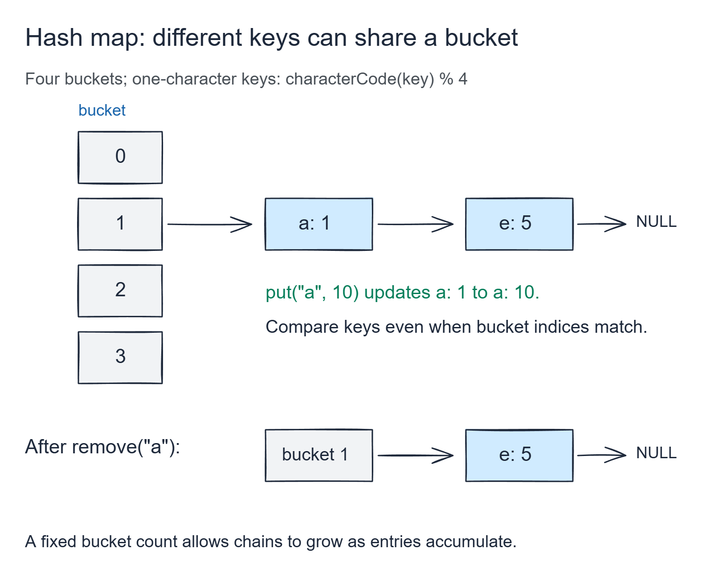
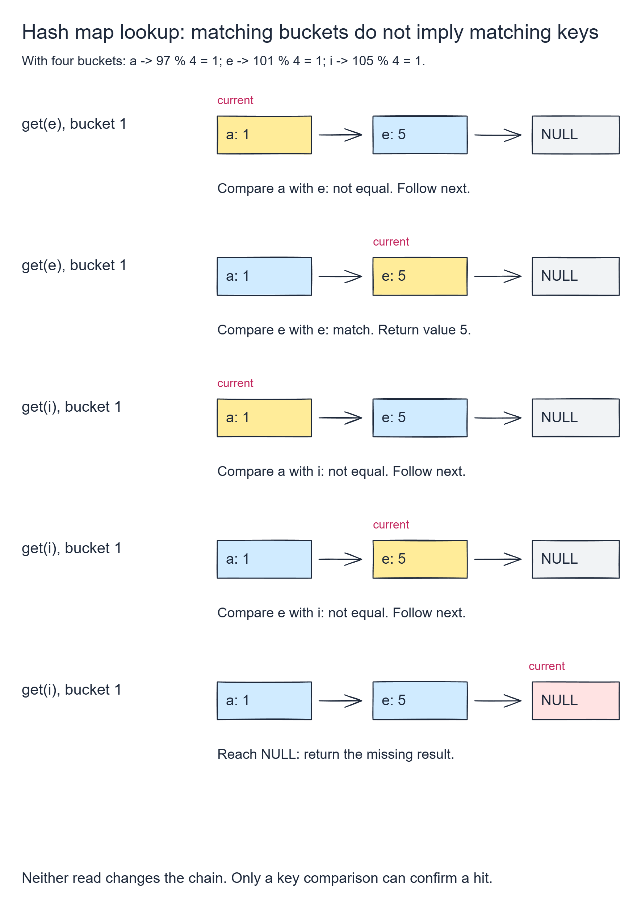

# Hash Map

A hash map is a key-value data structure that uses a hash function to choose a bucket for each key. A bucket is a position in a backing array. Looking up a key starts by computing its bucket, then checking the entries stored there. Updating an existing key replaces its value without adding another entry for that key.

Different keys can choose the same bucket, which is a **collision**. This project handles collisions with separate chaining: each bucket points to a linked list of entries. With four buckets and `hash(key) = characterCode(key) % 4` for one-character keys, both `"a"` and `"e"` choose bucket `1`. You still compare the stored keys to distinguish them.



## Hash, compare and change a chain

To get `"e"`, compute bucket `1`, compare against `"a"`, then follow `next` to `"e"`. An empty bucket or the end of the chain means the key is absent.



The two reads inspect the same bucket. `get("e")` rejects `"a"`, follows its link, then returns the value at `"e"`. The missing key `"i"` also hashes to bucket 1, but fails both key comparisons and reaches `NULL`. Reading the bucket alone cannot distinguish either outcome. The pseudocode uses `NOT_FOUND` as a separate missing result, so a stored value can be distinguished from a miss.

```c
get(map, key) {
    index = hash(key) % map.bucketCount;
    node = map.buckets[index];
    while (node != NULL) {
        if (node.key == key) {
            return node.value;
        }
        node = node.next;
    }
    return NOT_FOUND;
}

put(map, key, value) {
    index = hash(key) % map.bucketCount;
    previous = NULL;
    node = map.buckets[index];
    while (node != NULL) {
        if (node.key == key) {
            node.value = value;
            return;
        }
        previous = node;
        node = node.next;
    }

    entry = createEntry(key, value, NULL);
    if (previous == NULL) {
        map.buckets[index] = entry;
    } else {
        previous.next = entry;
    }
}
```

Here, `hash` returns a nonnegative integer and `createEntry` creates a node with `key`, `value` and `next`. In the diagram, updating `"a"` to `10` changes its value without changing the chain. To remove `"a"`, change the bucket's head to `"a".next`. For a later node, link its predecessor to its successor. You must keep the rest of the chain reachable.

For string keys, compute the hash from the characters. The project uses a rolling calculation based on `31 * hash + characterCode`, wraps the result to 32 bits, then maps it to a bucket. This function supports bucket selection; it provides no cryptographic security. The language versions use their own string representations, so Unicode bucket indices need not match across languages.

## Costs and project code

Let `n` be the number of entries and `m` the number of buckets. The **load factor** is `n / m`. With well-distributed hashes, it describes the average chain length. The bucket costs below treat hashing and key comparison as constant-time operations.

| Operation | Expected cost | Worst case |
| --- | --- | --- |
| Get, put or remove | `O(1 + n / m)` | `O(n)` if entries share a bucket |
| Traverse the map | `O(m + n)` | Visit buckets and entries |
| Store buckets and entries | `O(m + n)` space | Includes next references |

For a key of length `L`, hashing takes `O(L)` work, and comparing keys can also depend on their length. Expected `O(1)` lookup assumes bounded key costs and a bounded load factor. A growing hash table can allocate more buckets and rehash entries to maintain that factor.

The custom maps in this repository keep a fixed positive bucket count and do not rehash. Adding entries can therefore increase chain lengths and lookup time. Python and TypeScript return `None` or `undefined` for a miss, which can be ambiguous if you store that value. Go returns a value and a boolean indicating whether the key exists.

Use a hash map to associate identifiers with values or track counts, such as character frequencies. Ordered iteration and range queries require an additional ordering scheme.

Code: [Go](../../implementation/hashmaps/golang/solution.go), [Python](../../implementation/hashmaps/python/solution.py) and [TypeScript](../../implementation/hashmaps/typescript/index.ts).
