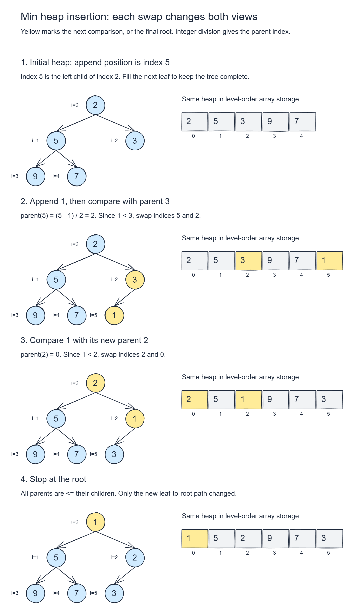
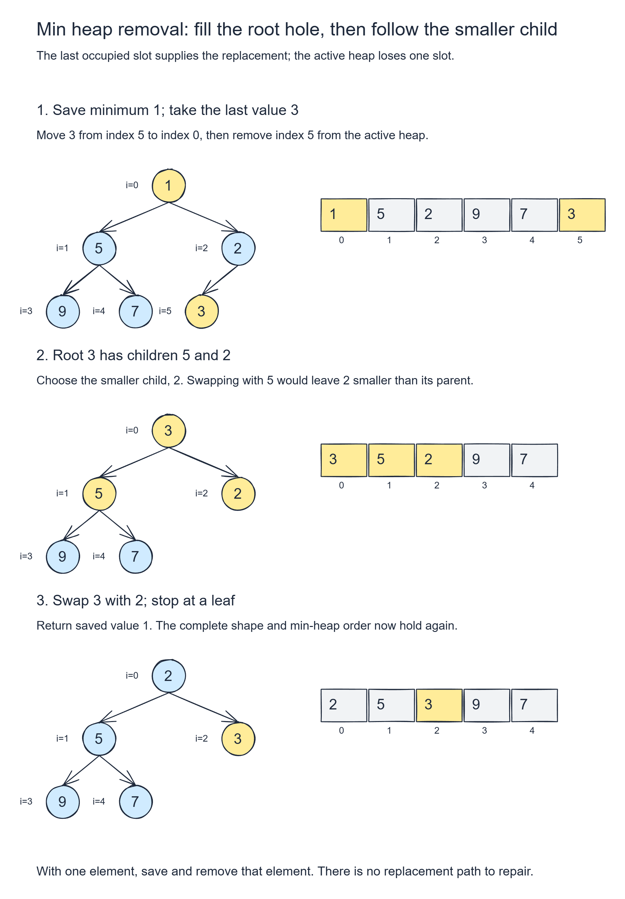

# Binary Min Heap

A binary min heap is a complete binary tree in which each parent's value is less than or equal to its children's values. Complete means that levels fill from left to right, with gaps allowed only after the last node on the final level. These rules put a minimum value at the root and keep the height proportional to `log n` for `n` elements.

The project stores the tree in an array. For a node at index `i`, its children are at `2 * i + 1` and `2 * i + 2`; its parent is at `(i - 1) / 2` using integer division. The array `[2, 5, 3, 9, 7]` represents a root `2`, children `5` and `3`, and children `9` and `7` under `5`. Siblings have no required order.



Each panel keeps node indices aligned with the array. Appending at index 5 creates the left child of index 2. The two following exchanges move `1` from index 5 to 2, then to 0. The tree keeps the same shape while those values change places.

## Restore order along one path

To insert `1`, append it at the next free leaf. Its parent is `3`, so swap them. Its new parent is `2`, so swap again. Stop at the root or a parent no larger than the new value. Appending preserves the complete shape; these upward swaps restore the heap property.

```c
insert(heap, value) {
    i = heap.size;
    heap.data[i] = value;
    heap.size++;

    while (i > 0) {
        parent = (i - 1) / 2;
        if (heap.data[parent] <= heap.data[i]) {
            break;
        }
        swap(heap.data[parent], heap.data[i]);
        i = parent;
    }
}
```

To remove the minimum, save the root and move the last value to index `0`. Decrease the size, then swap the replacement with its smaller child while it exceeds that child. Choosing the smaller child keeps the new parent no larger than either child. Only the replacement's downward path needs repair.



After the insertion example, removing `1` moves the last value, `3`, to the root and drops the last leaf. Compare both children before swapping: choose `2` rather than `5`. The exchange restores root order and places `3` at a leaf, ending the repair. Removing the final array slot preserves the complete-tree shape; removing an arbitrary interior leaf would leave a gap.

```c
removeMin(heap) {
    if (heap.size == 0) {
        error("Heap is empty");
    }
    minimum = heap.data[0];
    heap.size--;
    heap.data[0] = heap.data[heap.size];
    i = 0;

    while (2 * i + 1 < heap.size) {
        child = 2 * i + 1;
        if (child + 1 < heap.size && heap.data[child + 1] < heap.data[child]) {
            child++;
        }
        if (heap.data[i] <= heap.data[child]) {
            break;
        }
        swap(heap.data[i], heap.data[child]);
        i = child;
    }
    return minimum;
}
```

The pseudocode assumes enough backing capacity for insertion. Positions at or beyond `size` lie outside the heap. `swap` exchanges two slots, and `error(...)` stops the operation with a failure. A one-element removal leaves an empty heap and needs no downward swaps. Reversing the comparison rule gives a max heap with a maximum at the root.

## Costs and project code

| Operation | Cost | Reason |
| --- | --- | --- |
| Read the minimum of a nonempty heap | `O(1)` | Read the root |
| Repair after insertion or root removal | `O(log n)` | Follow one tree path |
| Find an arbitrary value | `O(n)` worst case | Heap order does not identify a single search branch |
| Build a heap bottom-up from an array | `O(n)` | Most nodes need little or no downward repair |

Calling insertion `n` times instead costs `O(n log n)` in the worst case. A conventional array-backed heap uses `O(n)` storage. An append can also resize its backing array, so its allocation cost must be accounted for; array append is amortized constant-time.

The project calls minimum removal `delete`, not removal by an arbitrary index. Go and Python return `(0, false)` for an empty heap; TypeScript throws. Python's implementation copies a slice after removal, adding `O(n)` time and temporary space to that operation. The implementations also use recursive heap repair, which takes up to `O(log n)` call-stack space. The iterative pseudocode above avoids that recursion. TypeScript keeps backing slots beyond the logical length until the heap empties.

Use a min heap when you need repeated access to the smallest available item, such as a task with the earliest deadline. The priority queue used by an optimized Dijkstra implementation is another example; the current Dijkstra code in this repository selects vertices by scanning instead.

Code: [Go](../../implementation/heap/golang/solution.go), [Python](../../implementation/heap/python/solution.py) and [TypeScript](../../implementation/heap/typescript/index.ts).
