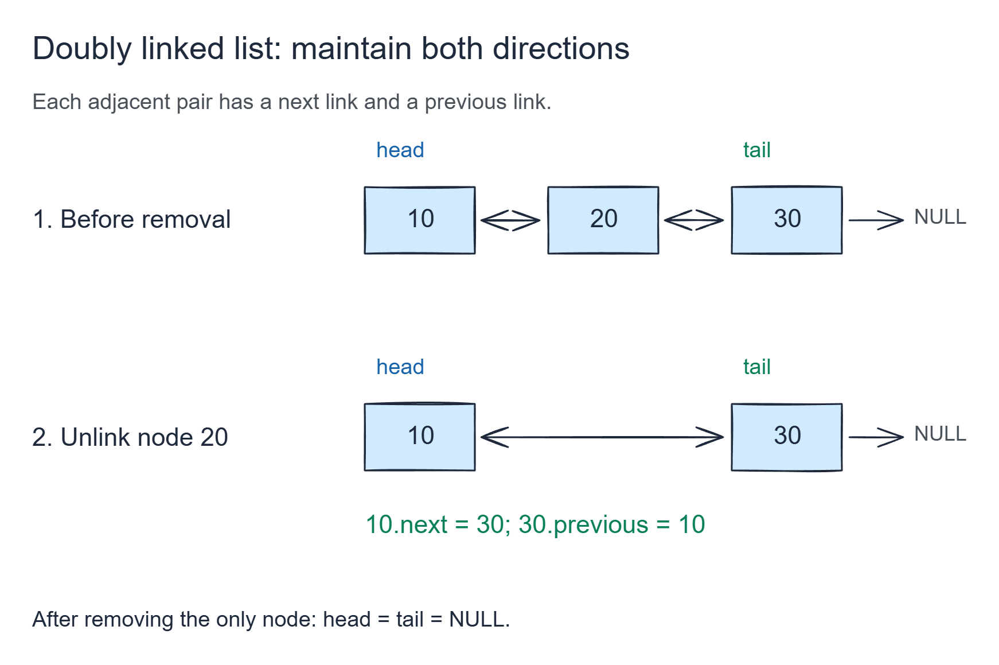
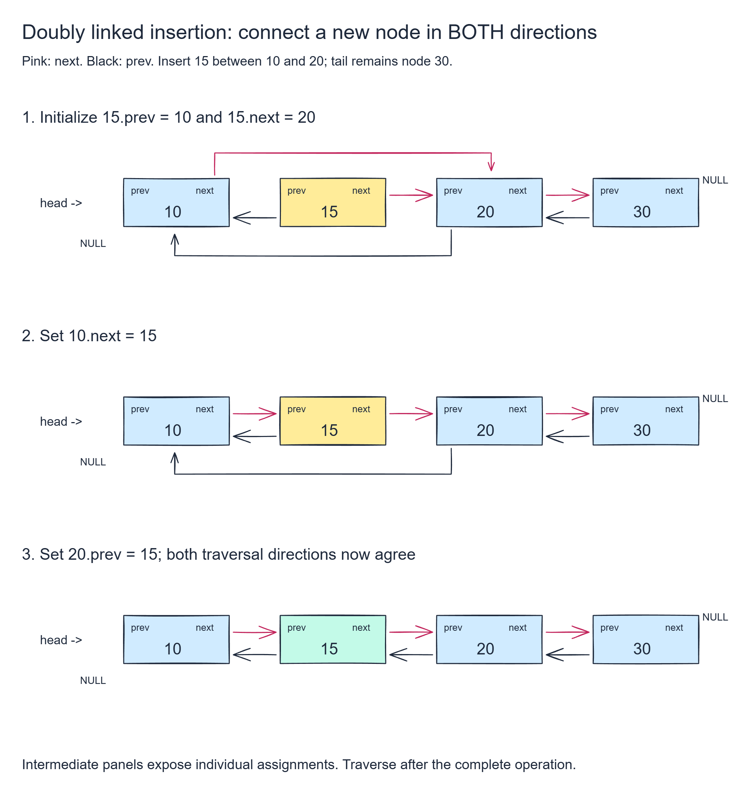
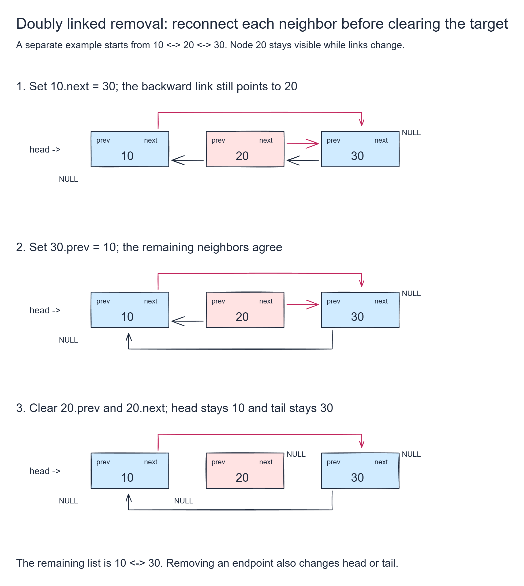

# Doubly Linked List

A doubly linked list is a sequence of nodes with references in both directions. Each node stores a value, a `previous` reference and a `next` reference. A `head` reference identifies the first node and a `tail` reference identifies the last. The head has no predecessor, and the tail has no successor.

In `10 <-> 20 <-> 30`, the node containing `20` points back to `10` and forward to `30`. You can traverse in either direction. With both endpoints stored, you can insert at the head or tail without searching for either end.



## Keeping both directions consistent

For adjacent nodes `a` and `b`, keep `a.next = b` and `b.previous = a`. To insert a node between them, give the new node references to both neighbors and update both neighbors to reference it. Updating one direction alone leaves a broken backward or forward traversal.



To insert `15` between `10` and `20`, give it both neighboring references, set `10.next = 15`, then set `20.previous = 15`. These are stages inside one operation. Only after both neighbors point to the new node do forward and backward traversal agree.

```c
append(list, value) {
    node = createNode(value, list.tail, NULL);
    if (list.tail == NULL) {
        list.head = node;
    } else {
        list.tail.next = node;
    }
    list.tail = node;
}

unlink(list, node) {
    if (node.previous == NULL) {
        list.head = node.next;
    } else {
        node.previous.next = node.next;
    }

    if (node.next == NULL) {
        list.tail = node.previous;
    } else {
        node.next.previous = node.previous;
    }

    node.previous = NULL;
    node.next = NULL;
}
```

Here, `createNode(value, previous, next)` creates those fields. `unlink` assumes that its node belongs to this list. To remove `20` in the diagram, connect `10.next` to `30` and `30.previous` to `10`.



Changing `10.next` alone makes forward traversal skip `20`, but backward traversal from `30` still reaches it. Update `30.previous` too, then clear the removed node's links. The diagram keeps node identities fixed so you can follow each reference change. No values shift between nodes. Removing the head updates `head`; removing the tail updates `tail`. Removing the only node sets both endpoints to `NULL`. With manual memory management, release an unlinked node after saving any value you need.

Deleting by value includes another step: traverse from the head to find the node, then call `unlink`. Inserting at a numeric position also requires traversal, unless the position is an endpoint. The backward reference makes unlinking a known node constant-time; it does not supply indexed access.

## Costs and project code

For `n` nodes:

| Operation | Cost | Condition |
| --- | --- | --- |
| Insert or remove at either endpoint | `O(1)` | Head and tail are stored |
| Unlink a known node | `O(1)` | The node belongs to the list |
| Insert next to a known node | `O(1)` | Both neighboring links are available |
| Find an index or value, or delete by value | `O(n)` worst case | Traversal to locate the node |

The nodes take `O(n)` space with two references per node. Use a doubly linked list when you need movement in both directions or frequent removal of nodes you can locate through another structure. An LRU cache uses that combination to move recently accessed entries to the head.

The repository's `delete`/`Delete` methods receive a value and search for it before unlinking, so their worst-case cost is `O(n)`. Their endpoint insertion methods avoid that search. The implementations also provide insertion at a position; Go and Python include sorted insertion.

Code: [Go](../../../implementation/linked_list/doubly/golang/solution.go), [Python](../../../implementation/linked_list/doubly/python/solution.py) and [TypeScript](../../../implementation/linked_list/doubly/typescript/index.ts).
