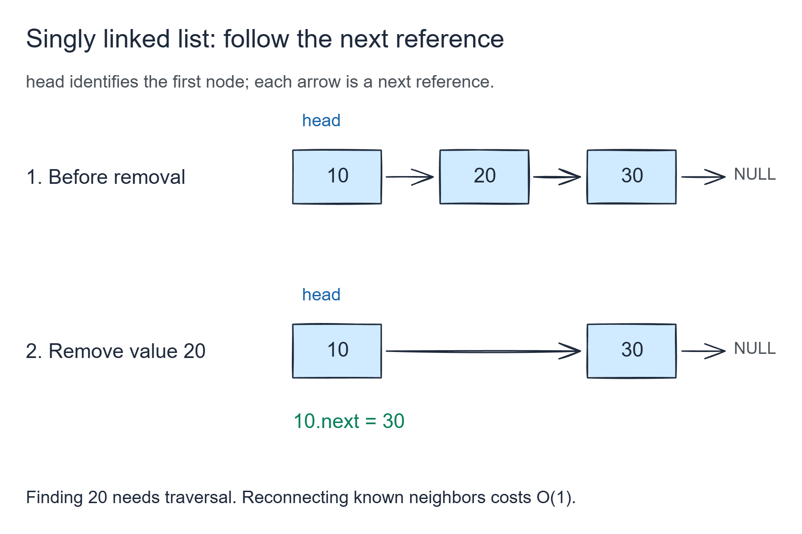
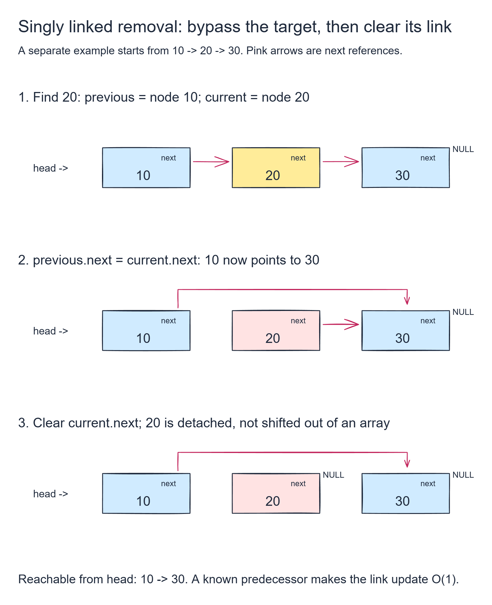
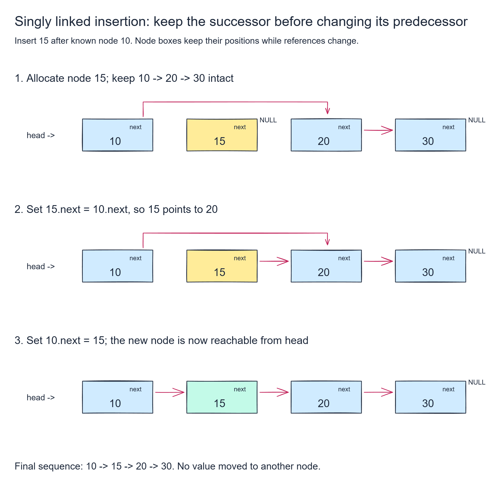

# Singly Linked List

A singly linked list is a sequence of nodes in which each node stores a value and a reference to the next node. A `head` reference identifies the first node, and the last node points to `NULL`. An empty list has `head = NULL`. Nodes can occupy separate memory locations; their links determine the sequence.

In `10 -> 20 -> 30 -> NULL`, following `head.next` reaches `20`. Reaching index `2` requires following two links. The list stores no address formula for jumping to an index as an array does.



## Following and changing links

To insert `5` at the head, create a node pointing to the old head, then update `head`. Keeping the old head as the new node's `next` preserves the remaining list. In the pseudocode, `createNode(value, next)` creates those two fields, and `error(...)` stops the operation with a failure.

```c
prepend(list, value) {
    node = createNode(value, list.head);
    list.head = node;
}

find(list, target) {
    current = list.head;
    while (current != NULL) {
        if (current.value == target) {
            return current;
        }
        current = current.next;
    }
    return NULL;
}
```

To remove `20`, find its node and keep a reference to its predecessor, `10`. Set `10.next` to `20.next`, which points to `30`. The remaining sequence is `10 -> 30 -> NULL`. You change a link without shifting the other values.



The intermediate state still contains node `20`, but the head no longer reaches it. Save its successor before clearing links or releasing the node. Nodes `10` and `30` keep their values and identities.

```c
remove(list, target) {
    previous = NULL;
    current = list.head;

    while (current != NULL && current.value != target) {
        previous = current;
        current = current.next;
    }
    if (current == NULL) {
        error("Value not found");
    }

    if (previous == NULL) {
        list.head = current.next;
    } else {
        previous.next = current.next;
    }
    current.next = NULL;
}
```

Removing the head updates `head`; removing the last node sets its predecessor's `next` to `NULL`. With manual memory management, release the removed node after saving any return value. Inserting after a known node also takes a link update: point the new node to the old successor before linking the predecessor to the new node.



For an insertion of `15` after `10`, first set `15.next` to the old successor `20`. Then set `10.next` to `15`. Reversing those assignments without keeping the old successor would lose the reference needed to reach the remainder of the list.

Appending requires finding the last node unless you keep a `tail` reference. To insert into a sorted list, walk until the next value belongs after the new value, then splice the node into that position. You must find that position even though the link changes take constant time.

## Costs and project code

For `n` nodes:

| Operation | Cost | Condition |
| --- | --- | --- |
| Prepend or remove the head | `O(1)` | The head is known |
| Insert after a node or unlink its successor | `O(1)` | The predecessor is known |
| Append | `O(n)` here | These implementations do not keep a tail |
| Access by index, search or remove by value | `O(n)` worst case | Follow links to locate the node |
| Insert in sorted order | `O(n)` worst case | Find the insertion point |

The nodes take `O(n)` space, including one next reference per node. A singly linked list suits operations near a known predecessor or at the head. Indexed access requires traversal, and allocating nodes can cost more memory and reduce locality compared with an array.

The project implementations search from the head when deleting by value. Go and Python also implement sorted insertion. The TypeScript version tracks `length`; the Go and Python versions shown here do not store a size counter. Check the source before assuming that reading a stored size or appending has constant cost.

Code: [Go](../../../implementation/linked_list/singly/golang/solution.go), [Python](../../../implementation/linked_list/singly/python/solution.py) and [TypeScript](../../../implementation/linked_list/singly/typescript/index.ts).
