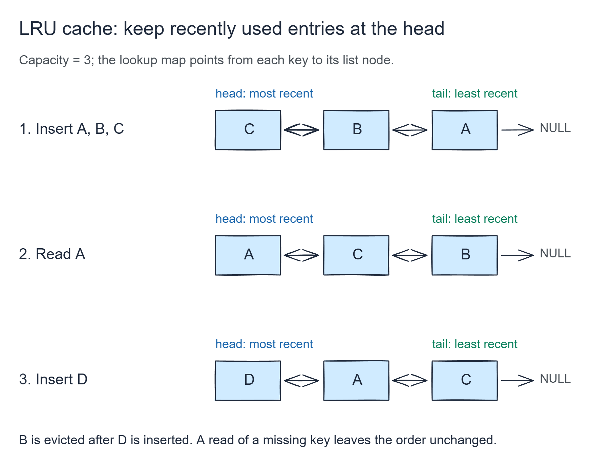

# LRU Cache

An LRU cache is a capacity-limited key-value store that evicts the **least recently used** entry when a new entry exceeds its capacity. A successful read counts as use, as does inserting or updating a value. The cache therefore needs both lookup by key and an ordering of entries by recency.

Combine a hash map from keys to nodes with a doubly linked list. Keep the most recently used entry at the head and the least recently used at the tail. The map locates a node without a list search; the node's two links let you move it or unlink it without searching for its predecessor.



## Find a node, then move it

With capacity `3`, insert `A`, `B` and `C`. The order from most to least recent is `C, B, A`. Reading `A` changes the order to `A, C, B`. Inserting `D` then evicts `B`, leaving `D, A, C`. The eviction follows recency, not key order or the age of the value.

```c
get(cache, key) {
    node = cache.lookup.get(key);
    if (node == NOT_FOUND) {
        return NOT_FOUND;
    }
    detach(cache, node);
    prepend(cache, node);
    return node.value;
}

put(cache, key, value) {
    node = cache.lookup.get(key);
    if (node != NOT_FOUND) {
        node.value = value;
        detach(cache, node);
        prepend(cache, node);
        return;
    }

    node = createNode(key, value);
    cache.lookup.put(key, node);
    prepend(cache, node);
    cache.size++;

    if (cache.size > cache.capacity) {
        oldest = cache.tail;
        detach(cache, oldest);
        cache.lookup.remove(oldest.key);
        cache.size--;
    }
}
```

This pseudocode stores the key in each node and uses `NOT_FOUND` as a distinct missing result. `detach` reconnects the node's neighbors, updates the head or tail when necessary and clears its links. `prepend` links the node before the current head and sets both endpoints when the list is empty. Detaching and prepending an existing node leave the cache size unchanged.

A miss leaves the order unchanged. Updating a key changes its value and moves it to the head without creating another entry. Capacity `1` follows the same rule: inserting a different key evicts the previous key. Require a positive capacity for this implementation.

## Costs and project code

| Operation | Expected cost | Required work |
| --- | --- | --- |
| Read or update a key | `O(1)` | Map lookup and a fixed number of link updates |
| Insert with eviction | `O(1)` | Map insertion, head insertion and tail removal |
| Store entries | `O(c)` space | At most capacity `c`, plus a transient new entry |

The expected time assumes bounded key costs and the usual average constant-time behavior of the backing maps. Collisions or costly hashing can increase lookup time. The recency list itself needs no scan.

In the project, nodes store values without keys. A second map from node to key lets eviction find the key to remove from the lookup map. These reverse-map entries must stay consistent with the list and primary map. The source calls insertion or update `update`/`Update`; its built-in maps are separate from this repository's custom hash map.

Use LRU when recent access is a useful guide to future reuse, such as caching repeated query results. A stream of distinct keys can evict useful entries, and LRU alone supplies no expiration time. A cached value also needs a policy for invalidation if its source changes.

Related notes: [hash map](../hashmaps/Hash%20Map.md) and [doubly linked list](../linked_list/doubly/Doubly%20Linked%20List.md).

Code: [Go](../../implementation/lru_cache/golang/solution.go), [Python](../../implementation/lru_cache/python/solution.py) and [TypeScript](../../implementation/lru_cache/typescript/index.ts).
