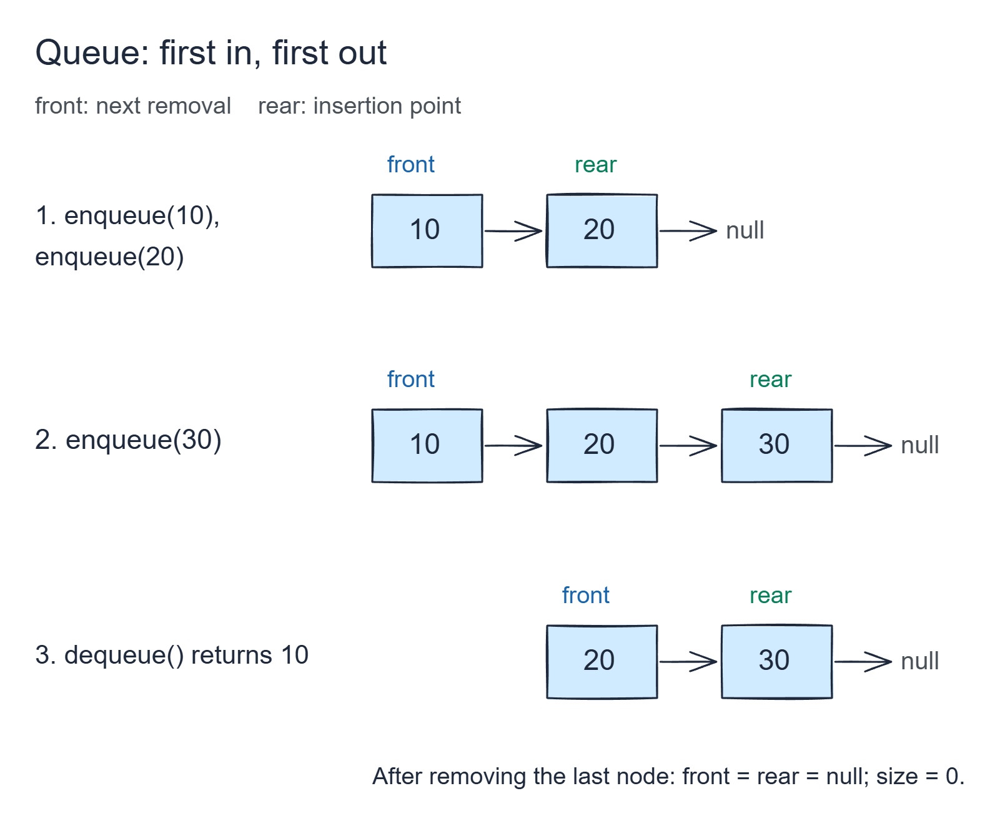

# Queue

A queue is a linear data structure with insertion at the **rear** and removal at the **front**. It follows **FIFO**, *First In, First Out*: the first element inserted is the first one removed. After inserting `10`, `20` and `30`, the front contains `10` and the rear contains `30`.

Use `enqueue(value)` to insert, `dequeue()` to remove and return the front element, and `peek()` to read that element without removing it. In the diagram, enqueuing `30` leaves `10` at the front. After dequeuing `10`, the next element to read or remove is `20`.



## Maintaining the front and rear

The project implementations store each value in a **node** with a reference to the next node. Nodes can occupy separate memory locations. Keep references to the first and last nodes, plus a size counter. The initial state is `front = NULL`, `rear = NULL` and `size = 0`.

To enqueue `30`, link the last node, `20`, to the new node and update `rear`. For the first insertion, point both endpoints at the same node. Keeping the rear reference avoids traversing the queue to find the insertion point.

```c
enqueue(queue, value) {
    node = createNode(value, NULL);

    if (queue.rear == NULL) {
        queue.front = node;
    } else {
        queue.rear.next = node;
    }

    queue.rear = node;
    queue.size++;
}

dequeue(queue) {
    if (queue.front == NULL) {
        error("Queue is empty");
    }

    removed = queue.front;
    queue.front = removed.next;
    queue.size--;

    if (queue.front == NULL) {
        queue.rear = NULL;
    }

    removed.next = NULL;
    return removed.value;
}

peek(queue) {
    if (queue.front == NULL) {
        error("Queue is empty");
    }

    return queue.front.value;
}
```

Here, `createNode(value, next)` creates a node with those fields, and `error(...)` stops the operation with a failure. With manual memory management, release the removed node after saving the return value.

To dequeue `10`, advance the front to the node containing `20`. The remaining nodes keep their values and links. Removing the last element must also clear `rear`. A stale rear reference could attach the next insertion to a node outside the queue, leaving the new element unreachable from the front.

## Costs and use

With access to both endpoints, insertion and removal change a fixed number of references. For `n` elements:

| Operation | Cost |
| --- | --- |
| `enqueue`, `dequeue` and `peek` | `O(1)` in a linked queue |
| Read size or check whether empty | `O(1)` with a stored counter |
| Search by value or traverse | `O(n)` worst case |
| Store the nodes | `O(n)` space, including references |

A circular array can implement the same FIFO behavior by advancing indices and reusing vacant slots. Using an array that shifts the remaining elements after removing the first one makes that removal cost `O(n)`. Compare the [ring buffer implementation](../../implementation/ringbuffer/python/solution.py) with the linked queue.

Use a queue to process work in arrival order or explore a graph by levels. In breadth-first search, dequeue a vertex and enqueue its undiscovered neighbors. This processes vertices at one distance before those at the next distance, measuring distance in number of edges.

For an empty queue, the pseudocode reports an error. The project code returns `None` in Python, `undefined` in TypeScript, and the element type's zero value together with `false` in Go. Use the Go boolean to check whether the operation returned an element.

Code: [Go](../../implementation/queues/golang/solution.go), [Python](../../implementation/queues/python/solution.py) and [TypeScript](../../implementation/queues/typescript/index.ts).
