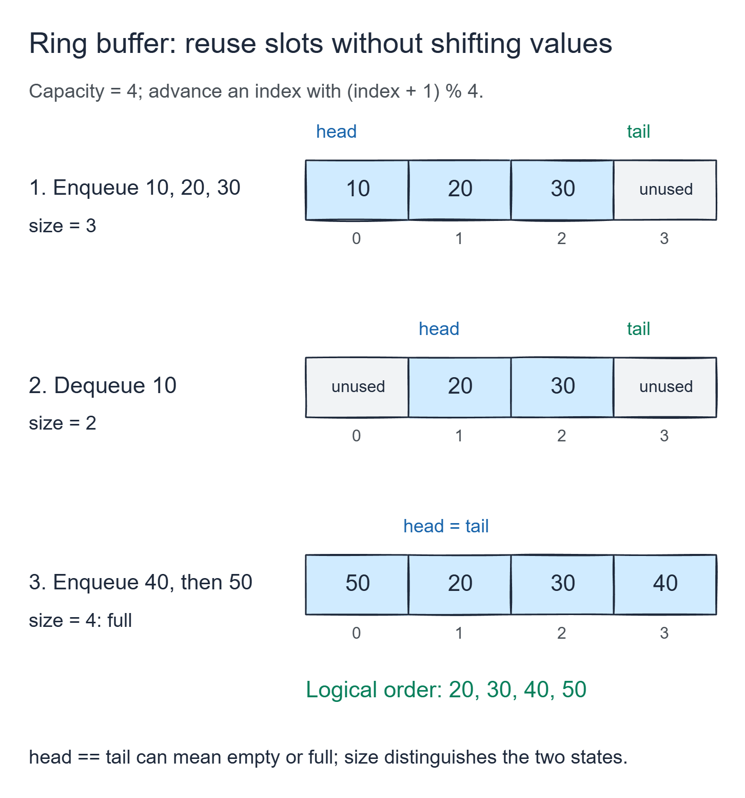

# Ring Buffer

A ring buffer is a fixed-capacity array that treats the position after its last slot as slot zero. It maintains logical FIFO order with moving indices, so removing the front does not require shifting the other elements. The project uses a positive capacity and rejects insertion when the buffer is full.

Keep `head` at the next element to read, `tail` at the next slot to write, and `size` as the number of elements. Start with all three equal to zero. Advance an index with `(index + 1) % capacity`; `%` gives the remainder. With capacity `4`, advancing from index `3` gives index `0`.



## Wrap the indices, preserve the order

After enqueuing `10`, `20` and `30`, you have `head = 0`, `tail = 3` and `size = 3`. Dequeue `10`, then enqueue `40` at slot `3` and `50` at slot `0`. The physical slots contain `[50, 20, 30, 40]`, but the logical order is `20, 30, 40, 50`. Begin reading at `head = 1` to recover that order.

```c
enqueue(buffer, value) {
    if (buffer.size == buffer.capacity) {
        error("Buffer is full");
    }
    buffer.data[buffer.tail] = value;
    buffer.tail = (buffer.tail + 1) % buffer.capacity;
    buffer.size++;
}

dequeue(buffer) {
    if (buffer.size == 0) {
        error("Buffer is empty");
    }
    value = buffer.data[buffer.head];
    buffer.data[buffer.head] = NULL;
    buffer.head = (buffer.head + 1) % buffer.capacity;
    buffer.size--;
    return value;
}
```

Here, `error(...)` stops the operation with a failure. `NULL` clears a slot outside the occupied sequence; the size determines which slots contain elements. In a full buffer, `head` and `tail` can be equal, as they are in an empty buffer. The size distinguishes these states. After the final removal, the indices need not return to zero; the next enqueue can reuse the current tail.

To read the element at logical position `i`, require `0 <= i < size` and access `data[(head + i) % capacity]`. In the final state of the diagram, logical position `3` maps to physical index `0`, which holds `50`. A `peek` reads the head without advancing it.

Some ring buffers overwrite the oldest value when full. This implementation reports an error instead, preserving unread values. An overwrite policy would need to update the head as well as the tail.

## Costs and project code

| Operation | Cost |
| --- | --- |
| Enqueue, dequeue or peek | `O(1)` |
| Read a valid logical index | `O(1)` |
| Check empty or full, or read size | `O(1)` |
| Visit the stored elements | `O(n)` for `n` elements |
| Reserve the storage | `O(c)` space for capacity `c` |

These operations do not resize the buffer. Choose the capacity before using it and decide how callers should handle a full buffer. Ring buffers suit bounded streams, input buffers and producer-consumer queues where a fixed amount of storage is useful. The project versions provide no synchronization for concurrent access.

All three implementations reject nonpositive capacity and overflow. Go returns a value and `false` for an empty read or invalid logical index. Python and TypeScript return `None` and `undefined`. The `get` method uses a logical index relative to the current head, not a physical slot number.

Code: [Go](../../implementation/ringbuffer/golang/solution.go), [Python](../../implementation/ringbuffer/python/solution.py) and [TypeScript](../../implementation/ringbuffer/typescript/index.ts).
