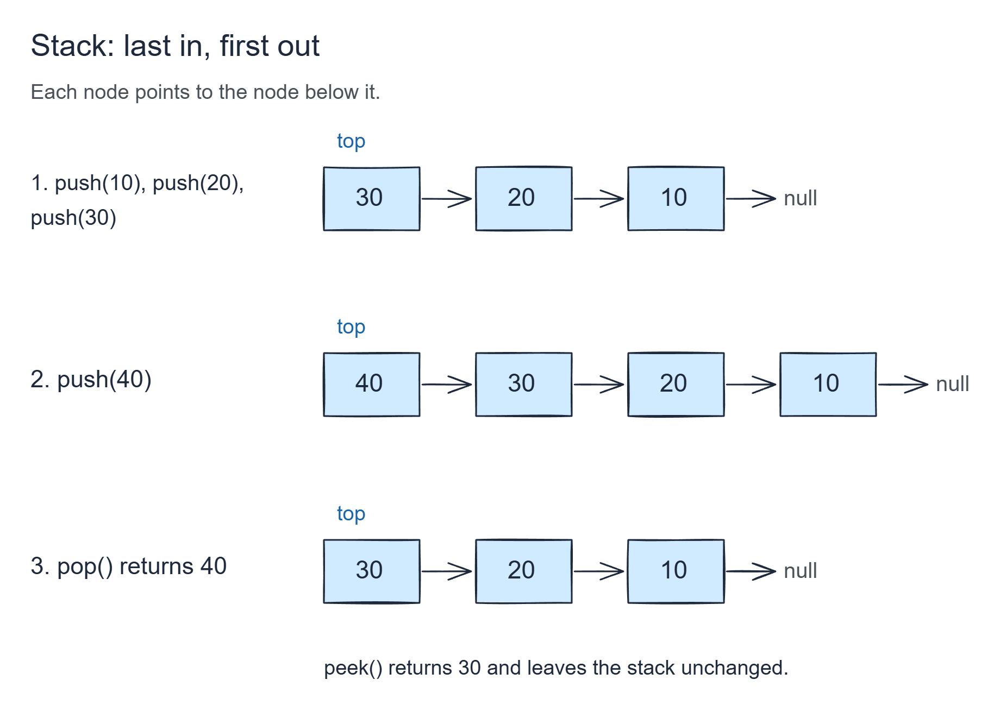

# Stack

A stack is a linear data structure with insertion and removal at one end, called the **top**. It follows **LIFO**, *Last In, First Out*: the last element inserted is the first one removed. After inserting `10`, `20` and `30`, the top contains `30`.

The operations are `push(value)` to insert, `pop()` to remove and return the top, and `peek()` to read the top without removing it. In the example, `peek()` returns `30` and leaves three elements. After `push(40)`, `pop()` returns `40` and restores the previous state.



## Updating the top

The project implementations store each value in a **node** with a reference to the node below it. Nodes can occupy separate memory locations. Keep a `top` reference to the next node to remove and a `size` counter. The initial state is `top = NULL` and `size = 0`.

To push `40`, create a node whose `previous` field points to the old top, `30`. Then update `top` to point to the new node. The reference to `30` preserves access to the remaining values.

```c
push(stack, value) {
    node = createNode(value, stack.top);
    stack.top = node;
    stack.size++;
}

pop(stack) {
    if (stack.top == NULL) {
        error("Stack is empty");
    }

    removed = stack.top;
    stack.top = removed.previous;
    stack.size--;
    return removed.value;
}

peek(stack) {
    if (stack.top == NULL) {
        error("Stack is empty");
    }

    return stack.top.value;
}
```

Here, `createNode(value, previous)` creates a node with those fields, and `error(...)` stops the operation with a failure. To pop `40`, follow its `previous` reference and make the node containing `30` the new top. Removing the last node sets `top` to `NULL` and the size to zero. With manual memory management, release the removed node after saving the return value.

These steps preserve LIFO order: each push places a new value before the old top, and each pop follows the reference back to the preceding value.

## Costs and use

In a linked stack, pushing, popping and peeking change or inspect a fixed number of references. For `n` elements:

| Operation | Cost |
| --- | --- |
| `push`, `pop` and `peek` | `O(1)` |
| Read size or check whether empty | `O(1)` with a stored counter |
| Search by value or traverse | `O(n)` worst case |
| Store the nodes | `O(n)` space, including references |

An array-based stack uses the last occupied slot as its top. With a dynamic array, `push` costs `O(1)` amortized because an insertion can require a copy to grow.

Use a stack to save states that you need to revisit in reverse order. To validate `([])`, push `(` and then `[`. On reading `]`, check and pop `[`. On reading `)`, check and pop `(`. An empty stack at the end means the openings have matching closings, provided no mismatched pair occurred. The [Valid Parentheses](../../../../problems/20_valid_parenthesis/QUESTION.md) problem demonstrates this use. Recursive function calls also require saving unfinished calls and their return points.

Empty-stack results differ from the error used in the pseudocode: Python returns `None`, TypeScript returns `undefined`, and the current Go implementation returns `(0, nil)`. That Go result does not distinguish an empty stack from a stored zero; check the stack's state before the operation.

Code: [Go](../../implementation/stack/golang/solution.go), [Python](../../implementation/stack/python/solution.py) and [TypeScript](../../implementation/stack/typescript/index.ts).
