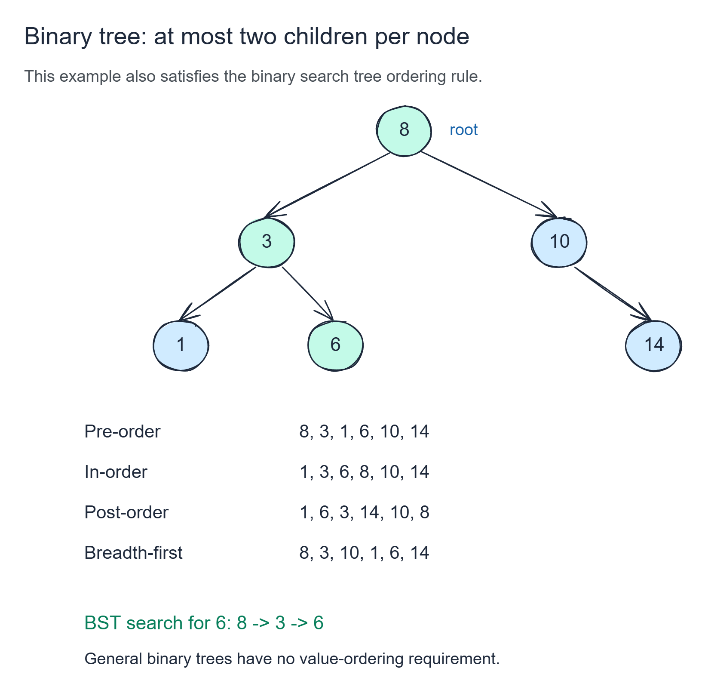
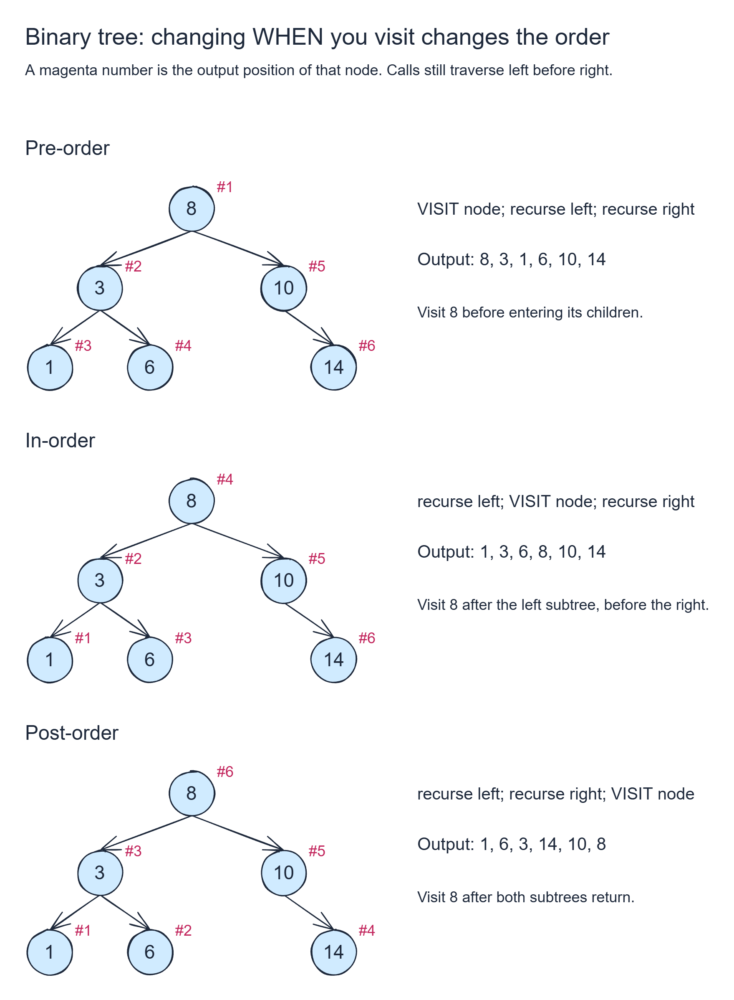
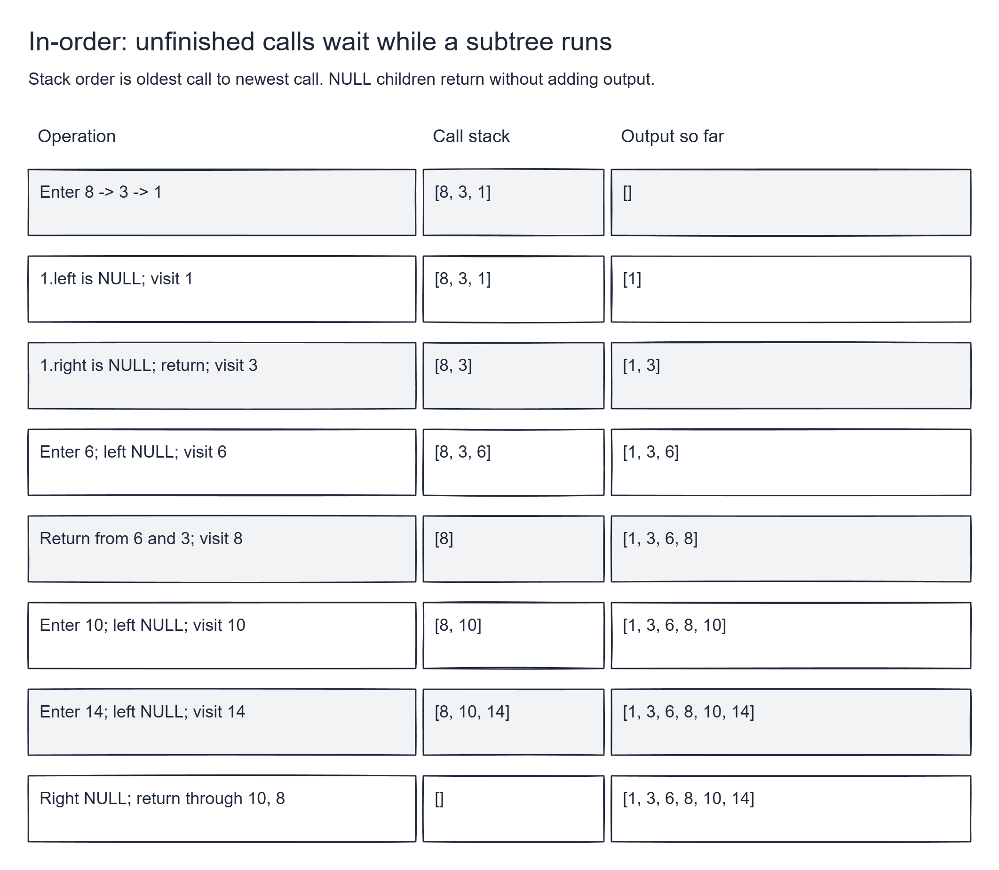
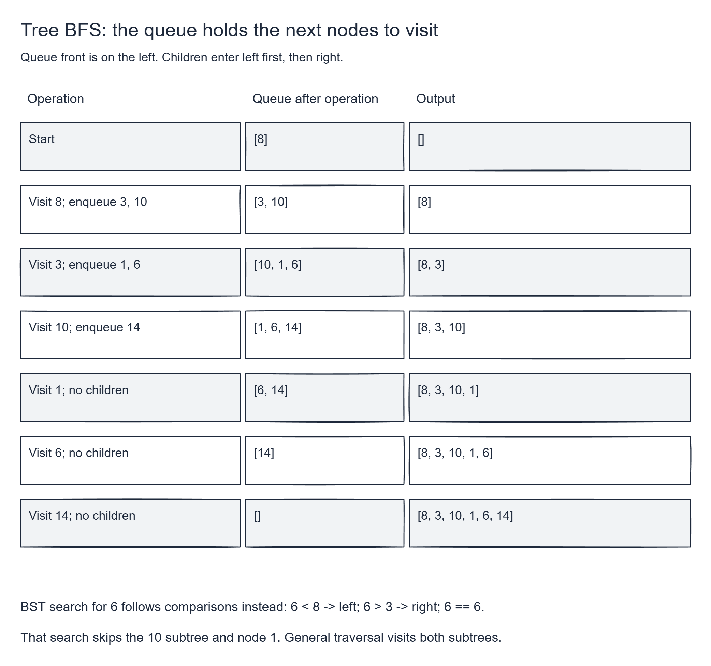

# Binary Tree

A binary tree is a hierarchical structure in which each node has at most two children, called **left** and **right**. A root identifies the tree's starting node. A node with no children is a leaf, and a child together with its descendants forms a subtree. An empty tree has a `NULL` root. The structure contains no cycles, and each non-root node has one parent.

A node stores its value and references to its children. A missing child is `NULL`; having a right child does not require a left child. Values need no ordering in a general binary tree. A **binary search tree**, or BST, adds an ordering rule: values in the left subtree are smaller than the node's value, and values in the right subtree are larger, with a defined policy needed for duplicates.



## Nodes, ordering and traversal

The diagram shows root `8`, children `3` and `10`, and leaves `1`, `6` and `14`. Its height is three levels, counting the root as the first. Its widest level contains three nodes. You can create the same shape without a BST ordering rule, but comparing values would then give no reason to skip a subtree.

Depth-first traversal completes one subtree before returning to another. With the left subtree first, placing the visit before both recursive calls gives **pre-order**; placing it between them gives **in-order**; placing it after both gives **post-order**.

```c
inOrder(node, output) {
    if (node == NULL) {
        return;
    }
    inOrder(node.left, output);
    output.append(node.value);
    inOrder(node.right, output);
}
```

For the diagram, pre-order produces `8, 3, 1, 6, 10, 14`; in-order produces `1, 3, 6, 8, 10, 14`; post-order produces `1, 6, 3, 14, 10, 8`. In-order produces sorted values when the tree satisfies the BST ordering rule.



The numbers beside the nodes mark output positions, not the order in which calls begin. In post-order, for example, the root's call starts first but emits its value last. The call waits until both subtrees finish.



Descending from `8` to `3` to `1` leaves the earlier calls waiting. After visiting `1`, return to `3`, emit `3`, then traverse `6`. Only after that left subtree returns can the waiting call emit `8`. A `NULL` child returns without adding a value.

Breadth-first traversal uses a queue. Enqueue the root, then dequeue one node at a time, visiting it and enqueuing its children. The resulting level order is `8, 3, 10, 1, 6, 14`. An empty tree has no values to visit.



After visiting `3`, the queue contains `10, 1, 6`. Visit the older entry `10` before the children just enqueued from `3`; this waiting order gives level-by-level traversal. A recursive depth-first call would enter `1` before continuing to `10`.

Searching a BST can follow one branch at each step. To find `6`, compare with `8`, go left to `3`, then right to `6`. A missing child means the value is absent.

```c
searchBST(node, target) {
    if (node == NULL) {
        return false;
    }
    if (node.value == target) {
        return true;
    }
    if (target < node.value) {
        return searchBST(node.left, target);
    }
    return searchBST(node.right, target);
}

equal(a, b) {
    if (a == NULL || b == NULL) {
        return a == b;
    }
    return a.value == b.value
        && equal(a.left, b.left)
        && equal(a.right, b.right);
}
```

Tree equality requires matching values and shape. Putting the same value on a left child in one tree and a right child in another makes the trees different. The recursive comparison stops at a mismatch or matching empty subtrees.

## Costs and project code

Let `n` count nodes, `h` count levels on the longest root-to-leaf path, and `w` be the maximum number of nodes at a level.

| Operation | Time | Auxiliary space |
| --- | --- | --- |
| Create or inspect a node | `O(1)` | `O(1)` |
| Depth-first traversal or equality comparison | `O(n)` worst case | `O(h)` recursive stack |
| Breadth-first traversal | `O(n)` with constant-time queue operations | `O(w)` live queue entries |
| Search a BST | `O(h)` | `O(h)` for recursive search |

Traversal output adds `O(n)` space. The tree itself takes `O(n)` space. A balanced tree has `h = O(log n)`; a chain-shaped tree can have `h = n`. Creating binary nodes does not balance the tree.

The `bt_dfs` implementation follows the BST rule, despite its general DFS name. It can miss a value in a tree that violates that rule. The other depth-first files traverse both subtrees. Python's breadth-first implementation removes the front of a list, and TypeScript uses `shift`; moving front elements can raise their worst-case time to `O(n^2)`. The table describes BFS with an appropriate queue.

The repository implements node creation, comparison, traversal and BST search. It does not implement BST insertion, deletion or balancing. Use trees for hierarchical data; use a BST ordering rule when you need ordered search.

Code: node definitions in [Go](../../implementation/tree/bt_base/golang/binary_tree.go), [Python](../../implementation/tree/bt_base/python/binary_tree.py) and [TypeScript](../../implementation/tree/bt_base/typescript/binary_tree.ts). The [tree implementation directory](../../implementation/tree) also contains comparison, BST search and breadth-first and depth-first traversals in each language.
