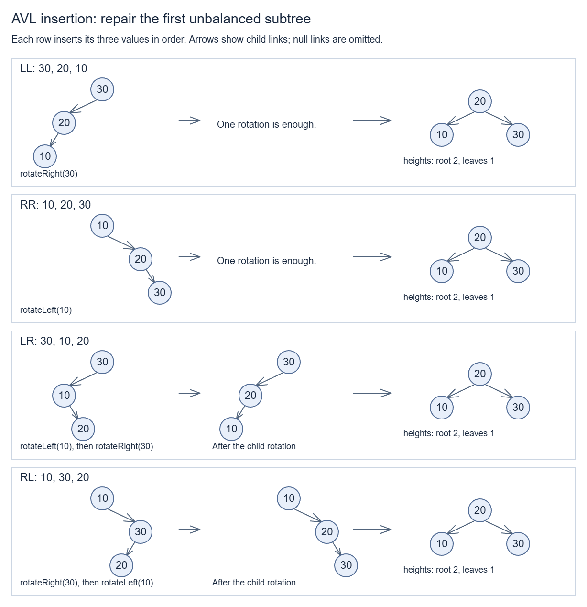
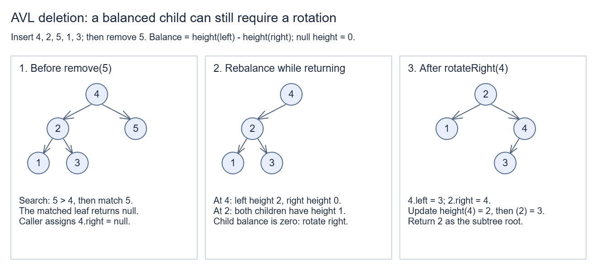

# AVL Tree

An AVL tree is a binary search tree that keeps the heights of each node's two subtrees within one level of each other. Given a root and an integer, insertion adds the value if absent and removal deletes it if present, returning the updated root. These versions store distinct integers and rebalance after both operations.

## How it works

Each `AVLNode` stores `value`, `left`, `right` and a cached `height`. A null subtree has height zero and a leaf has height one. For a node, compute `height = 1 + max(height(left), height(right))` and **balance factor** `height(left) - height(right)`. Valid factors are -1, 0 and 1. Cached heights make these checks constant-time; recursively measuring entire subtrees at each step would change the operation's cost.

Insertion follows ordinary BST comparisons and creates a leaf at a null link. Removal uses the BST's leaf, one-child and successor cases. After reconnecting a changed child, update the current height and repair any factor outside the valid range. Return the repaired subtree root to the caller. Always assign the public result, including at the top: `root = insert(root, value)` and `root = remove(root, value)`. A rotation can change that root even when the original root's value was not removed.

A right rotation promotes the left child. The child's old right subtree becomes the old root's left subtree, then the old root becomes the promoted child's right child. Update the old root's height first, then the promoted root's height, since the latter depends on the former. A left rotation mirrors these assignments.

```c
rotateRight(root) {
    pivot = root.left;
    root.left = pivot.right;
    pivot.right = root;
    updateHeight(root);
    updateHeight(pivot);
    return pivot;
}

rotateLeft(root) {
    pivot = root.right;
    root.right = pivot.left;
    pivot.left = root;
    updateHeight(root);
    updateHeight(pivot);
    return pivot;
}
```

For a right rotation, the sorted order before and after is `left subtree of pivot, pivot, pivot's old right subtree, root, root's right subtree`. Moving links without changing that order preserves BST search behavior. A rotation changes a bounded number of links and cached heights, so it takes constant time.

Choose a single or double rotation from the current subtree heights:

| Current root | Heavy child | Repair |
| --- | --- | --- |
| Balance greater than 1 | Left child is left-heavy or balanced | Rotate right at root |
| Balance greater than 1 | Left child is right-heavy | Rotate left at left child, then right at root |
| Balance less than -1 | Right child is right-heavy or balanced | Rotate left at root |
| Balance less than -1 | Right child is left-heavy | Rotate right at right child, then left at root |

```c
rebalance(root) {
    updateHeight(root);
    balance = height(root.left) - height(root.right);
    if (balance > 1) {
        if (height(root.left.left) < height(root.left.right)) {
            root.left = rotateLeft(root.left);
        }
        return rotateRight(root);
    }
    if (balance < -1) {
        if (height(root.right.right) < height(root.right.left)) {
            root.right = rotateRight(root.right);
        }
        return rotateLeft(root);
    }
    return root;
}
```

The four insertion traces below start from empty trees. Inserting `30, 20, 10` creates a left-left chain, requiring a right rotation at 30. Inserting `10, 20, 30` mirrors it. For `30, 10, 20`, first rotate left at 10, producing `30.left = 20` with `20.left = 10`, then rotate right at 30. For `10, 30, 20`, first rotate right at 30 and then left at 10. All four end with root 20 and leaves 10 and 30, with heights 2, 1 and 1.



The mutation routines retain the return-and-reconnect structure of [BST maintenance](../bst/Binary%20Search%20Tree.md). Their nontrivial paths finish with `return rebalance(root)` instead of simply returning the old root. A duplicate insertion returns immediately at the matching node. Removing from an empty subtree returns null. Removing a node with at most one child returns that child directly; its already-valid height is unchanged, and its parent handles any imbalance caused by the shortened subtree. With two children, copy the smallest value in the right subtree and recursively remove that successor before rebalancing.

Deletion can make a subtree shorter, causing repairs at multiple ancestors. The heavy child's balance may be zero, which still requires a single rotation when the root is unbalanced. For example, insert `4, 2, 5, 1, 3` and remove 5. The leaf returns null, so `4.right = null`. Node 4 now has left height 2 and right height 0, while its left child 2 has two height-one children. Rotate right at 4, moving `2.right = 3` to `4.left`, then linking `2.right = 4`. Recompute height 4 as 2, then height 2 as 3. The returned root is 2 and the in-order result is `[1, 2, 3, 4]`.



For correctness, assume both children are valid AVL trees when a recursive call returns. BST insertion or removal preserves ordering. Updating the current height makes it consistent with those children. One insertion or deletion changes a child height by at most one, so any new imbalance is repaired by the listed local rotations, preserving sorted order and restoring valid heights and balance. Applying that argument while returning to the root restores the invariant for the entire tree. Missing-value removal and duplicate insertion preserve the contents and remain valid.

## Costs and project code

Let `n` count stored values and `h` count node levels. The minimum number of nodes in an AVL tree of height `h` obeys `N(0) = 0`, `N(1) = 1`, and `N(h) = 1 + N(h - 1) + N(h - 2)`: a minimum-size tall subtree must have children of heights `h - 1` and `h - 2`. This Fibonacci-like growth implies `h = O(log(n + 1))`. Unlike an unbalanced BST, sorted insertion cannot create a linear-height chain through this API.

Insertion, removal and ordinary BST search therefore take `O(log(n + 1))` worst-case time on a valid nonempty AVL tree. The recursive mutation code uses `O(log(n + 1))` auxiliary stack space. A rotation itself is `Θ(1)` time and space; insertion needs at most two rotations at its first unbalanced ancestor, whereas deletion can need repairs at `O(log(n + 1))` ancestors. These routines continue updating ancestors on return in either case. The tree retains `Θ(n)` nodes, each with one extra height field; insertion allocates one node when the value is new. Empty-tree operations take constant time.

The API mutates nodes and returns a subtree root, rather than a boolean indicating success. Duplicates are ignored and missing values leave contents unchanged. Two-child deletion copies a successor value into an existing node, so external references do not provide stable value identities. Rotations also change parent-child relationships. Callers should traverse from the latest returned root.

The implementations assume valid cached heights, an acyclic ordered tree and integer inputs. Python and TypeScript do not validate values; TypeScript callers should use safe integers, excluding `NaN` and infinities. Build the tree through `insert` rather than manually modifying links or heights. AVL nodes have the familiar value/child layout plus height, but Go's `AVLNode` is a distinct type from the base `BinaryNode`; existing Go functions accepting the base node type cannot take it directly.

Code: [Go](../../../implementation/tree/avl/golang/solution.go), [Python](../../../implementation/tree/avl/python/solution.py) and [TypeScript](../../../implementation/tree/avl/typescript/index.ts). Go exports `Insert` and `Remove`; the other languages use `insert` and `remove`. Tests recompute heights and check global ordering, unique node reachability, balance and set contents after every operation. They cover all small mutation orders, the four insertion rotations, a balanced heavy child during deletion, sorted insertion and 1,000 deterministic mixed updates: [Go](../../../implementation/tree/avl/golang/solution_test.go), [Python](../../../implementation/tree/avl/python/test_solution.py), [TypeScript](../../../implementation/tree/avl/typescript/index.test.ts).
