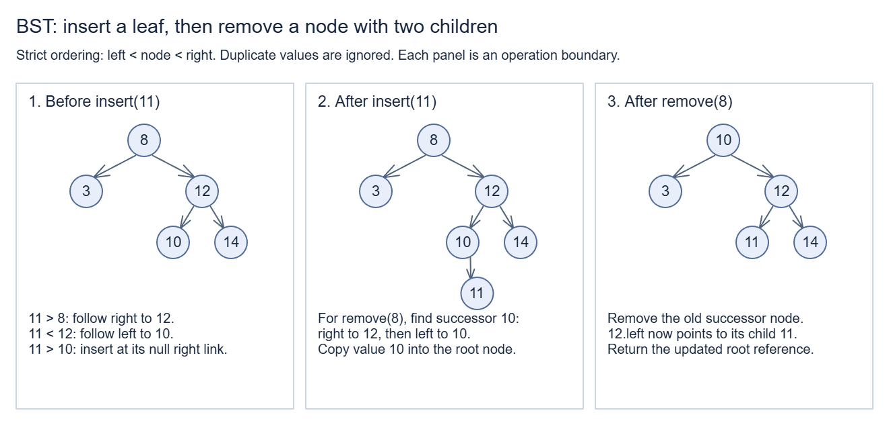

# Binary Search Tree Maintenance

A binary search tree (BST) stores ordered values so that every value in a node's left subtree is smaller and every value in its right subtree is larger. Given a root and an integer, insertion adds that value if absent, and removal deletes it if present. Both operations return the resulting root. These implementations represent a set: duplicate insertions and missing-value removals leave its contents unchanged.

## How it works

The tree uses the project's existing `BinaryNode`, with a value and two child references. An empty tree has a null root. Each recursive operation returns the updated root of the subtree it received. The caller assigns that return value to its left or right link, then returns its own root. At the outermost call, assign the result too: `root = insert(root, value)` or `root = remove(root, value)`. A root can be created, replaced by a child or removed entirely.

Insertion compares the value against the current node. A smaller value descends left, a larger value descends right, and equality returns without adding a node. Reaching a null link creates a leaf there. Since every comparison restricts the valid range, the new leaf satisfies the ordering of every ancestor, not just its immediate parent.

```c
insert(root, value) {
    if (root == NULL) {
        return newNode(value);
    }
    if (value < root.value) {
        root.left = insert(root.left, value);
    } else if (value > root.value) {
        root.right = insert(root.right, value);
    }
    return root;
}
```

Start by inserting `8, 3, 12, 10, 14` into an empty tree. To insert 11, compare against 8 and go right, compare against 12 and go left, then compare against 10 and go right. That null link becomes the leaf 11. Returning through 10, 12 and 8 reconnects the modified subtree at each level.



Removal first follows the same comparison rule to find the value. At a match, a node with no left child returns its right child; this also handles a leaf, whose right child is null. A node with no right child returns its left child. The caller reconnects the replacement at the link that previously pointed to the removed node.

A node with two children needs a replacement value between both subtrees. Find its **in-order successor**, the smallest value in the right subtree, by following left links there. Copy that value into the matched node, then remove the original successor from the right subtree. The successor has no left child, so that second removal uses a simpler case. Its right child, if any, must be retained.

```c
remove(root, value) {
    if (root == NULL) {
        return NULL;
    }
    if (value < root.value) {
        root.left = remove(root.left, value);
    } else if (value > root.value) {
        root.right = remove(root.right, value);
    } else {
        if (root.left == NULL) {
            return root.right;
        }
        if (root.right == NULL) {
            return root.left;
        }
        successor = root.right;
        while (successor.left != NULL) {
            successor = successor.left;
        }
        root.value = successor.value;
        root.right = remove(root.right, successor.value);
    }
    return root;
}
```

In the example, removing 8 finds successor 10 through `8.right = 12` and `12.left = 10`. The original root node receives value 10. Removing the old successor returns its right child 11, so the caller assigns `12.left = 11`. The resulting in-order sequence is `[3, 10, 11, 12, 14]`. Removing a leaf simply clears its parent's link; removing the final node returns null. If the successor is already the immediate right child, the same code promotes its right child directly.

The correctness argument follows the subtree invariant. When descending, the target cannot occur in the discarded subtree. Replacing a node by its only child preserves all ancestral bounds. In the two-child case, every left-subtree value is smaller than the successor, and every remaining right-subtree value is larger after removing its original occurrence. Reconnecting these valid subtrees preserves strict ordering and removes exactly the requested set member.

## Costs and project code

Let `n` be the number of stored values and `h` the height measured in node levels. Each operation follows one search path, with an additional successor walk and removal path when necessary. Those paths together have length `O(h)`, so insertion and removal take `O(h)` time and `O(h)` auxiliary call-stack space. A new insertion allocates one node; removal allocates no replacement node. The retained tree occupies `Θ(n)` space. Empty-tree operations take constant time.

A balanced shape has `h = O(log(n + 1))`, but these operations do not balance it. Inserting sorted values builds a chain, making an individual operation `Θ(n)` in the worst case and building `n` sorted values `Θ(n²)` in total. Recursive stack depth grows with that chain and can reach a language's recursion limit. Tree shape must be part of the complexity claim.

The operations mutate existing nodes and do not create persistent snapshots. In two-child removal, a reference to the matched node observes its value change. References to removed nodes are not automatically cleared or invalidated. Treat the returned root as the current tree, and use the ordinary BST search and traversals from the [binary tree note](../Binary%20Tree.md) to inspect it.

The examples assume integer values and an initially valid, acyclic BST with no duplicates. Python and TypeScript do not validate the value domain; TypeScript callers should use safe integers, excluding `NaN` and infinities. Arbitrarily wiring child links can violate the ordering invariant. Go names the exported operations `Insert` and `Remove`; Python and TypeScript use `insert` and `remove`.

Code: [Go](../../../implementation/tree/bst/golang/solution.go), [Python](../../../implementation/tree/bst/python/solution.py) and [TypeScript](../../../implementation/tree/bst/typescript/index.ts). Tests cover every insertion/deletion order of four distinct values, duplicate and missing operations, root replacement and a successor with a right child: [Go](../../../implementation/tree/bst/golang/solution_test.go), [Python](../../../implementation/tree/bst/python/test_solution.py), [TypeScript](../../../implementation/tree/bst/typescript/index.test.ts).
