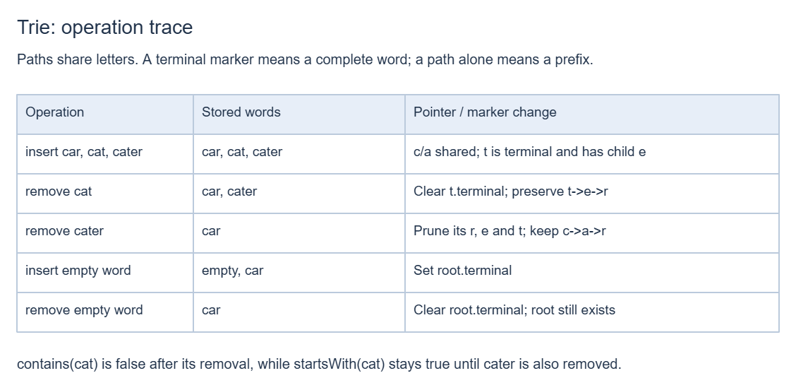

# Trie

A trie stores strings as paths of character edges, sharing common prefixes. These implementations store a set of words over lowercase English letters `a` through `z`, including the empty word. They support insertion, exact membership, prefix membership and removal. Insert and remove return whether the set changed.

## How it works

Each node has a child map and a terminal marker. Following a path proves a prefix exists; only a terminal marker proves the whole word is stored. Insertion creates missing nodes and marks its final node. Removal first verifies a stored word, clears its marker, then walks a saved parent path backward, pruning a child only when it has no children and is not terminal. Validate the entire string before mutation.

```c
remove(word) {
    node = follow(word);
    if (node == NULL || !node.terminal) {
        return false;
    }
    node.terminal = false;
    for (parent, letter in reversedPath(word)) {
        child = parent.children[letter];
        if (child.terminal || !empty(child.children)) {
            break;
        }
        erase(parent.children, letter);
    }
    return true;
}
```

Insert `car`, `cat` and `cater`. The `c` and `a` nodes are shared; `r` and `t` distinguish the branches, and `t` has a descendant path `e,r`. Removing `cat` clears the terminal marker at `t` but retains that path for `cater`, so exact membership is false while prefix membership stays true. Removing `cater` next prunes its `r`, `e` and `t`, preserving `car`. The root represents the empty prefix, which always exists; storing the empty word sets the root terminal flag. Pruning only nonterminal leaves preserves every other stored word and its prefixes.



## Costs and project code

Let `L` count letters in a query. Validation and traversal cost `O(L)` with bounded-alphabet child lookups. Insert/search/prefix operations use constant auxiliary traversal state; removal stores `O(L)` parent entries. Retained nodes are proportional to distinct prefixes of stored words plus the root, bounded by total stored character count plus one. All operations are iterative, including deletion of long words. Duplicate insertions and missing removals return false. Unsupported characters panic in Go or raise `ValueError`/`RangeError` in Python/TypeScript, even after an early missing prefix. Go uses `New` and exported method names; Python uses `starts_with` and TypeScript `startsWith`. Tests compare with a word-set model, preserve shared prefixes, check pruning, empty strings, invalid insertion atomicity and a 2,000-letter word.

Code: [Go](../../implementation/trie/golang/solution.go), [Python](../../implementation/trie/python/solution.py), [TypeScript](../../implementation/trie/typescript/index.ts).

Tests: [Go](../../implementation/trie/golang/solution_test.go), [Python](../../implementation/trie/python/test_solution.py), [TypeScript](../../implementation/trie/typescript/index.test.ts).
