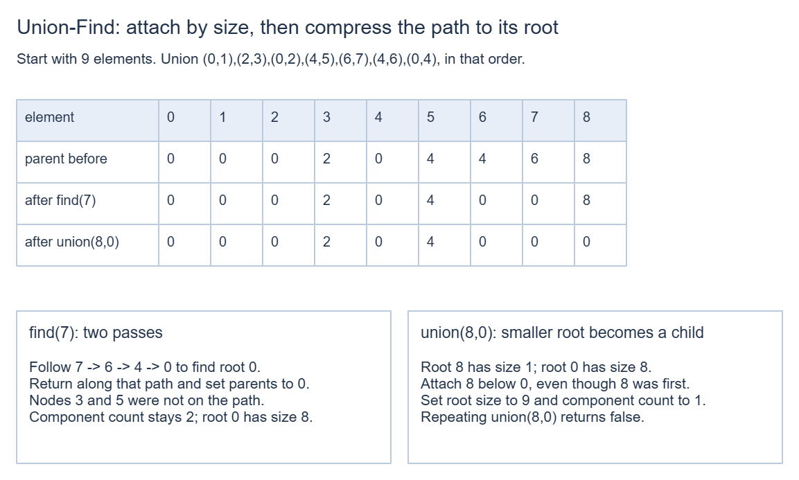

# Union-Find

Union-Find, also called a disjoint-set structure, maintains a partition of a fixed universe of integer elements. Construct it with `n` elements numbered zero through `n - 1`. A find operation returns an element's representative, union merges two components and reports whether a merge occurred, and connectivity asks whether two elements currently share a representative. The implementation also provides component sizes and the number of remaining components.

## How it works

Represent each component as a rooted parent-pointer tree. Initially `parent[v] = v`, each root has size one and the component count is `n`. Only roots have authoritative size entries. Non-root size entries are left in place but are not used as component totals.

Find first follows parents until it reaches a root that points to itself. A second pass follows the original path again and points each visited element directly at that root. Saving the old parent before replacing it lets the pass continue along the original path. This **full path compression** changes the tree shape without changing component membership.

```c
find(value) {
    root = value;
    while (parent[root] != root) {
        root = parent[root];
    }
    while (value != root) {
        next = parent[value];
        parent[value] = root;
        value = next;
    }
    return root;
}
```

Union first finds both roots. If they match, the elements are already connected, so return false without decrementing the count. Otherwise attach the smaller component's root below the larger component's root, add its size and decrement the component count once. Equal sizes keep the first root as representative. Choosing by size bounds how often an element's depth can increase.

```c
union(a, b) {
    left = find(a);
    right = find(b);
    if (left == right) {
        return false;
    }
    if (size[left] < size[right]) {
        swap(left, right);
    }
    parent[right] = left;
    size[left] += size[right];
    componentCount--;
    return true;
}
```

For nine elements, union pairs `(0,1)`, `(2,3)`, `(0,2)`, `(4,5)`, `(6,7)`, `(4,6)` and `(0,4)`, in that order. The parent array becomes `[0, 0, 0, 2, 0, 4, 4, 6, 8]`. There are two components, with root 0 storing size eight and root 8 storing size one. Find on 7 follows `7 -> 6 -> 4 -> 0`, then compresses that path, giving `[0, 0, 0, 2, 0, 4, 0, 0, 8]`. Elements 3 and 5 were not on the path, so their links stay unchanged.



Next, union `(8,0)` attaches root 8 below root 0 even though 8 was passed first, because its component is smaller. The size becomes nine and the count becomes one. Repeating the union returns false. Connectivity compares the two roots; component size reads the size stored at the root returned by find. These queries can compress paths as a side effect.

The invariant is that each component has one root, every parent chain reaches that root, and its root size equals its membership count. Linking two distinct roots cannot create a parent cycle and merges exactly their components. Redirecting a path to its existing root preserves membership and root size. Those facts prove find, union, connectivity and component size remain consistent. A representative is an implementation-chosen element, not a promise of the smallest label or a stable identity after future unions.

## Costs and project code

For `n` elements, initialization takes `Θ(n)` time and storage. With union by size, increasing an element's depth means placing its component below one at least as large, so its new component has at least twice as many members. This bounds an individual find or union by `O(log(n + 1))` worst-case time. Path compression can only shorten subsequent parent paths.

With both union by size and full path compression, a sequence of `m` find/union-based operations has total `O(n + m α(n + 1))` time including initialization, where `α` is the inverse Ackermann function. The resulting amortized cost per operation is nearly constant, not a constant worst-case bound for every call. Count retrieval is `Θ(1)`; connectivity and component size perform finds and inherit their bounds. Each method uses constant auxiliary state and no recursion. Parent and size arrays retain `Θ(n)` space.

An empty universe has count zero and no valid element indices. Negative sizes or invalid element indices panic in Go, raise `ValueError` in Python and throw `RangeError` in TypeScript; Python/TypeScript also reject nonintegers, with Python rejecting booleans. The universe does not grow, and this structure does not support splitting a component or deleting an edge. Its parent pointers encode a partition, not paths in an input graph or edges of a spanning forest.

Python and TypeScript construct `UnionFind(n)` and expose `components`; Go constructs `New(n)` and reads `Count()`. Methods are `find`, `union`, `connected`, `component_size` in Python; `find`, `union`, `connected`, `componentSize` in TypeScript; and `Find`, `Union`, `Connected`, `ComponentSize` in Go. Caller code should not modify parent/size arrays or bookkeeping fields.

Code: [Go](../../implementation/union_find/golang/solution.go), [Python](../../implementation/union_find/python/solution.py), [TypeScript](../../implementation/union_find/typescript/index.ts). Tests compare unions with explicit component relabeling, check all pairwise connectivity and sizes after each update, inspect full path compression and smaller-component attachment, and cover repeated merges, empty universes and invalid inputs: [Go tests](../../implementation/union_find/golang/solution_test.go), [Python tests](../../implementation/union_find/python/test_solution.py), [TypeScript tests](../../implementation/union_find/typescript/index.test.ts).
